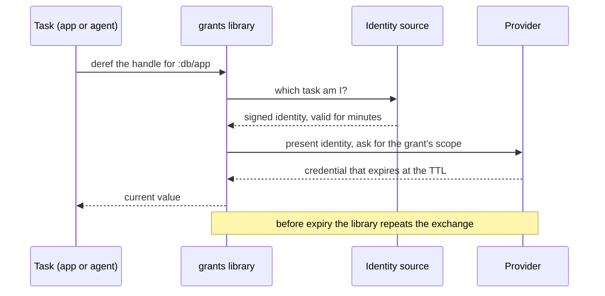
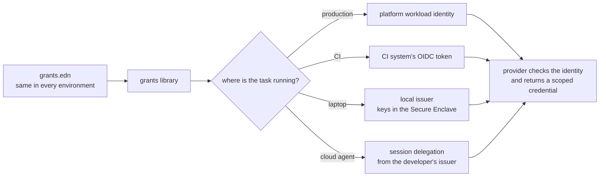

# Grants: design

Status: draft, 2026-11-10. Nothing here is built. Provider behaviour is
described from memory, and [Claims to check](#claims-to-check) lists what has
to be confirmed before anything depends on it.

## The problem

`com.kirahowe/secrets` keeps an application's secrets in one age-encrypted EDN
file per environment, committed next to the code. Its treatment of config is
right. Secrets are data the application loads, a committed manifest makes
changes reviewable, and no value travels through an environment variable.

Its weakness is the key. One age identity decrypts every value in a store. The
values are long lived. The identity sits in the login Keychain or behind a
password-manager command, and any process running as the developer can call
either. The threat model says so and puts that attacker out of scope (A6, B3).

A coding agent is code running as the developer. For an agent that goes wrong,
the store is a single prize: fetch one key, read every value, and use them
until somebody rotates.

Stronger encryption does not help, because the store still exists. The fix is
to have nothing worth finding. No values are stored anywhere, and a credential
is issued when a task needs it, limited to what that task does, and dead soon
after.

## Principles

1. Store no secret values. The repository, the laptop, and the CI system hold
   descriptions of access and never the credentials.
2. Issue each credential to one task, with the narrowest scope its provider
   can express and a short lifetime.
3. Keep config as data. A credential reaches the application through its
   config, the way `#secret/req` does today. Environment variables are global
   mutable state and carry nothing.
4. Commit the description of access. It holds no values, so an ordinary diff
   is the access review and there is nothing to encrypt.
5. Ship the same artifact to every environment. Environments differ in who the
   workload is, and that decides what a grant resolves to.
6. Add nothing to deploy or CI. The platform already gives the workload an
   identity there, and the library uses it.

## Vocabulary

A grant describes one credential: which provider issues it, for which
resource, with which permissions, and for how long.

A task is one bounded piece of work, such as a dev server run, a migration, a
test run, or an agent session. A task lists the grants it may use.

An identity source answers "which task is asking?" with a short signed
statement. Production and CI already have one. A laptop does not, and filling
that gap is most of what this project builds.

A provider is the system that accepts the identity and returns a credential:
AWS, a Postgres server, GitHub.

## What gets committed

```clojure
;; grants.edn (committed, holds no values)
{:app "website"

 :grants
 {:db/app
  {:provider :postgres/cert
   :database "website_dev"
   :role     "app_rw"
   :ttl      "1h"}

  :db/migrate
  {:provider :postgres/cert
   :database "website_dev"
   :role     "schema_owner"
   :ttl      "10m"}

  :assets/write
  {:provider :aws/sts
   :allow    [{:actions   ["s3:PutObject"]
               :resources ["arn:aws:s3:::website-dev-assets/*"]}]
   :ttl      "15m"}

  :repo/read
  {:provider    :github/app
   :repos       ["kirahowe/website"]
   :permissions {:contents :read}
   :ttl         "15m"}}

 :tasks
 {:serve   {:grants [:db/app :assets/write]}
  :migrate {:grants [:db/migrate] :approval :presence}
  :agent   {:grants [:repo/read]}}}
```

A task can ask for less than its declaration allows, for example one
repository out of three. Asking for more means changing this file, and that is
a reviewed diff.

Differences between environments are written in the file as data, in the style
of Aero's `#profile`. Dev and production name different databases, roles, and
buckets, and never share a credential.

The application's own config refers to grants by name:

```clojure
;; config.edn
{:db     {:host        "localhost"
          :dbname      "website_dev"
          :credentials #grant :db/app}
 :assets {:bucket      "website-dev-assets"
          :credentials #grant :assets/write}}
```

`#secret/req` returns a string. `#grant` cannot, because the credential behind
it expires while the process is still running. It returns a handle. The
application dereferences the handle when it needs the current value, and the
library renews the credential before it lapses. A connection pool takes the
handle as its credential supplier.

## How a grant resolves



The library stores nothing it receives. A credential lives in the memory of
the task that asked for it.

The provider enforces the scope. For AWS, `grants init` generates one role per
grant. The role's policy is the grant's `:allow` block, and its trust
condition admits only the tasks that list the grant. A task that presents
another task's name gets nothing, because the name is inside a statement the
identity source signed.

## One file, four identity sources



| Where | Identity source | New infrastructure |
| --- | --- | --- |
| Production | The platform's workload identity | None |
| CI | The CI system's OIDC token | None |
| Laptop | The local issuer | One small daemon |
| Cloud agent sandbox | A delegation from the developer's issuer, bound to the session | Undecided, see [Cloud agents](#cloud-agents) |

## The local issuer

The local issuer is a small daemon that makes the laptop an identity provider.
It holds signing keys and no credentials.

Its keys are generated inside the Secure Enclave and cannot be exported. A
process that compromises the developer's account can ask the issuer to sign,
subject to the checks below. It cannot copy a key and leave with it.

The issuer signs two things: short JWTs for providers that federate over OIDC,
and short-lived X.509 certificates for providers that trust a certificate
authority. Each provider is told once, at setup, to trust the public half.

### Identifying the task

A launcher starts each task. `grants run serve` runs the command that
`grants.edn` declares for `serve`, and the issuer matches the peer process on
its Unix socket to a task it launched. The caller does not state its own task,
and nothing passes through the environment.

The issuer records every issuance: task, grant, time, and process.

### Approving the file

The issuer pins the `grants.edn` it will honour. When the file changes, the
developer approves the new version with Touch ID, in the way `direnv allow`
approves a changed `.envrc`. An agent that edits the working copy to widen its
own grants gets nothing until a person has looked at the change.

### Presence

A task marked `:approval :presence` is signed by a second enclave key that
needs Touch ID for every use. An agent cannot supply a fingerprint, so those
grants stay with the person.

### Setup

Setup is where "as easy as a `.env` file" is hardest to deliver. Each provider
has to be told once to trust the issuer and what each task maps to. `grants
init` should generate that as Terraform or CLI commands from `grants.edn`, so
the trust setup is code in the repository too. Whether this can feel light is
the main product risk.

## Providers

| How the provider trusts the task | Examples | Long-lived secret held |
| --- | --- | --- |
| A signed identity token (OIDC federation) | AWS STS, Google Cloud, Azure, Vault | None |
| A short-lived certificate from the issuer's CA | Postgres `cert` auth, SSH certificates, mTLS services, AWS Roles Anywhere | None |
| A token minted from a root credential | GitHub App installation tokens | One root per provider |
| A static API key | Most SaaS APIs | The key itself |

The first two rows are the product. A provider in those rows needs no stored
secret at any point, on any machine.

## What cannot be made ephemeral

Two kinds of provider leave something long lived behind.

Some mint short-lived tokens only for a caller that holds a long-lived root.
GitHub is the common case. An installation token lasts an hour and can be
limited to named repositories and permissions, but minting one takes the
App's private key.

Others have nothing but static API keys.

The design's position on held roots:

- A root is a minting capability that only the issuer uses. No task receives
  one.
- Each root is sealed separately to an enclave key. No key opens more than one
  root, so nothing plays the part the age identity played.
- `grants doctor` lists every held root. The count is visible, and the aim is
  zero.

Static-only upstreams are undecided. The options are a gateway that holds the
key and injects it for a granted task, the provider's test mode or a fake in
development, or leaving those upstreams out of scope. A gateway is a stored
secret under another name. Whether to accept one is the first open question.

## Cloud agents

Giving a cloud agent access today usually means pasting long-lived keys into
the platform's settings.

The sketch for doing it without a pasted secret: the sandbox generates a key
pair when the session starts. The developer's issuer signs a delegation that
names the public key, the task, and an expiry. The sandbox then acts as that
task.

Two limits are known. A provider that accepts a plain OIDC token accepts it
from whoever holds it, so the delegation has to be short. Renewing it during a
long session needs an issuer the sandbox can reach, and a laptop is not
reachable. A hosted or self-hosted issuer would cover that, and it is not
designed yet.

## Threat model

### In scope

T1. A reader of the repository. They see `grants.edn` and learn what access
exists. They gain none of it.

T2. A reader of the developer's files at rest, through backups, synced
dotfiles, or a disk image. No values and no exportable keys are on disk. A
held root is sealed to the enclave and is useless on another machine.

T3. Code running as the developer outside any sandbox, such as an unsandboxed
agent or a malicious dependency. It cannot export an issuer key, pass a
presence check, or widen `grants.edn` without the developer's approval. It can
run the launcher, so it can obtain any grant that needs no presence. What
limits the damage is that those grants are narrow, point at development
resources, expire, and are logged.

T4. A compromised task. It holds that task's grants until they expire. This is
the designed blast radius, and it replaces "the whole store, until somebody
rotates."

T5. An agent inside a sandbox. The sandbox's only route to the issuer is its
own session identity, so it gets the grants of its task and no others. This is
where task scoping is enforced strictly, and it is the configuration to
recommend for agents.

### Out of scope

- Root on the laptop, or a compromised kernel.
- A provider that issues more than the grant describes. The provider enforces
  scope.
- Walls between processes of one user beyond what the OS gives. Code that can
  inject itself into a running task is that task (T4).

## Relationship to secrets

The manifest idea carries over and gets simpler. `secrets` needed keyed hashes
so that a diff could show a change without disclosing a value. `grants.edn`
has no values, so it is its own manifest.

A check that needs no identity still has a place in CI: the file is valid, and
the application's config refers only to grants that exist.

## Open questions

1. Static-only upstreams: a gateway, test modes only, or out of scope?
2. Language. The issuer needs the Secure Enclave, which suggests Swift, or Go
   or Rust with bindings. The protocol could be language neutral with a
   Clojure client first. Is this a Clojure library with a helper daemon, or a
   general tool with a Clojure binding?
3. Third-party tools. `psql`, `aws`, `gh`, and `git` do not read an EDN
   config. Several support helpers that fetch a credential on demand, such as
   git credential helpers and AWS `credential_process`, and those fit the
   model. For tools that read only environment variables, is an adapter scoped
   to one child process acceptable, or are they out of scope?
4. Production that is not federated yet. Principle 6 assumes the platform
   provides a workload identity. An application that still reads static
   secrets in production needs a migration path.
5. AWS OIDC federation fetches the issuer's public keys from a public HTTPS
   URL. A static file on any host would do. Roles Anywhere with the issuer's
   CA avoids the question.
6. Linux and Windows. A TPM can stand in for the Secure Enclave. Presence
   needs an equivalent.
7. The name. `grants` is a working title.

## Claims to check

These come from memory.

- AWS IAM accepts ES256-signed tokens from an OIDC provider. The Secure
  Enclave signs with P-256 only.
- AWS Roles Anywhere accepts ECDSA P-256 certificates from an external CA.
- Google Cloud workload identity federation accepts an uploaded JWKS, with no
  public issuer endpoint.
- Azure federated credentials need a publicly reachable issuer.
- GitHub App installation tokens can be narrowed to named repositories and a
  subset of permissions when they are minted, and the App's key must be RSA.
- A JDBC Postgres connection can take its client certificate and key from
  memory, with no file on disk.
- macOS lets a daemon identify the peer process on a Unix socket reliably
  enough to match it to a launched task.

## Prior art

This list is from memory. No survey has been done.

- SPIFFE and SPIRE give workloads attested identities. They are built for
  clusters and are heavy for a laptop.
- Vault's dynamic secrets mint short-lived credentials, from a server that
  holds the roots.
- Smallstep's `step-ca` issues short-lived X.509 and SSH certificates.
- Octo STS exchanges OIDC tokens for scoped GitHub tokens through a GitHub
  App.
- `aws-vault` and AWS `credential_process` hand short-lived AWS credentials to
  local tools.
- Fly's Tokenizer injects held keys at a gateway.
- Tailscale Aperture, as I understand it, keeps LLM provider keys at a gateway
  and admits callers by their tailnet identity.

As far as I know, none of these combines an issuer sized for a laptop with
grants declared in application config. Confirming that is the first research
task.

## First spike

The spike should test the two riskiest assumptions: that an enclave-backed
issuer can stand in for a stored credential, and that setup is light.

1. A local issuer with a Secure Enclave key that signs short-lived client
   certificates.
2. A local Postgres that trusts the issuer's CA through `cert` auth.
3. A Clojure application whose connection pool takes its credentials from
   `#grant :db/app` and survives a renewal.
4. A count of the steps from an empty repository to a working grant.

This path needs no cloud account and no public endpoint. An AWS grant through
STS comes second.
