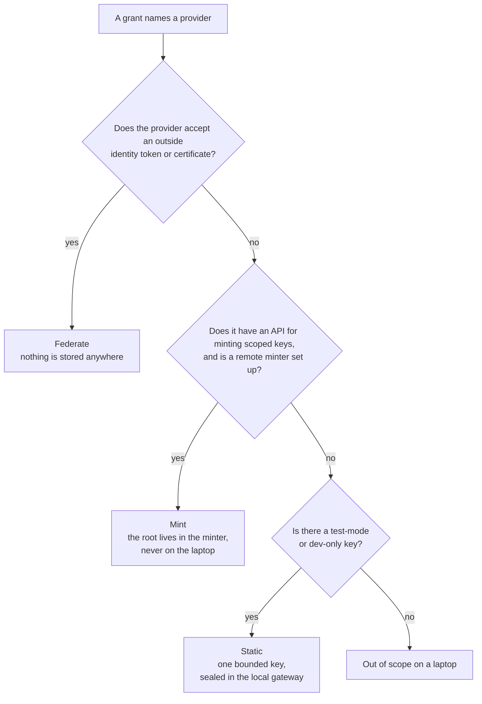
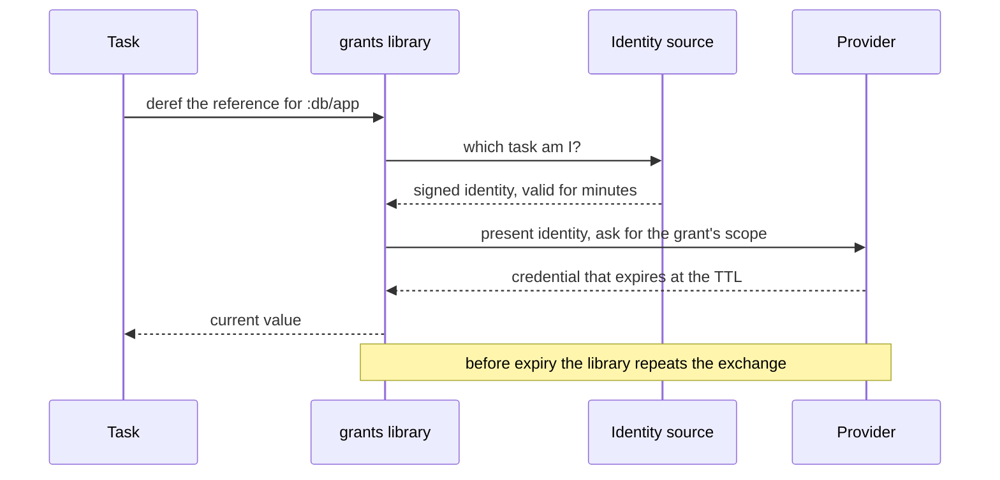
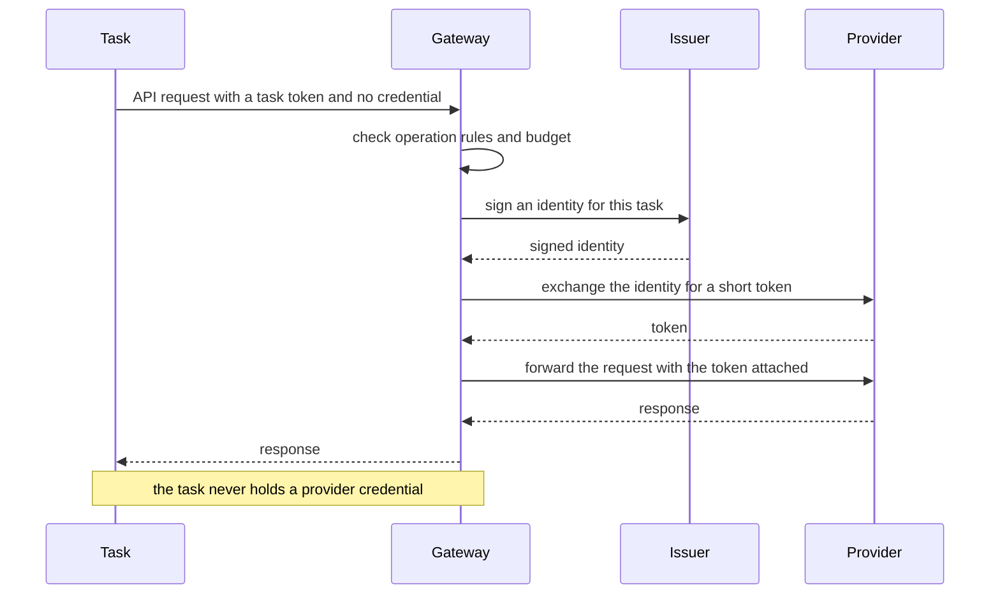
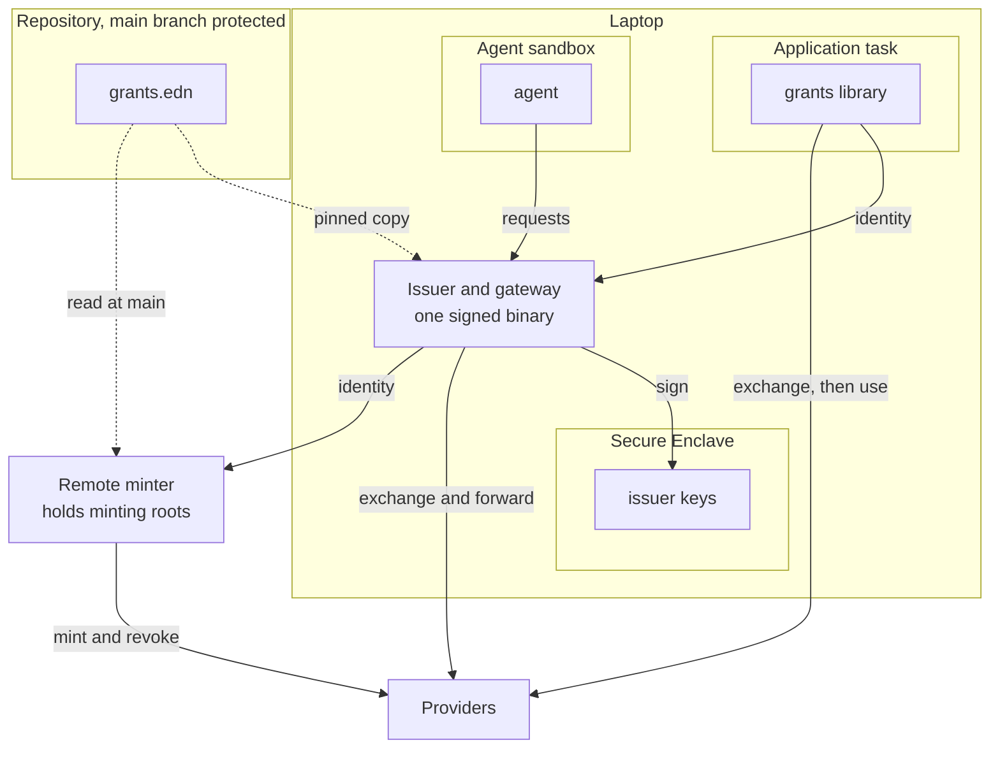
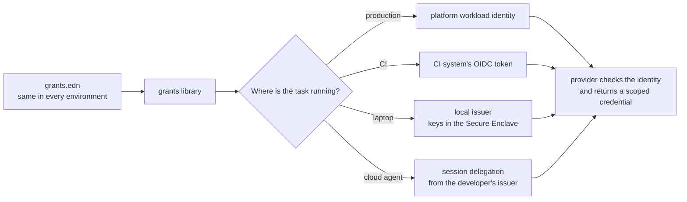
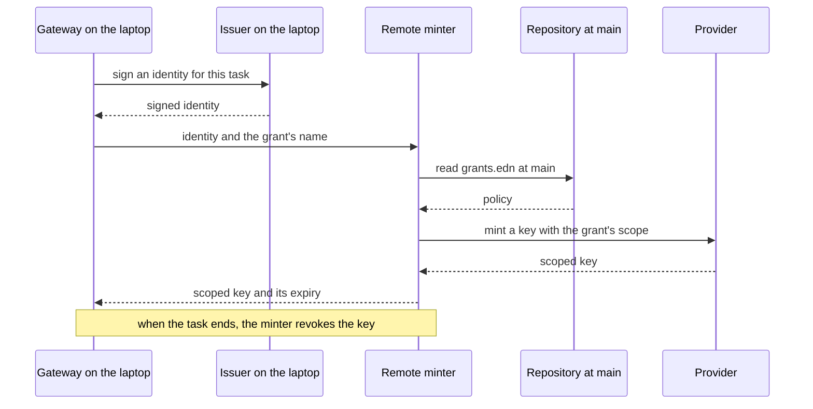
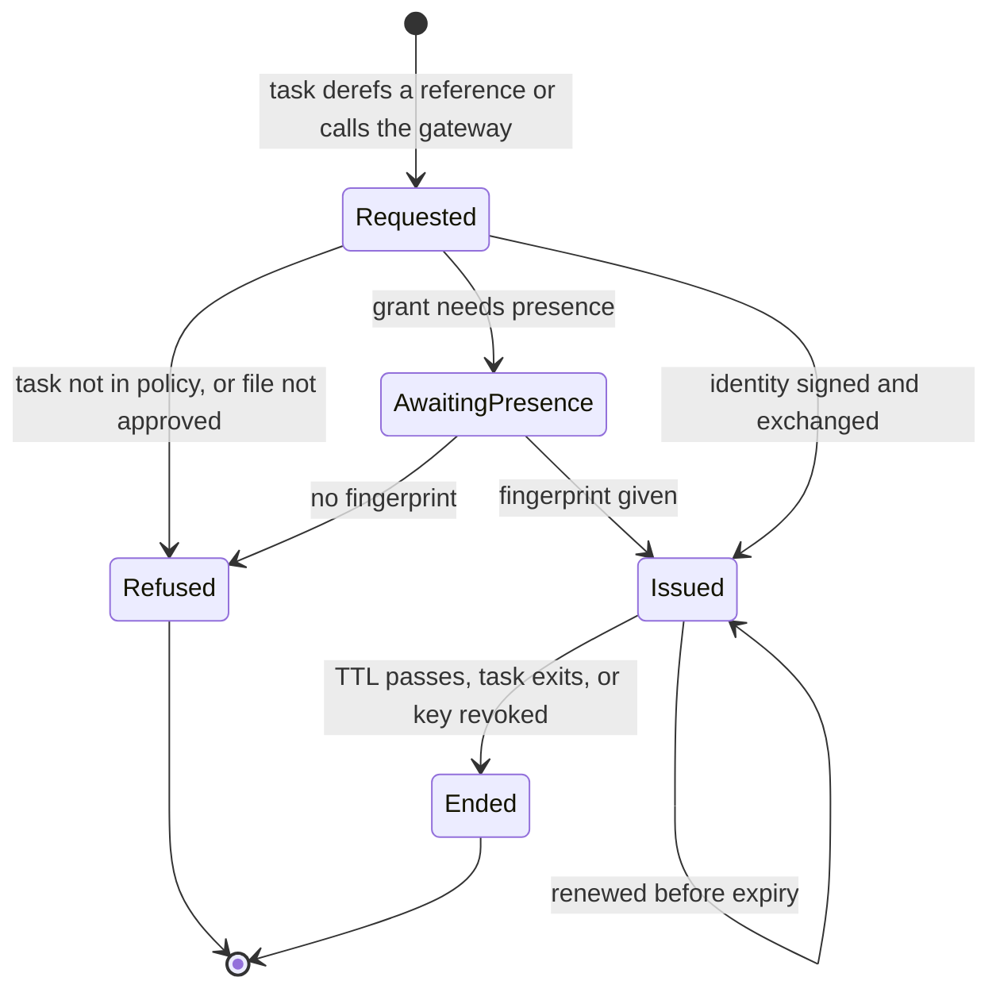

# Grants: design

Status: draft, 2026-11-10. Nothing described here has been built yet.

This document describes how grants works. Two companion documents cover the
rest: the [threat model](threat-model.md) explains what the design protects
and where it falls short, and [prior art](prior-art.md) records what other
products and providers do, along with how carefully each finding was checked.

## The problem

`com.kirahowe/secrets` stores an application's secrets in an age-encrypted EDN
file, one per environment, committed alongside the code. It handles config
well: secrets are data that the application loads, a committed manifest makes
every change reviewable, and no value ever passes through an environment
variable.

Its weakness is the key. A single age identity decrypts every value in a
store, and those values are long-lived. The identity is kept in the login
Keychain or behind a password-manager command, and any process running as the
developer can call either one. The `secrets` threat model acknowledges this
and puts that attacker out of scope (A6, B3).

A coding agent is code running as the developer. If an agent goes rogue, the
store is a single prize: the agent can fetch one key, read every value, and
keep using those values until someone rotates them.

Stronger encryption doesn't solve this, because the store still exists. The
fix is to leave nothing worth finding. Instead of storing a credential, grants
issues one when a task needs it, limits it to what that task does, and lets it
expire soon afterward.

## Principles

1. **Store as little as possible, and nothing valuable.** A federated grant
   stores nothing anywhere. The only secret allowed on a laptop is a bounded
   key for a provider that offers nothing better, and by default that key is a
   test-mode key.
2. **Issue each credential to one task.** Give it the narrowest scope that its
   provider can express, and a short lifetime.
3. **Let a task use a credential rather than hold it.** Where the protocol
   allows it, a gateway attaches the credential to the request, and the task
   never holds it.
4. **Keep config as data.** A credential reaches the application through its
   config, the same way `#secret/req` works today. Environment variables are
   global mutable state, so don’t use them.
5. **Commit the description of access.** The description contains no values,
   so there's nothing to encrypt, and reviewing an ordinary diff is the access
   review.
6. **Ship the same artifact to every environment.** What differs between
   environments is the workload identity, and that decides what each grant
   resolves to.
7. **Add nothing to deploy or CI.** Those platforms already give the workload
   an identity, and the library uses it.
8. **Keep minting roots off laptops.** A credential that can create other
   credentials is worth more than any key it replaces.
9. **Run agents in a sandbox.** Outside a sandbox, an agent is effectively the
   developer, and nothing on the laptop can tell the two apart.
10. **Degrade per platform.** Apple hardware supports the most complete
    design. Every other platform gets as much of it as its hardware and OS
    allow. When a protection is missing, the issuer falls back to the next
    best one, and the cost of that fallback is written down rather than
    hidden.

## Vocabulary

- **Grant**: a description of one credential. It says which provider issues
  the credential, for which resource, with which permissions, and for how
  long.
- **Task**: one bounded piece of work, such as a dev server run, a migration,
  a test run, or an agent session. Each task lists the grants it may use.
- **Provider**: the system that issues or accepts the credential, such as AWS,
  a Postgres server, GitHub, or Anthropic.
- **Identity source**: something that answers the question "which task is
  asking?" with a short signed statement. Production and CI already have an
  identity source. A laptop doesn't, so the local issuer fills that gap.
- **Source** of a grant: where the grant's authority comes from. It's one of
  federation, a minted key, or a static key. In production, a grant can also
  read from the platform's own secret store (see [Decisions](#decisions)).
- **Delivery** of a grant: how the task uses it. The task either receives the
  credential by reference, or a gateway injects the credential for it.
- **Reference**: what `#grant` returns in place of a credential, in the
  Clojure sense of an identity whose value changes over time. Dereferencing it
  gives the current credential, and the library renews the value behind it
  before it lapses.

## What gets committed

The repository commits a `grants.edn` file that declares every grant and
task. The file holds no values:

```clojure
;; grants.edn (committed, holds no values)
{:app    "website"
 :minter "https://minter.example.dev"

 :grants
 {:db/app
  {:provider :postgres
   :database "website_dev"
   :role     "app_rw"
   :ttl      "1h"}

  :db/migrate
  {:provider :postgres
   :database "website_dev"
   :role     "schema_owner"
   :ttl      "10m"}

  :llm/claude
  {:provider :anthropic
   :scope    :inference
   :ttl      "10m"
   :budget   {:requests 500}}

  :repo/read
  {:provider    :github
   :repos       ["kirahowe/website"]
   :permissions {:contents :read}
   :ttl         "15m"}

  :payments/test
  {:provider :stripe
   :source   :static
   :allow    [[:post "/v1/payment_intents"]
              [:get  "/v1/payment_intents/*"]]}}

 :tasks
 {:serve   {:grants [:db/app :payments/test]}
  :migrate {:grants [:db/migrate] :approval :presence}
  :agent   {:grants  [:repo/read :llm/claude]
            :deliver :inject}}}
```

Each grant names its provider, and the tool resolves the grant using the best
source that provider supports. To see the source of every grant, run `grants
doctor`. You have to write out a static source explicitly, because it's the
one case where a key is stored.

A task can ask for less than its declaration allows, such as one repository
out of three. Asking for more means changing this file, and that change shows
up as a diff that someone reviews.

Differences between environments are written in the file as data, in the
style of Aero's `#profile`. Dev and production name different databases,
roles, and accounts, and they never share a credential.

The application's own config refers to grants by name:

```clojure
;; config.edn
{:db       {:host        "localhost"
            :dbname      "website_dev"
            :credentials #grant :db/app}
 :payments {:client #grant :payments/test}}
```

`#secret/req` returns a string, but `#grant` can't, because the credential
behind it expires while the process is still running. Instead, `#grant`
returns a reference. The application derefs it whenever it needs the current
value, and the library renews the credential before it lapses. A connection
pool takes the reference as its credential supplier.

## Where a grant's authority comes from

A grant gets its authority from one of three sources. The tool works through
them in this order and uses the first one the provider supports:



**Federate.** The provider trusts the identity source directly, and exchanges
a signed identity for a short-lived credential. Anthropic, OpenAI, AWS, and
Google Cloud work this way, and so does anything that trusts a certificate
authority, such as Postgres `cert` auth and SSH certificates. No secret is
stored on any machine.

**Mint.** The provider has an API for creating scoped keys, but creating one
requires a long-lived root. GitHub Apps and Cloudflare work this way. The root
lives in a remote minter, which creates a key for the task and revokes it when
the task ends.

**Static.** The provider offers only long-lived keys. One key, restricted as
far as the provider allows, is sealed on the laptop. Only the gateway can use
it, and a task never receives it. By default, it must be a test-mode or
dev-only key.

[Providers today](#providers-today) shows which providers fall under each
source.

## How a task uses a grant

A task uses a grant in one of two ways: it holds a reference to the
credential, or a gateway injects the credential into its requests.

### By reference

The task receives the credential and keeps it in memory. This suits
application tasks, and protocols other than HTTP, such as a Postgres
connection.



The library doesn't store anything it receives, and the credential exists only
in the task's memory. If the credential leaks from there, though, it works
from anywhere until it expires.

### By injection

The task sends its request to the gateway without a credential. The gateway
checks the request, gets the credential, and attaches it. This suits agent
tasks and every static key.



When federation and injection are combined, nothing is stored and the task has
nothing to leak. The cost is a proxy in the request path, and a base URL that
differs between a laptop and production.

## Where things run

The following diagram shows each component and where it runs:



## One file, four identity sources

The same `grants.edn` works in every environment. What changes is where the
task's identity comes from:



| Where               | Identity source                                                | New infrastructure               |
| ------------------- | -------------------------------------------------------------- | -------------------------------- |
| Production          | The platform's workload identity                               | None                             |
| CI                  | The CI system's OIDC token                                     | None                             |
| Laptop              | The local issuer                                               | One signed binary                |
| Cloud agent sandbox | A delegation from the developer's issuer, bound to the session | Undecided, see [Agents](#agents) |

## The local issuer

The local issuer turns the laptop into an identity provider. It holds signing
keys, but no credentials.

This section describes the issuer on macOS, where the Secure Enclave is
Apple's hardware key store. [Platforms](#platforms) covers what changes on
Windows and Linux.

The issuer's keys are generated inside the Secure Enclave and can't be
exported, and the enclave lets only the issuer's signed binary use them. A
process that takes over the developer's account can ask the issuer to sign
something, subject to the checks described below, but it can't copy a key and
leave with it.

The issuer signs two kinds of things:

- Short-lived JWTs, for providers that federate over OIDC.
- Short-lived X.509 certificates, for providers that trust a certificate
  authority.

During setup, each provider is told once to trust the issuer's public key.
Anthropic and OpenAI accept the public key inline, so the laptop doesn't need
a public endpoint for them.

### Identifying the task

A launcher starts each task. For example, `grants run serve` runs the command
that `grants.edn` declares for `serve`. When a process connects to the
issuer's Unix socket, the issuer matches that peer process to a task it
launched. The caller doesn't declare its own task, and nothing passes through
the environment.

Outside a sandbox, this matching is only bookkeeping, because any code running
as the developer can run the launcher too. The threat model covers what that
means.

The issuer records every issuance: the task, the grant, the time, and the
process.

### Approving the file

The issuer pins the version of `grants.edn` that it will honour. When the file
changes, the issuer shows the change in its own window, described in terms of
access, for example "task agent gains write on kirahowe/website". The
developer approves the change there, with Touch ID. The issuer doesn't rely on
the terminal to show the change, because an agent might control the terminal.

### Presence

For a task marked `:approval :presence`, the issuer signs with a second
enclave key that requires Touch ID every time it's used. An agent can't supply
a fingerprint, so that task's grants stay with the person. Keep presence for
rare actions: when a prompt appears often, people start approving it without
reading it.

### Setup

Setup is where the goal of being "as easy as a `.env` file" is hardest to
meet. Each provider has to be told once to trust the issuer, and told what
each task maps to. `grants init` generates that configuration from
`grants.edn` as Terraform or CLI commands, so the trust setup lives in the
repository as code too.

Applying the configuration requires the owner's login to the provider, and the
owner does this outside any agent session. Whether setup can feel light is the
main product risk.

## Platforms

The issuer is defined by the protections it provides, not by the Secure
Enclave. macOS on Apple hardware is the reference platform and provides all
of them. On other platforms the issuer provides what the hardware and OS
allow, and falls back where they don't.

| Protection                                 | macOS                                      | Windows                                   | Linux                                | When it's missing                                                                                                                                            |
| ------------------------------------------ | ------------------------------------------ | ----------------------------------------- | ------------------------------------ | ------------------------------------------------------------------------------------------------------------------------------------------------------------ |
| Signing keys can't be exported             | Secure Enclave                             | TPM 2.0                                   | TPM 2.0                              | Use a security key such as a YubiKey. See [Decisions](#decisions) for machines with neither                                                                  |
| Only the issuer binary can use its keys    | Keychain access tied to the code signature | No known equivalent                       | No known equivalent                  | Code running as the developer can use the keys directly and skip the issuer's checks. Unsandboxed code then has what a tampered issuer has (threat model A7) |
| Other processes can't attach to the issuer | Hardened runtime                           | No known option for ordinary applications | Partial, through Yama `ptrace_scope` | Code running as the developer can read unsealed keys and credentials from the issuer's memory                                                                |
| The issuer can identify the peer process   | Unix socket peer lookup                    | Named-pipe client process ID              | `SO_PEERCRED`                        | No fallback. Task identification depends on it                                                                                                               |
| Presence                                   | Touch ID on the key                        | Windows Hello                             | No standard                          | Use the touch requirement on a security key                                                                                                                  |
| The issuer's own approval window           | Native window                              | Native window                             | Native window                        | Separate work on each OS                                                                                                                                     |

Everything outside the macOS column is on the list of
[claims to check](#claims-to-check).

A security key works the same way on every platform, and its touch
requirement gives real presence. It's the uniform fallback for both the key
store and presence, at the cost of extra hardware.

Each fallback has to be explicit. `grants doctor` reports which protections
hold on the current machine, and the threat model records what each missing
protection costs.

## The gateway

The gateway runs in the same signed binary as the issuer, and it handles every
grant delivered by injection. The gateway does the following:

- Attaches the credential to the outgoing request. For a federated grant, the
  gateway does the exchange itself and holds the token in memory.
- Enforces operation rules, which are the methods and paths listed in a
  grant's `:allow`.
- Enforces budgets: a count of requests per task, and spend where the provider
  reports it.
- Holds the sealed static keys. Each key is encrypted to an enclave key, and
  is only ever unsealed into the gateway's memory.

A task reaches the gateway through a local base URL and a task token, both of
which the `#grant` reference supplies. The token works only at this gateway and
only while the task is running, so it's worthless on any other machine. An
agent in a sandbox reaches the gateway through the sandbox's own egress proxy.

Other gateways scope by host and have no budgets (see
[prior art](prior-art.md)). In this design, operation rules and budgets are
the only controls over what a grant is used for, so they're where this gateway
has to do better than the others.

## The remote minter

The minter is a small service that holds minting roots, so that no laptop has
to.



The minter reads policy from the protected main branch, not from the laptop's
working copy. As a result, widening a minted grant requires a merged pull
request. Octo STS works the same way for GitHub.

The minter is optional. Without one, a provider that can only mint falls back
to a static test key, or is out of scope. Where the minter runs is still an
open question.

## Agents

An agent task runs in a sandbox that provides the following:

- No read access to the home directory outside the project.
- Network egress only through the gateway.
- No access to the REPL ports of other tasks.
- No way to run the launcher for another task.

Without these restrictions, an agent can read the developer's own logins or
start any task, and the grants file limits nothing. The threat model treats an
unsandboxed agent as the developer.

Today, giving a cloud agent access usually means pasting long-lived keys into
the platform's settings. Here's a sketch of how to do it without pasting a
secret:

1. When the session starts, the sandbox generates a key pair.
2. The developer's issuer signs a delegation that names the public key, the
   task, and an expiry.
3. The sandbox then acts as that task.

This sketch has two known limits. First, a provider that accepts a plain OIDC
token accepts it from whoever holds it, so the delegation has to be short.
Second, renewing the delegation during a long session requires an issuer that
the sandbox can reach, and a laptop isn't reachable. A hosted or self-hosted
issuer would cover that, but it hasn't been designed yet.

## Life of a grant

A grant moves through the following states:



## Providers today

| Source   | Providers                                                                                                                                         | Stored secret                        |
| -------- | ------------------------------------------------------------------------------------------------------------------------------------------------- | ------------------------------------ |
| Federate | AWS, Google Cloud, Anthropic, OpenAI, Tailscale, Postgres `cert` auth, SSH certificates; Stripe in private preview from AWS and Google Cloud only | None                                 |
| Mint     | GitHub Apps, Cloudflare, Vercel, PlanetScale; SendGrid, Resend, Neon, Supabase, and Twilio with no expiry                                         | A root in the remote minter          |
| Static   | Stripe outside the preview, Postmark, Sentry, Linear, Hugging Face                                                                                | One bounded key in the local gateway |

Most of these rows come from search summaries. [Prior art](prior-art.md) marks
which ones were read at the source.

## Relationship to secrets

The manifest idea from `secrets` carries over, and gets simpler. `secrets`
needed keyed hashes so that a diff could show a value had changed without
revealing it. `grants.edn` has no values, so it is its own manifest.

CI still has a use for a check that needs no identity: one that confirms the
file is valid and that the application's config refers only to grants that
exist.

## Decisions

**Language and shape** (2026-11-11). `grants` is a Clojure library backed by
a native daemon written in Go. The daemon is the issuer, the gateway, and the
launcher. It can't run on the JVM: it needs hardware key stores and a code
signature, and the threat model's defence against a tampered issuer (A7) asks
for a small codebase with few dependencies. A documented socket protocol and
the `grants.edn` format form the language-neutral boundary between the
daemon and its clients, so clients in other languages can follow later.
Injection already works from any language, because a task only needs a base
URL and a task token.

Go was chosen over Rust because its TPM support is pure Go, while Rust's main
TPM crate wraps a C library, and both need native code for the Secure Enclave.
Rust could reliably wipe keys from memory, but on macOS the code-signature
boundary already keeps other processes out of the issuer's memory. A Clojure
daemon built with GraalVM `native-image` would have shared code with the
library, but it would reach the Secure Enclave and TPM through hand-written
FFM bindings, where Go has existing libraries.

**Third-party tools** (2026-11-11). `psql`, `aws`, `gh`, `git`, and the agent
harness don't read an EDN config, so each one uses whatever hook it already
has:

- A tool that supports an on-demand credential helper gets one. Examples are
  git credential helpers, AWS `credential_process`, Docker credential helpers,
  and kubectl exec plugins.
- A tool whose base URL can point at the gateway, such as an agent harness,
  gets injection. The only thing it holds is a task token that works at this
  gateway alone.
- For a tool that reads only environment variables, `grants run <task> --
  <command>` sets them for that one child process. This breaks principle 4,
  narrowly, and it's a documented fallback in the spirit of principle 10.
- `psql` with `cert` auth reads its certificate and key from files, so it gets
  a private temporary file that lasts only as long as the task. That's
  another explicit trade-off.

**The remote minter is deferred** (2026-11-11). A project starts without one,
and a provider that can only mint falls back to a static test key or stays out
of scope. When GitHub matters, Octo STS is the model to follow, or to reuse.

**Production that isn't federated yet** (2026-11-11). In production, `#grant`
can resolve by reading a static secret from the platform's own secret store,
using the platform's workload identity to read it. The application's config
stays the same while each provider moves to federation. This is a fourth
source, used only in production, alongside federate, mint, and static.

**Parity** (2026-11-11). The `#grant` reference supplies the base URL, so an
application that reads its URL from config reaches the gateway locally and the
real endpoint in production, with no code changes. Budgets and operation rules
apply only locally, and that difference is accepted. Application tasks get
delivery by reference by default. Injection is for agents and static keys.

**Machines with no hardware key store** (2026-11-11). Linux VMs and WSL often
have no TPM, and not everyone has a security key. On such a machine the issuer
can run with a software key, but only when per-machine config opts in.
`grants.edn` can't opt in. `grants doctor` and every issuance warn that the
key is in software, and grants that need presence are refused on that
machine, because a software key can't prove presence.

**Decoy credentials are deferred** (2026-11-11). A credential an agent finds
in `.env` or `~/.aws` could be a planted decoy, so any use of one would be a
real alarm. That only works once no real secrets are on disk, and existing
tools such as `canaryhook` already cover the idea.

## Open questions

1. **The remote minter.** Where does it run, and who operates it for a solo
   developer?
2. **Who does the exchange on a laptop.** The diagrams show the library
   exchanging the identity with the provider. If the Go daemon did every
   laptop exchange instead, the library would need exchange code only for
   production and CI, and less provider code would exist in two languages.
   The application's code is the same either way.
3. **Editor jack-in.** CIDER and Calva start the REPL's JVM themselves, but
   the issuer only recognises processes that the launcher started. How does a
   REPL started from an editor become a task? A custom jack-in command that
   goes through `grants run` is one answer.
4. **Sealing a static key.** The design doesn't yet say how a static key gets
   into the gateway. One obvious shape is `grants seal :payments/test`,
   reading the key from a hidden prompt.
5. **The name.** `grants` is a working title. Check that it's free on Clojars
   and as a Go module path.

## Claims to check

The following claims come from memory or from search summaries:

- AWS IAM accepts ES256-signed tokens from an OIDC provider. This matters
  because the Secure Enclave signs only with P-256.
- AWS Roles Anywhere accepts ECDSA P-256 certificates from an external CA.
- Google Cloud workload identity federation accepts an uploaded JWKS, with no
  public issuer endpoint.
- OpenAI accepts ES256. Its federation guide doesn't list algorithms.
- On macOS, a Secure Enclave key can be used only by the signed binary that
  created it.
- On macOS, a process can't attach to another process of the same user when
  the target is signed with the hardened runtime.
- On macOS, a daemon can identify the peer process on a Unix socket reliably
  enough to match it to a launched task.
- On Windows and Linux, a TPM 2.0 can hold a non-exportable P-256 signing
  key.
- Neither Windows nor Linux can restrict a TPM key to one signed binary.
- On Linux, Yama `ptrace_scope` can stop processes of the same user from
  attaching to the issuer. Windows has no equivalent for ordinary
  applications.
- `SO_PEERCRED` on Linux, and the named-pipe client process ID on Windows,
  identify the peer process reliably enough to match it to a launched task.
- Windows Hello can require a biometric for every use of a key.
- A YubiKey's PIV applet holds P-256 keys and can require a touch for every
  use.
- `google/go-tpm` talks to the TPM directly, with no C library.
- Smallstep's `go.step.sm/crypto` has working KMS backends for the macOS
  Secure Enclave and for TPMs.
- GitHub App keys must be RSA, which the Secure Enclave can't hold.
- A JDBC Postgres connection can take its client certificate and key from
  memory, without a file on disk.
- Every provider row in [prior art](prior-art.md) that's marked "summary".

## First spike

The first spike tests three assumptions: that an enclave key can replace an
API key, that injection is workable for an agent, and that setup is light. It
has four parts:

1. Build a local issuer with a Secure Enclave key, and register it with
   Anthropic as a custom issuer, with its public key inline. The issuer
   exchanges a signed identity for a token and calls the Messages API. No API
   key exists at any point.
2. Make the same call through the gateway, with a request budget, from an
   agent in a sandbox.
3. Set up a local Postgres that trusts the issuer's CA through `cert` auth,
   and a Clojure application whose connection pool takes its credentials from
   `#grant :db/app` and survives a renewal.
4. Count the steps from an empty repository to a working grant.
