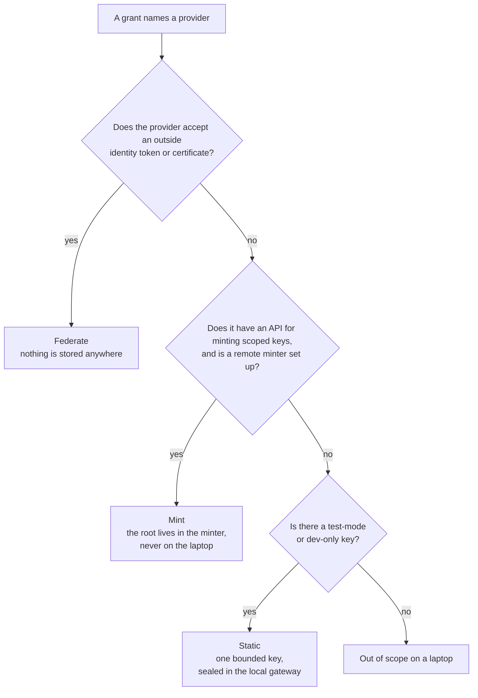
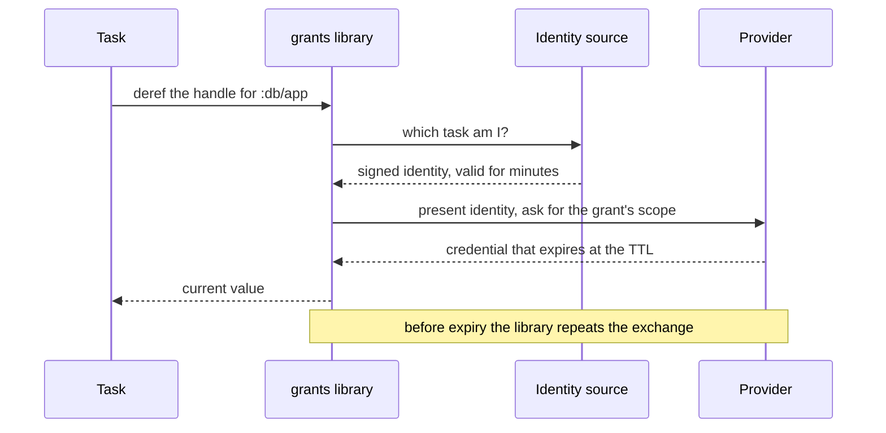
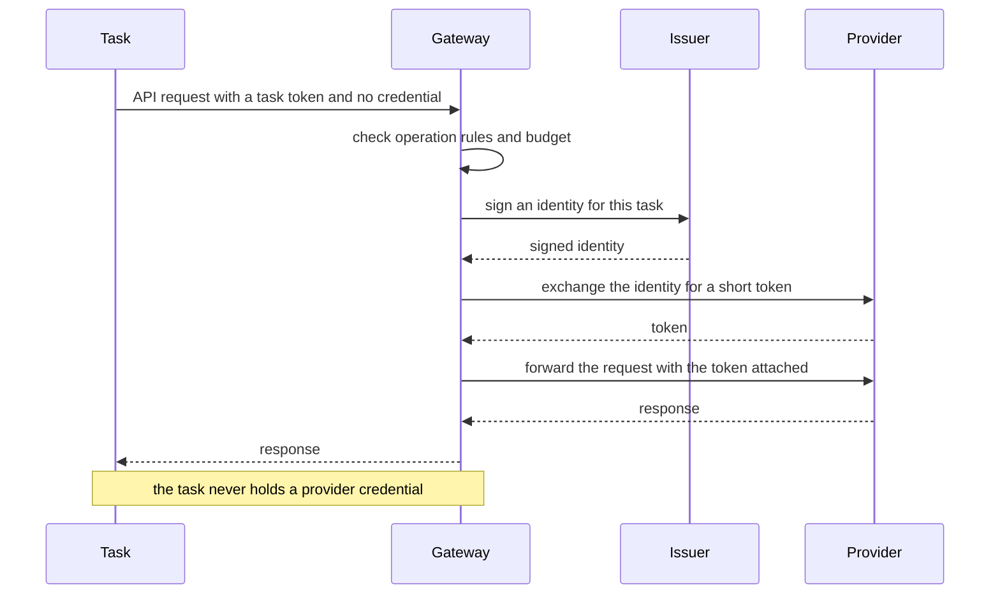
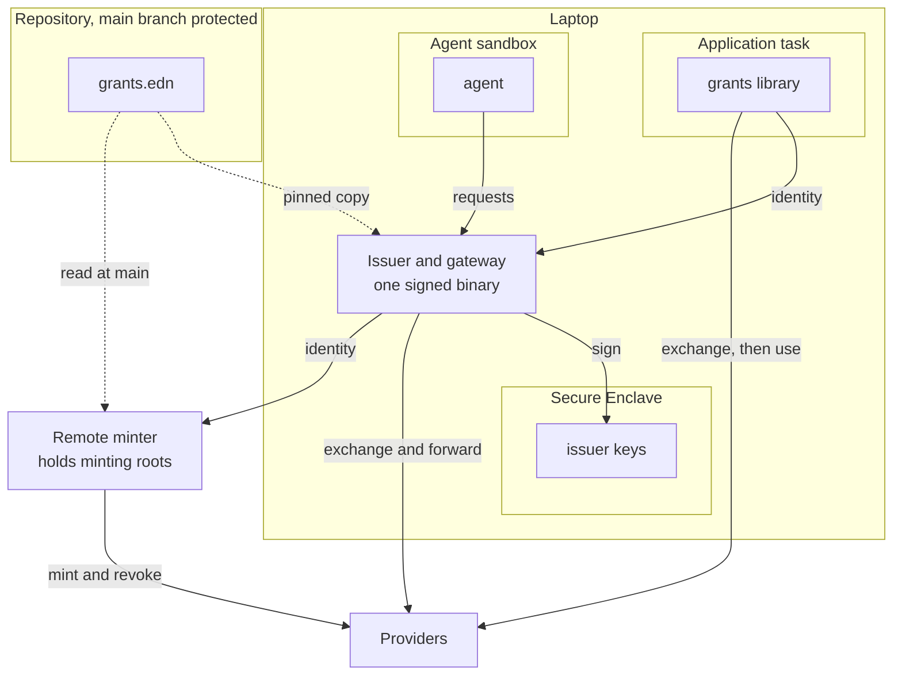
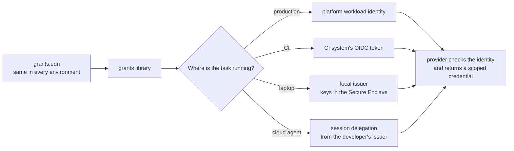
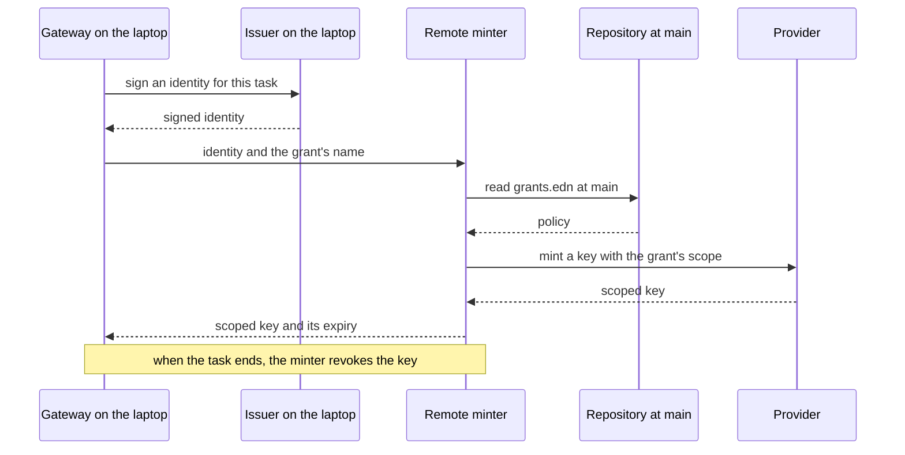

# Grants: design

Status: draft, 2026-11-10. Nothing here is built.

Two companion documents carry the rest. [Threat model](threat-model.md) says
what the design protects and where it falls short. [Prior art](prior-art.md)
records what other products and providers do, and how far each finding was
checked.

## The problem

`com.kirahowe/secrets` keeps an application's secrets in one age-encrypted EDN
file per environment, committed next to the code. Its treatment of config is
right. Secrets are data the application loads, a committed manifest makes
changes reviewable, and no value travels through an environment variable.

Its weakness is the key. One age identity decrypts every value in a store. The
values are long lived. The identity sits in the login Keychain or behind a
password-manager command, and any process running as the developer can call
either. The threat model says so and puts that attacker out of scope (A6, B3).

A coding agent is code running as the developer. For an agent that goes wrong,
the store is a single prize: fetch one key, read every value, and use them
until somebody rotates.

Stronger encryption does not help, because the store still exists. The fix is
to have nothing worth finding. A credential is issued when a task needs it,
limited to what that task does, and dead soon after.

## Principles

1. Store as little as possible, and nothing valuable. A federated grant stores
   nothing anywhere. The only secret allowed on a laptop is a bounded key for
   a provider that offers nothing better, and by default it is a test-mode
   key.
2. Issue each credential to one task, with the narrowest scope its provider
   can express and a short lifetime.
3. Give a task the use of a credential in preference to the credential. Where
   the protocol allows it, a gateway attaches the credential and the task
   never holds it.
4. Keep config as data. A credential reaches the application through its
   config, the way `#secret/req` does today. Environment variables are global
   mutable state and carry nothing.
5. Commit the description of access. It holds no values, so an ordinary diff
   is the access review and there is nothing to encrypt.
6. Ship the same artifact to every environment. Environments differ in who the
   workload is, and that decides what a grant resolves to.
7. Add nothing to deploy or CI. The platform already gives the workload an
   identity there, and the library uses it.
8. Keep minting roots off laptops. A credential that can create other
   credentials is worth more than any key it replaces.
9. Run agents in a sandbox. Without one an agent is the developer, and nothing
   on the laptop can tell them apart.

## Vocabulary

A grant describes one credential: which provider issues it, for which
resource, with which permissions, and for how long.

A task is one bounded piece of work, such as a dev server run, a migration, a
test run, or an agent session. A task lists the grants it may use.

A provider is the system that issues or accepts the credential: AWS, a
Postgres server, GitHub, Anthropic.

An identity source answers "which task is asking?" with a short signed
statement. Production and CI already have one. A laptop does not, and the
local issuer fills that gap.

The source of a grant is where its authority comes from: federation, a minted
key, or a static key.

The delivery of a grant is how the task uses it: as a handle the task
dereferences, or by injection at a gateway.

## What gets committed

```clojure
;; grants.edn (committed, holds no values)
{:app    "website"
 :minter "https://minter.example.dev"

 :grants
 {:db/app
  {:provider :postgres
   :database "website_dev"
   :role     "app_rw"
   :ttl      "1h"}

  :db/migrate
  {:provider :postgres
   :database "website_dev"
   :role     "schema_owner"
   :ttl      "10m"}

  :llm/claude
  {:provider :anthropic
   :scope    :inference
   :ttl      "10m"
   :budget   {:requests 500}}

  :repo/read
  {:provider    :github
   :repos       ["kirahowe/website"]
   :permissions {:contents :read}
   :ttl         "15m"}

  :payments/test
  {:provider :stripe
   :source   :static
   :allow    [[:post "/v1/payment_intents"]
              [:get  "/v1/payment_intents/*"]]}}

 :tasks
 {:serve   {:grants [:db/app :payments/test]}
  :migrate {:grants [:db/migrate] :approval :presence}
  :agent   {:grants  [:repo/read :llm/claude]
            :deliver :inject}}}
```

A grant names its provider, and the tool resolves it on the best source that
provider supports. `grants doctor` prints the source of every grant. A static
source has to be written out, because it is the one case where a key is
stored.

A task can ask for less than its declaration allows, for example one
repository out of three. Asking for more means changing this file, and that is
a reviewed diff.

Differences between environments are written in the file as data, in the style
of Aero's `#profile`. Dev and production name different databases, roles, and
accounts, and never share a credential.

The application's own config refers to grants by name:

```clojure
;; config.edn
{:db       {:host        "localhost"
            :dbname      "website_dev"
            :credentials #grant :db/app}
 :payments {:client #grant :payments/test}}
```

`#secret/req` returns a string. `#grant` cannot, because the credential behind
it expires while the process is still running. It returns a handle. The
application dereferences the handle when it needs the current value, and the
library renews the credential before it lapses. A connection pool takes the
handle as its credential supplier.

## Where a grant's authority comes from



Federate. The provider trusts the identity source directly and exchanges a
signed identity for a short credential. Anthropic, OpenAI, AWS, and Google
Cloud work this way, and so does anything that trusts a certificate authority,
such as Postgres `cert` auth and SSH certificates. No secret is stored on any
machine.

Mint. The provider has an API that creates scoped keys, and creating one takes
a long-lived root. GitHub Apps and Cloudflare work this way. The root lives in
a remote minter, which creates a key for the task and revokes it when the task
ends.

Static. The provider has nothing but long-lived keys. One key, limited as far
as the provider allows, is sealed on the laptop. Only the gateway can use it,
and a task never receives it. By default it must be a test-mode or dev-only
key.

The table in [Providers today](#providers-today) shows which providers sit
where.

## How a task uses a grant

### As a handle

The task receives a credential and holds it in memory. This suits application
tasks and protocols that are not HTTP, such as a Postgres connection.



The library stores nothing it receives. The credential exists only in the
task's memory. If it leaks from there, it works from anywhere until it
expires.

### By injection

The task sends its request to the gateway with no credential. The gateway
checks the request, obtains the credential, and attaches it. This suits agent
tasks and every static key.



Federation and injection together store nothing and give the task nothing to
leak. The cost is a proxy in the request path, and a base URL that differs
between a laptop and production.

## Where things run



## One file, four identity sources



| Where | Identity source | New infrastructure |
| --- | --- | --- |
| Production | The platform's workload identity | None |
| CI | The CI system's OIDC token | None |
| Laptop | The local issuer | One signed binary |
| Cloud agent sandbox | A delegation from the developer's issuer, bound to the session | Undecided, see [Agents](#agents) |

## The local issuer

The local issuer makes the laptop an identity provider. It holds signing keys
and no credentials.

Its keys are generated inside the Secure Enclave and cannot be exported. The
enclave lets only the issuer's signed binary use them. A process that takes
over the developer's account can ask the issuer to sign, subject to the checks
below. It cannot copy a key and leave with it.

The issuer signs two things: short JWTs for providers that federate over OIDC,
and short-lived X.509 certificates for providers that trust a certificate
authority. Each provider is told once, at setup, to trust the public half.
Anthropic and OpenAI accept the public key inline, so the laptop needs no
public endpoint for them.

### Identifying the task

A launcher starts each task. `grants run serve` runs the command that
`grants.edn` declares for `serve`, and the issuer matches the peer process on
its Unix socket to a task it launched. The caller does not state its own task,
and nothing passes through the environment.

Outside a sandbox this is bookkeeping, because any code running as the
developer can run the launcher. The threat model covers what that means.

The issuer records every issuance: task, grant, time, and process.

### Approving the file

The issuer pins the `grants.edn` it will honour. When the file changes, the
issuer shows the change in its own window, in terms of access: "task agent
gains write on kirahowe/website". The developer approves it there with Touch
ID. The terminal is not trusted to show the change, because an agent may
control it.

### Presence

A task marked `:approval :presence` is signed by a second enclave key that
needs Touch ID for every use. An agent cannot supply a fingerprint, so those
grants stay with the person. Presence is for rare actions. A prompt that
appears often gets approved without being read.

### Setup

Setup is where "as easy as a `.env` file" is hardest to deliver. Each provider
has to be told once to trust the issuer and what each task maps to. `grants
init` generates that as Terraform or CLI commands from `grants.edn`, so the
trust setup is code in the repository too.

Applying it takes the owner's login to the provider. The owner does that
outside any agent session. Whether this can feel light is the main product
risk.

## The gateway

The gateway runs in the same signed binary as the issuer. It handles every
grant delivered by injection.

- It attaches the credential to the outgoing request. For a federated grant it
  does the exchange itself and holds the token in memory.
- It enforces operation rules: the methods and paths in a grant's `:allow`.
- It enforces budgets: a count of requests per task, and spend where the
  provider reports it.
- It holds the sealed static keys. Each one is encrypted to an enclave key and
  is opened only into the gateway's memory.

A task reaches the gateway through a local base URL and a task token, both
supplied by the `#grant` handle. The token works only at this gateway and only
while the task lives, so it is worth nothing on another machine. An agent in a
sandbox reaches the gateway through the sandbox's own egress proxy.

Other gateways scope by host and have no budgets ([prior art](prior-art.md)).
Operation rules and budgets are the only controls in this design over what a
grant is used for, so they are where the gateway has to be better.

## The remote minter

The minter is a small service that holds minting roots. It exists so that no
laptop has to.



The minter reads policy from the protected main branch and ignores the
laptop's working copy. Widening a minted grant therefore takes a merged pull
request. Octo STS works this way for GitHub.

The minter is optional. Without one, a provider that can only mint falls
through to a static test key or out of scope. Where the minter runs is open.

## Agents

An agent task runs in a sandbox that provides four things:

- no read access to the home directory outside the project
- network egress only through the gateway
- no access to the REPL ports of other tasks
- no way to run the launcher for another task

Without these an agent can read the developer's own logins or start any task,
and the grants file limits nothing. The threat model treats an unsandboxed
agent as the developer.

Giving a cloud agent access today usually means pasting long-lived keys into
the platform's settings. The sketch for doing it without a pasted secret: the
sandbox generates a key pair when the session starts. The developer's issuer
signs a delegation that names the public key, the task, and an expiry. The
sandbox then acts as that task.

Two limits are known. A provider that accepts a plain OIDC token accepts it
from whoever holds it, so the delegation has to be short. Renewing it during a
long session needs an issuer the sandbox can reach, and a laptop is not
reachable. A hosted or self-hosted issuer would cover that, and it is not
designed yet.

## Life of a grant


## Providers today

| Source | Providers | Stored secret |
| --- | --- | --- |
| Federate | AWS, Google Cloud, Anthropic, OpenAI, Tailscale, Postgres `cert` auth, SSH certificates; Stripe in private preview from AWS and Google Cloud only | None |
| Mint | GitHub Apps, Cloudflare, Vercel, PlanetScale; SendGrid, Resend, Neon, Supabase, and Twilio with no expiry | A root in the remote minter |
| Static | Stripe outside the preview, Postmark, Sentry, Linear, Hugging Face | One bounded key in the local gateway |

Most rows come from search summaries. [Prior art](prior-art.md) marks which
were read at the source.

## Relationship to secrets

The manifest idea carries over and gets simpler. `secrets` needed keyed hashes
so that a diff could show a change without disclosing a value. `grants.edn`
has no values, so it is its own manifest.

A check that needs no identity still has a place in CI: the file is valid, and
the application's config refers only to grants that exist.

## Open questions

1. Language. The issuer needs the Secure Enclave and a code signature, which
   suggests Swift, or Go or Rust with bindings. The protocol could be language
   neutral with a Clojure client first. Is this a Clojure library with a
   helper binary, or a general tool with a Clojure binding?
2. Third-party tools. `psql`, `aws`, `gh`, `git`, and the agent harness itself
   do not read an EDN config. Several support helpers that fetch a credential
   on demand, such as git credential helpers and AWS `credential_process`, and
   those fit the model. For tools that read only environment variables, is an
   adapter scoped to one child process acceptable, or are they out of scope?
3. Where the remote minter runs, and who operates it for a solo developer.
4. Production that is not federated yet. Principle 7 assumes the platform
   provides a workload identity. An application that still reads static
   secrets in production needs a migration path.
5. Parity. Injection gives a task a local base URL that production does not
   use. Is that acceptable for application tasks, or is injection for agents
   only?
6. Linux and Windows. A TPM can stand in for the Secure Enclave. Presence and
   the code-signature boundary need equivalents.
7. Decoy credentials. With no real secrets on disk, a credential an agent
   finds in `.env` or `~/.aws` could be a planted decoy, so any use of one is
   a true alarm. Is that in scope?
8. The name. `grants` is a working title.

## Claims to check

These come from memory or from search summaries.

- AWS IAM accepts ES256-signed tokens from an OIDC provider. The Secure
  Enclave signs with P-256 only.
- AWS Roles Anywhere accepts ECDSA P-256 certificates from an external CA.
- Google Cloud workload identity federation accepts an uploaded JWKS, with no
  public issuer endpoint.
- OpenAI accepts ES256. Its federation guide does not list algorithms.
- On macOS, a Secure Enclave key can be used only by the signed binary that
  created it.
- On macOS, a process cannot attach to another process of the same user when
  the target is signed with the hardened runtime.
- macOS lets a daemon identify the peer process on a Unix socket reliably
  enough to match it to a launched task.
- GitHub App keys must be RSA, which the Secure Enclave cannot hold.
- A JDBC Postgres connection can take its client certificate and key from
  memory, with no file on disk.
- Every provider row in [prior art](prior-art.md) that is marked "summary".

## First spike

The spike tests three assumptions: that an enclave key can replace an API key,
that injection is workable for an agent, and that setup is light.

1. A local issuer with a Secure Enclave key, registered with Anthropic as a
   custom issuer with its public key inline. It exchanges a signed identity
   for a token and calls the Messages API. No API key exists at any point.
2. The same call through the gateway, with a request budget, from an agent in
   a sandbox.
3. A local Postgres that trusts the issuer's CA through `cert` auth, and a
   Clojure application whose connection pool takes its credentials from
   `#grant :db/app` and survives a renewal.
4. A count of the steps from an empty repository to a working grant.
