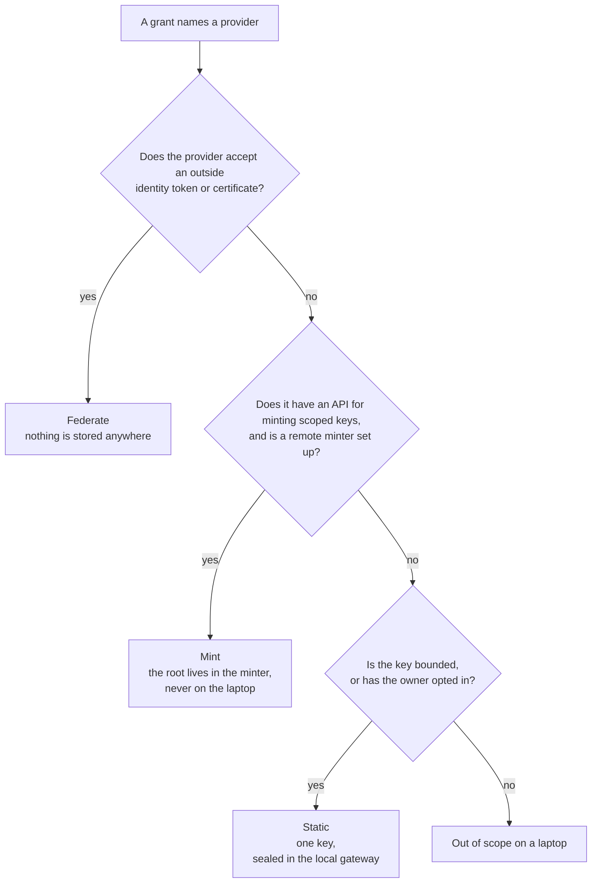
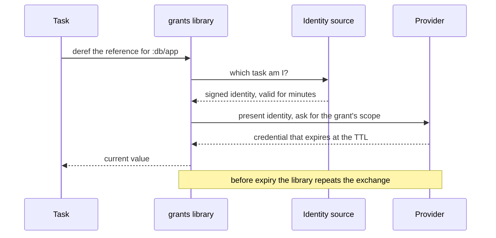
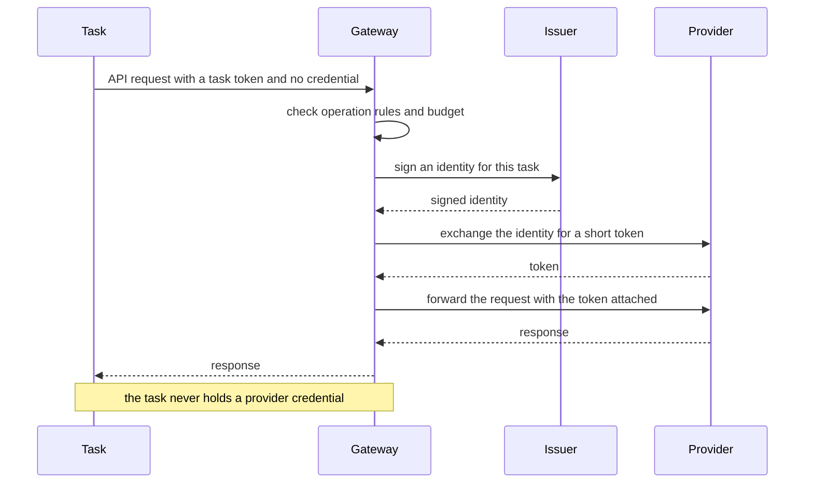
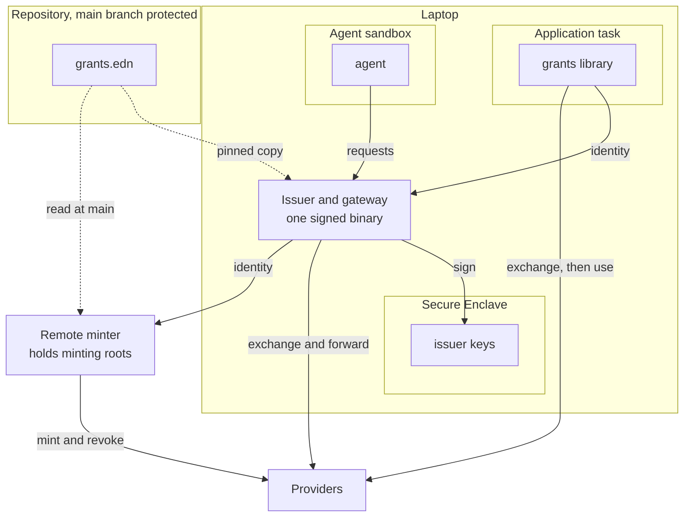
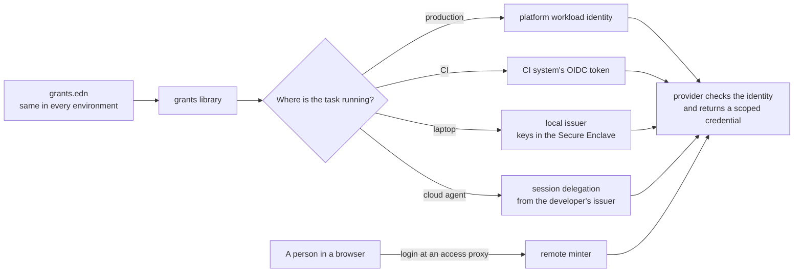
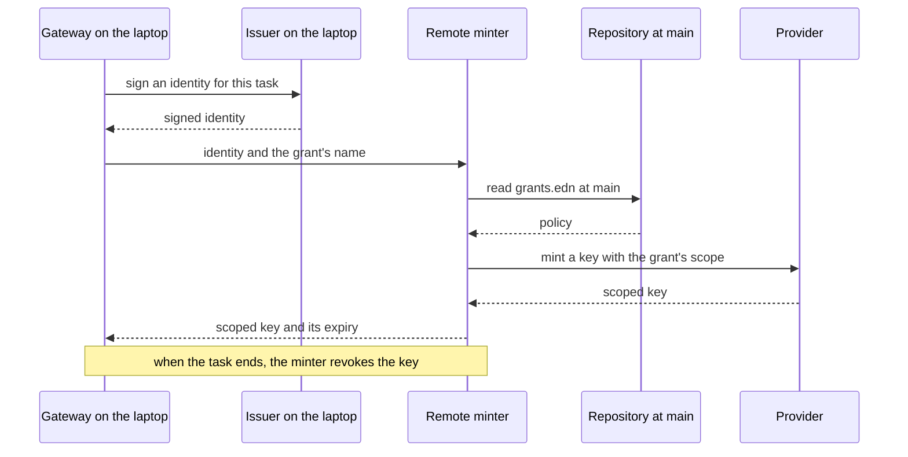
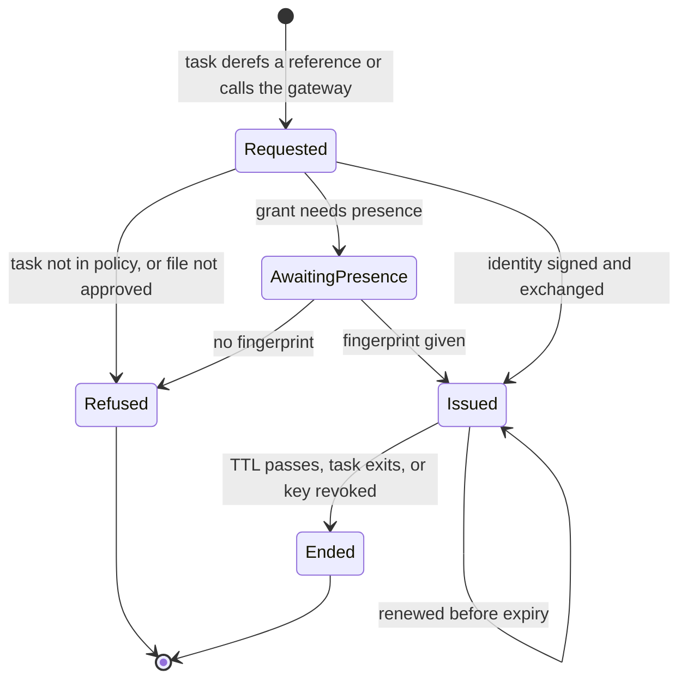

# Grants: design

Status: draft, 2026-11-10. Nothing described here has been built yet.

This document describes how grants works. Three companion documents cover the
rest: the [threat model](threat-model.md) explains what the design protects
and where it falls short, [use cases](use-cases.md) works the design through
three real applications, and [prior art](prior-art.md) records what other
products and providers do, along with how carefully each finding was checked.

## The problem

`com.kirahowe/secrets` stores an application's secrets in an age-encrypted EDN
file, one per environment, committed alongside the code. It handles config
well: secrets are data that the application loads, a committed manifest makes
every change reviewable, and no value ever passes through an environment
variable.

Its weakness is the key. A single age identity decrypts every value in a
store, and those values are long-lived. The identity is kept in the login
Keychain or behind a password-manager command, and any process running as the
developer can call either one. The `secrets` threat model acknowledges this
and puts that attacker out of scope (A6, B3).

A coding agent is code running as the developer. If an agent goes rogue, the
store is a single prize: the agent can fetch one key, read every value, and
keep using those values until someone rotates them.

Stronger encryption doesn't solve this, because the store still exists. The
fix is to leave nothing worth finding. Instead of storing a credential, grants
issues one when a task needs it, limits it to what that task does, and lets it
expire soon afterward.

## Principles

1. **Store as little as possible, and nothing valuable.** A federated grant
   stores nothing anywhere. The only secret allowed on a laptop is a key for a
   provider that offers nothing better, and that key has to be bounded: a
   test-mode key, a spend-capped key, or a read-only key. A key with none of
   those bounds needs the machine's owner to opt in.
2. **Issue each credential to one task.** Give it the narrowest scope that its
   provider can express, and a short lifetime.
3. **Let a task use a credential rather than hold it.** Where the protocol
   allows it, a gateway attaches the credential to the request, and the task
   never holds it.
4. **Keep config as data.** A credential reaches the application through its
   config, the same way `#secret/req` works today. Environment variables are
   global mutable state, so don’t use them.
5. **Commit the description of access.** The description contains no values,
   so there's nothing to encrypt, and reviewing an ordinary diff is the access
   review.
6. **Ship the same artifact to every environment.** What differs between
   environments is the workload identity, and that decides what each grant
   resolves to.
7. **Add as little as possible to deploy and CI.** Where a platform gives the
   workload an identity, the library uses it. Where it doesn't, the grant
   reads the platform's own secret store, and nothing else is added.
8. **Keep minting roots off laptops.** A credential that can create other
   credentials is worth more than any key it replaces.
9. **Sandbox agents by degrees.** Outside a sandbox, an agent is effectively
   the developer, and nothing on the laptop can tell the two apart. Grants
   still leaves that agent no stored secret to read, so trying it doesn't
   depend on a sandbox. Each sandbox level adds a protection, and an agent
   starts at the level that costs least to turn on.
10. **Degrade per platform.** Apple hardware supports the most complete
    design. Every other platform gets as much of it as its hardware and OS
    allow. When a protection is missing, the issuer falls back to the next
    best one, and the cost of that fallback is written down rather than
    hidden.

## Vocabulary

- **Grant**: a description of one credential. It says which provider issues
  the credential, for which resource, with which permissions, and for how
  long.
- **Task**: one bounded piece of work, such as a dev server run, a migration,
  a test run, or an agent session. Each task lists the grants it may use.
- **Provider**: the system that issues or accepts the credential, such as AWS,
  a Postgres server, GitHub, or Anthropic.
- **Identity source**: something that answers the question "which task is
  asking?" with a short signed statement. Production and CI already have an
  identity source. A laptop doesn't, so the local issuer fills that gap.
- **Source** of a grant: where the grant's authority comes from. It's one of
  federation, a minted key, or a static key. In production, a grant can also
  read from the platform's own secret store (see [Decisions](#decisions)).
- **Delivery** of a grant: how the task uses it. The task either receives the
  credential by reference, or a gateway injects the credential for it.
- **Reference**: what `#grant` returns in place of a credential, in the
  Clojure sense of an identity whose value changes over time. Dereferencing it
  gives the grant's current value, and the library renews that value before
  it lapses. [What a reference yields](#what-a-reference-yields) describes
  the value.
- **Profile**: a named variant of the file's data, such as `:dev` or `:live`.
  A profile picks the account, host, or database that a grant points at. On a
  laptop the task names its profile.
- **Slot**: one named secret that a static grant needs, such as `:secret`.
  The file names the slots, and the values are sealed on the machine.
- **Bound**: the limit a static key carries at its provider: `:test`,
  `:capped`, `:read-only`, or `:live` for a key with no limit.
- **Wrap**: to encrypt a piece of the application's own data with a key that
  never leaves the issuer. A wrap grant gives a task that operation without
  giving it the key.

## What gets committed

The repository commits a `grants.edn` file that declares every grant and
task. The file holds no values:

```clojure
;; grants.edn (committed, holds no values)
{:app    "website"
 :minter "https://minter.example.dev"

 :grants
 {:db/app
  {:provider :postgres
   :database "website_dev"
   :role     "app_rw"
   :ttl      "1h"}

  :db/migrate
  {:provider :postgres
   :database "website_dev"
   :role     "schema_owner"
   :ttl      "10m"}

  :llm/claude
  {:provider :anthropic
   :scope    :inference
   :ttl      "10m"
   :budget   {:requests 500}}

  :repo/read
  {:provider    :github
   :repos       ["kirahowe/website"]
   :permissions {:contents :read}
   :ttl         "15m"}

  :payments/test
  {:provider :stripe
   :source   :static
   :bound    :test
   :allow    [[:post "/v1/payment_intents"]
              [:get  "/v1/payment_intents/*"]]}}

 :default-task :dev

 :tasks
 {:dev     {:grants [:db/app :payments/test]}
  :serve   {:grants [:db/app :payments/test]}
  :migrate {:grants [:db/migrate] :approval :presence}
  :agent   {:grants  [:repo/read :llm/claude]
            :deliver :inject}}}
```

Each grant names its provider, and the tool resolves the grant using the best
source that provider supports. To see the source of every grant, run `grants
doctor`. You have to write out a static source explicitly, because it's the
one case where a key is stored.

A task can ask for less than its declaration allows, such as one repository
out of three. Asking for more means changing this file, and that change shows
up as a diff that someone reviews.

Differences between environments are written in the file as data, in the
style of Aero's `#profile`. Dev and production name different databases,
roles, and accounts, and they never share a credential.

```clojure
:plaid/api
{:provider :http
 :host     #profile {:dev  "sandbox.plaid.com"
                     :live "production.plaid.com"}
 ...}
```

On a laptop, a task names its profile with `:profile`, and the issuer
resolves every grant for that task under it. A task that names none gets
`:dev`. A process that declares the
`:dev` task can't reach what the `:live` profile points at. In production
the application names the profile when it reads its config, and the
provider's own rules decide what that workload may have.

The file above is an illustration. [Use cases](use-cases.md) has complete
files for three real applications.

The application's own config refers to grants by name:

```clojure
;; config.edn
{:db       {:host        "localhost"
            :dbname      "website_dev"
            :credentials #grant :db/app}
 :payments {:client #grant :payments/test}}
```

`#secret/req` returns a string, but `#grant` can't, because the credential
behind it expires while the process is still running. Instead, `#grant`
returns a reference. The application derefs it whenever it needs the current
value, and the library renews the credential before it lapses. A connection
pool takes the reference as its credential supplier.

The library provides `#grant` as a reader for `clojure.edn` and as an Aero
tag, so it works in a config that Integrant or Aero already loads.

### What a reference yields

The value behind a reference depends on what the grant is for, and it has
the same shape in every environment.

For a grant to an HTTP API, the value is a map with a base URL and a map of
headers:

```clojure
@(:client (:payments config))
;; => {:base-url "https://api.stripe.com"
;;     :headers  {"authorization" "Bearer sk_..."}}
```

The application sends its requests to `:base-url` and merges `:headers` into
each one. A string can't do this job, because the header changes with the
source. An Anthropic API key travels in `x-api-key`, and the token that
replaces it under federation travels in `authorization`. Plaid needs two
headers.

The map is what lets one piece of application code run everywhere:

| Where the grant resolves           | `:base-url`                  | `:headers`                          |
| ---------------------------------- | ---------------------------- | ----------------------------------- |
| Laptop, by injection               | The gateway, on loopback     | The grant's headers, as placeholders |
| Laptop, by reference               | The provider                 | A short-lived credential            |
| Production, federated              | The provider                 | A short-lived credential            |
| Production, platform secret store  | The provider                 | The stored key                      |

Under injection the headers are still present, each holding a placeholder,
and the gateway overwrites them. An SDK that insists on an API key gets a
value to pass, and the application doesn't branch on how the grant was
delivered.

For other protocols the value is whatever the client needs. A Postgres grant
yields a user name, a client certificate, and its key. A
[wrap grant](#application-data) yields a handle for `wrap` and `unwrap`.

## Where a grant's authority comes from

A grant gets its authority from one of three sources. The tool works through
them in this order and uses the first one the provider supports:



**Federate.** The provider trusts the identity source directly, and exchanges
a signed identity for a short-lived credential. Anthropic, OpenAI, AWS, and
Google Cloud work this way, and so does anything that trusts a certificate
authority, such as Postgres `cert` auth and SSH certificates. No secret is
stored on any machine.

**Mint.** The provider has an API for creating scoped keys, but creating one
requires a long-lived root. GitHub Apps and Cloudflare work this way. The root
lives in a remote minter, which creates a key for the task and revokes it when
the task ends.

**Static.** The provider offers only long-lived keys. One key, restricted as
far as the provider allows, is sealed on the laptop. Only the gateway can use
it, and a task never receives it. The key has to be bounded, unless the
machine's owner opts in to a live one. [Static keys](#static-keys) covers
sealing, bounds, and the opt-in.

[Providers today](#providers-today) shows which providers fall under each
source.

## How a task uses a grant

A task uses a grant in one of two ways: it holds a reference to the
credential, or a gateway injects the credential into its requests.

### By reference

The task receives the credential and keeps it in memory. This suits
application tasks, and protocols other than HTTP, such as a Postgres
connection.



The library doesn't store anything it receives, and the credential exists only
in the task's memory. If the credential leaks from there, though, it works
from anywhere until it expires.

On a laptop the issuer does the exchange and hands the library the result
over its socket, so the library there is a socket client that renews values.
In production and CI there is no issuer, and the library does the exchange
itself. Provider code for a laptop is therefore written once, in the issuer.

### By injection

The task sends its request to the gateway without a credential. The gateway
checks the request, gets the credential, and attaches it. This suits agent
tasks and every static key.



When federation and injection are combined, nothing is stored and the task has
nothing to leak. The cost is a proxy in the request path, and a base URL that
differs between a laptop and production.

## Static keys

### Describing an HTTP API

`:provider :http` describes any HTTP API by its host, the headers that carry
its key, and the operations a task may call:

```clojure
:plaid/api
{:provider :http
 :source   :static
 :host     #profile {:dev  "sandbox.plaid.com"
                     :live "production.plaid.com"}
 :bound    #profile {:dev :test :live :live}
 :attach   {:headers {"PLAID-CLIENT-ID" :client-id
                      "PLAID-SECRET"    :secret}}
 :allow    [[:post "/link/token/create"]
            [:post "/item/public_token/exchange"]
            [:post "/transactions/sync"]]}
```

In `:attach`, a keyword names a slot. A vector joins strings and slots, so a
bearer token is `{"authorization" ["Bearer " :key]}`. A named provider such
as `:stripe` is a preset that fills in the host and the headers, and a
provider with no preset is written out as above. Most providers will never
have a preset, so this form is the base one.

### Sealing

The file names a grant's slots, and `grants seal` puts the values on the
machine:

```
grants seal :plaid/api --profile live
```

The command asks for each slot at a hidden prompt, and the owner runs it
outside any agent session. The issuer encrypts each value to an enclave key
and stores the result on disk, filed under the application, the grant, the
profile, and the slot. `grants doctor` lists which slots are sealed on this
machine and which are missing. A new machine starts with none, and the owner
seals them again from the provider's dashboard.

### Bounds

A sealed key can be used by any task that lists its grant, so its worth
depends on what the key can do at the provider. Every static grant declares
a bound:

| `:bound`     | The key                                                 |
| ------------ | ------------------------------------------------------- |
| `:test`      | Belongs to a sandbox or test mode, and touches no real data |
| `:capped`    | Carries a spend cap set at the provider                 |
| `:read-only` | Can read but can't change anything                      |
| `:live`      | Has none of these limits                                |

The gateway checks a bound when the provider makes that possible. Plaid's
sandbox is a different host, and a Stripe test key has its own prefix.
Otherwise the bound is the owner's statement about the key, and the threat
model treats it as one.

### Live keys

Some applications have no production other than the laptop. A personal
finance application that runs at home needs the live key for its bank data
on the same machine where its developer writes code. Refusing that key
wouldn't remove it from the laptop. It would stay where it is now, in an
encrypted store whose key any process can read.

A grant with `:bound :live` is allowed under four conditions:

- The machine opts in. The owner runs `grants allow-live` for that
  application and grant, and approves it in the issuer's own window with
  Touch ID. `grants.edn` can't opt in, so a change to the repository can't
  bring a live key into reach.
- Delivery is by injection. The task never holds the key.
- The grant lists `:allow` rules. A live grant with no operation rules is
  refused.
- The key is sealed to the presence key. Unsealing it takes a fingerprint,
  once each time a task that uses it starts. The gateway holds the unsealed
  key in memory until that task ends.

A long-running server asks for one fingerprint when it starts, and its
scheduled work runs unattended after that.

## Application data

Some secrets don't come from a provider's dashboard. An application that
links a bank account through Plaid receives an access token for that
account, and it has to keep the token for years. Applications usually
encrypt such tokens with a key from their secret store, which puts the key
back on disk beside the data.

A wrap grant gives the application encryption without the key:

```clojure
;; grants.edn
:tokens/at-rest {:provider :wrap}
```

```clojure
(grants/wrap   tokens "access-sandbox-1234")  ;; => "gw1:k7:..."
(grants/unwrap tokens blob)                   ;; => "access-sandbox-1234"
```

The issuer creates a wrapping key the first time a profile uses the grant,
and seals it to an enclave key. `wrap` and `unwrap` run inside the issuer,
and the key never reaches the task. Each blob names the key that made it.
Every profile has its own key, so data written under `:dev` doesn't open
under `:live`.

Wrapping protects the stored copies: the database file, its backups, and
anything that syncs them. It doesn't protect against the running task, which
can unwrap whatever it's allowed to.

An enclave key can't be exported, so wrapped data doesn't survive the loss
of the machine. A grant handles that in one of two ways:

- **Acquire the data again.** A bank can be linked again, and this is the
  default.
- **Name a recovery recipient.** With `:recovery "age1..."`, the issuer also
  encrypts the wrapping key to that age public key when it creates it. The
  private half stays offline, and `grants recover` rebuilds the wrapping key
  on a new machine.

In production a wrap grant resolves to the platform's key management service
where one exists, reached by federation. Elsewhere the library reads a
wrapping key from the platform's secret store and does the encryption itself.

## Where things run

The following diagram shows each component and where it runs:



## One file, five identity sources

The same `grants.edn` works in every environment. What changes is where the
task's identity comes from:



| Where                  | Identity source                                                | New infrastructure               |
| ---------------------- | -------------------------------------------------------------- | -------------------------------- |
| Production             | The platform's workload identity, where it has one             | None                             |
| CI                     | The CI system's OIDC token                                     | None                             |
| Laptop                 | The local issuer                                               | One signed binary                |
| Cloud agent sandbox    | A delegation from the developer's issuer, bound to the session | Undecided, see [Agents](#agents) |
| A person in a browser  | Their login at an access proxy, checked by the minter          | [The remote minter](#the-remote-minter) |

The last row has no library in it. A browser application has no task and no
config to read, so it asks the minter for a credential directly.

## Production targets

Production differs from one platform to the next in two ways: whether the
platform gives a workload an identity, and where it keeps secrets.

| Target             | Workload identity                                   | Federated grants                         | Static grants                         |
| ------------------ | --------------------------------------------------- | ---------------------------------------- | ------------------------------------- |
| Fly.io             | An OIDC token, requested over a socket in the machine | The library exchanges the token          | Fly secrets                           |
| AWS, Google Cloud  | The platform's own                                  | The library exchanges it                 | The platform's secret manager         |
| GitHub Actions     | An OIDC token                                       | The library exchanges the token          | Actions secrets                       |
| Cloudflare Workers | None yet                                            | Not available                            | Worker secrets                        |
| The laptop itself  | The local issuer                                    | The issuer exchanges, as in development  | Sealed keys, with the live opt-in     |

A grant that can't federate on its target reads the platform's secret store.
Each slot maps to one secret, named after the grant and the slot:
`:plaid/api` with the slot `:secret` reads `PLAID_API_SECRET`. A grant can
override the name. On Fly and in Actions a secret arrives as an environment
variable, and the library reads it there, so the application's own code
still takes its credentials from config.

`grants init --target fly --profile prod` writes the setup for one target:

- For each federated grant, the provider-side trust: the platform's issuer,
  and a rule that matches this application's workloads.
- For each static grant, the command that stores its slots, with the secret
  names filled in and the values left for the owner to supply.

`grants doctor --target fly --profile prod` lists each grant with the source
it resolves to on that target, so a grant that still depends on a stored key
is visible before a deploy.

A Cloudflare Worker runs TypeScript and has no identity to federate with, so
the library has no part in it. `grants.edn` still describes the Worker's
grants, and `grants init --target workers` lists the secrets the Worker
needs. When Workers gains an identity binding, those grants can move to
federation with no change to the file.

## The local issuer

The local issuer turns the laptop into an identity provider. It holds signing
keys, but no credentials.

This section describes the issuer on macOS, where the Secure Enclave is
Apple's hardware key store. [Platforms](#platforms) covers what changes on
Windows and Linux.

The issuer's keys are generated inside the Secure Enclave and can't be
exported, and the enclave lets only the issuer's signed binary use them. A
process that takes over the developer's account can ask the issuer to sign
something, subject to the checks described below, but it can't copy a key and
leave with it.

The issuer signs two kinds of things:

- Short-lived JWTs, for providers that federate over OIDC.
- Short-lived X.509 certificates, for providers that trust a certificate
  authority.

During setup, each provider is told once to trust the issuer's public key.
Anthropic and OpenAI accept the public key inline, so the laptop doesn't need
a public endpoint for them.

### What an identity says

A JWT from the issuer carries these claims:

| Claim       | Value                                                              |
| ----------- | ------------------------------------------------------------------ |
| `iss`       | A URL that names this machine's issuer. Nothing fetches it         |
| `sub`       | `<app>:<profile>:<task>`, such as `finance-aggregator:live:serve`  |
| `aud`       | The provider the token is for                                      |
| `iat`, `exp` | Five minutes apart                                                |
| `jti`       | A fresh value for every token, so a provider can refuse a replay   |
| `launched`  | Whether the launcher started the process or it declared its task   |
| `presence`  | Whether a fingerprint was given for this signature                 |

The header carries a `kid`, because Anthropic rejects a token without one.
A provider's rule matches on `sub`, usually by prefix: a rule for
`finance-aggregator:live:*` covers that application's live tasks and nothing
else on the machine. A rule can also require `presence`.

### Identifying the task

A process becomes a task in one of two ways:

- **The launcher starts it.** For example, `grants run serve` runs the command
  that `grants.edn` declares for `serve`. When the process connects to the
  issuer's Unix socket, the issuer matches that peer process to the task it
  launched.
- **It declares its own task.** A process the launcher didn't start, such as
  a REPL that CIDER or Calva started, connects to the socket and names its
  project and task. If it names no task, the issuer uses the project's
  `:default-task` from `grants.edn`. A `-Dgrants.task=...` JVM option in a
  `deps.edn` alias overrides the default. A task name isn't a secret, so this
  doesn't break principle 4.

Either way, the issuer enforces the pinned `grants.edn`, approval when the
file changes, and presence. The task's profile comes from the pinned file
and never from the process. Declaring a task is no more powerful than running
the launcher, which any code running as the developer can already do. Outside
a sandbox, matching a process to a task was only ever bookkeeping, and the
threat model covers what that means. A sandboxed agent can do neither,
because its sandbox keeps the issuer's socket out of reach.

The daemon is installed as a launchd agent with socket activation, so the
first connection starts it if it isn't already running. A Clojure developer
adds the dependency and jacks in from their editor as usual.

The issuer records every issuance: the task, the grant, the time, the
process, and whether the task was launched or declared.

### Approving the file

The issuer pins the version of `grants.edn` that it will honour. When the file
changes, the issuer shows the change in its own window, described in terms of
access, for example "task agent gains write on kirahowe/website". The
developer approves the change there, with Touch ID. The issuer doesn't rely on
the terminal to show the change, because an agent might control the terminal.

### Presence

`:approval :presence` goes on a grant, or on a task as shorthand for all of
its grants. The issuer serves such a grant with a second enclave key that
requires Touch ID every time it's used. An agent can't supply a fingerprint,
so the grant stays with the person.

The fingerprint is asked for when the grant is issued. For a federated or
minted grant that's each issuance, so a REPL can hold `:db/migrate` among
its grants and prompt only when a migration runs. For a sealed key it's the
unsealing, which happens once each time a task starts.

Keep presence for rare actions: when a prompt appears often, people start
approving it without reading it.

### Setup

Setup is where the goal of being "as easy as a `.env` file" is hardest to
meet. Each provider has to be told once to trust the issuer, and told what
each task maps to. `grants init` generates that configuration from
`grants.edn` as Terraform or CLI commands, so the trust setup lives in the
repository as code too.

Applying the configuration requires the owner's login to the provider, and the
owner does this outside any agent session. Whether setup can feel light is the
main product risk.

For Anthropic the configuration is three resources: a service account, an
issuer that holds this machine's public key inline, and a rule that maps a
`sub` prefix to the service account with the `workspace:inference` scope.
`grants init` writes them as `ant` commands. They need an organization admin
who is logged in with `ant auth login`, because those endpoints refuse API
keys. `grants init` also proposes one workspace per application, since a
workspace is the smallest unit Anthropic limits and bills separately.

## Platforms

The issuer is defined by the protections it provides, not by the Secure
Enclave. macOS on Apple hardware is the reference platform and provides all
of them. On other platforms the issuer provides what the hardware and OS
allow, and falls back where they don't.

| Protection                                 | macOS                                      | Windows                                   | Linux                                | When it's missing                                                                                                                                            |
| ------------------------------------------ | ------------------------------------------ | ----------------------------------------- | ------------------------------------ | ------------------------------------------------------------------------------------------------------------------------------------------------------------ |
| Signing keys can't be exported             | Secure Enclave                             | TPM 2.0                                   | TPM 2.0                              | Use a security key such as a YubiKey. See [Decisions](#decisions) for machines with neither                                                                  |
| Only the issuer binary can use its keys    | Keychain access tied to the code signature | No known equivalent                       | No known equivalent                  | Code running as the developer can use the keys directly and skip the issuer's checks. Unsandboxed code then has what a tampered issuer has (threat model A7) |
| Other processes can't attach to the issuer | Hardened runtime                           | No known option for ordinary applications | Partial, through Yama `ptrace_scope` | Code running as the developer can read unsealed keys and credentials from the issuer's memory                                                                |
| The issuer can identify the peer process   | Unix socket peer lookup                    | Named-pipe client process ID              | `SO_PEERCRED`                        | No fallback. Task identification depends on it                                                                                                               |
| Presence                                   | Touch ID on the key                        | Windows Hello                             | No standard                          | Use the touch requirement on a security key                                                                                                                  |
| The issuer's own approval window           | Native window                              | Native window                             | Native window                        | Separate work on each OS                                                                                                                                     |

Everything outside the macOS column is on the list of
[claims to check](#claims-to-check).

A security key works the same way on every platform, and its touch
requirement gives real presence. It's the uniform fallback for both the key
store and presence, at the cost of extra hardware.

Each fallback has to be explicit. `grants doctor` reports which protections
hold on the current machine, and the threat model records what each missing
protection costs.

## The gateway

The gateway runs in the same signed binary as the issuer, and it handles every
grant delivered by injection. The gateway does the following:

- Attaches the credential to the outgoing request, in the headers the grant's
  `:attach` names, replacing whatever the client put there. For a federated
  grant, the gateway does the exchange itself and holds the token in memory.
- Enforces operation rules, which are the methods and paths listed in a
  grant's `:allow`.
- Enforces budgets: a count of requests per task, and spend where the provider
  reports it.
- Holds the sealed static keys. Each key is encrypted to an enclave key, and
  is only ever unsealed into the gateway's memory.

A task reaches the gateway through a local base URL, which the `#grant`
reference supplies. The URL contains a task token and the grant's name:

```
http://127.0.0.1:7465/t/<task-token>/plaid-api
```

The token is in the URL because a base URL is the one setting nearly every
SDK accepts, and many accept no extra header. It works only at this gateway
and only while the task is running, so it's worthless on any other machine.
An agent in a sandbox reaches the gateway through the sandbox's own egress
proxy.

The gateway is the only thing that can enforce a budget, so a budget holds
only for a grant delivered by injection. `grants doctor` reports a `:budget`
on a grant delivered by reference as an error. The limit that holds
everywhere is one the provider enforces, such as a spend limit on an
Anthropic workspace, and setup creates that where the provider has one.

Other gateways scope by host and have no budgets (see
[prior art](prior-art.md)). In this design, operation rules and budgets are
the only controls over what a grant is used for, so they're where this gateway
has to do better than the others.

## Clients in other languages

Only a Clojure process can read `#grant`. A Node script, a Worker under
`wrangler dev`, and a shell tool all take their settings from the
environment, and they reach their grants through the launcher:

```clojure
;; grants.edn
:tasks
{:dev {:grants  [:llm/claude]
       :command ["bb" "dev"]
       :env     {"ANTHROPIC_BASE_URL" :llm/claude}}}
```

`grants run dev` starts the command with each variable in `:env` set to the
gateway's base URL for the named grant. The grant is delivered by injection,
so the variable holds a loopback URL and a task token. Neither is a
credential anywhere else, and no key passes through the environment.
Principle 4 objects to environment variables as a way to carry secrets, and
this use carries none.

A process that needs a real credential in a variable is the exception that
[Decisions](#decisions) already records. `grants run` supports it for
by-reference grants and says so each time it does.

The socket protocol is documented, so a client in another language can speak
to the issuer directly. A Babashka client is the first one worth having,
because `bb` tasks start most of these projects.

## Tests and machines with no issuer

A test run, a CI job without a provider login, and a contributor's machine
with no issuer all have to load a config that contains `#grant`. The
application chooses a resolver when it reads its config:

```clojure
(grants/read-config "config.edn"
                    {:resolver (grants/fake
                                {:llm/claude {:base-url "http://localhost:9999"
                                              :headers  {}}})})
```

A fake resolver returns the values it was given and never opens a socket or
a network connection. With no resolver named, the library looks for a
platform identity, and then for the local issuer. If it finds neither, the
deref fails with an error that names the grant. It never falls back to a
fake, because a test that silently ran against nothing would pass for the
wrong reason.

## The remote minter

The minter is a small service that holds minting roots, so that no laptop has
to.



The minter reads policy from the protected main branch, not from the laptop's
working copy. As a result, widening a minted grant requires a merged pull
request. Octo STS works the same way for GitHub.

The minter is optional. Without one, a provider that can only mint falls back
to a static bounded key, or is out of scope.

### Where it runs

The minter is a Cloudflare Worker. A Worker costs nothing at this scale, no
agent runs there, and its secrets can be written but not read back. Each
minting root is a Worker secret. One minter serves all of an owner's
applications.

The first root is a GitHub App's private key. With it the minter creates
installation tokens that last an hour and cover only the repositories and
permissions a grant lists. The same App reads `grants.edn` from each
application's main branch, so the App is installed on the application's
repository as well as on the repositories its grants name.

### Who may call it

The minter accepts three kinds of caller, and treats each one's proof the
way a provider would:

| Caller                 | Proof                                         | How the minter checks it                       |
| ---------------------- | --------------------------------------------- | ---------------------------------------------- |
| A task on a laptop     | A JWT from that laptop's issuer               | Against the issuer's public key, held in the minter's config |
| A CI job               | The CI system's OIDC token                    | Against the CI system's published keys         |
| A person in a browser  | The JWT their access proxy adds to a request  | Against the proxy's published keys and audience |

For the first two, the request names an application, a task, and a grant,
and the minter issues the grant if the file at main gives it to that task.

### People in browsers

A browser application can't hold an issuer key or read a config, and its
user is a person and not a task. Today such an application stores a personal
access token on every device that uses it.

With the minter behind an access proxy such as Cloudflare Access, the proxy
handles the login and adds a signed JWT to each request. The application
asks the minter for a grant, and the minter checks the JWT and returns a
token that lasts an hour. In `grants.edn`, a task marked `:caller :person`
lists the grants a logged-in person may have:

```clojure
:tasks
{:publish {:caller :person
           :grants [:content/write]}}
```

The proxy's policy decides which people can log in. The file decides what a
logged-in person gets. The device ends up holding a login session and a
token that expires within the hour.

An application's own Worker can pass requests to the minter through a
service binding, so the browser calls its own origin.

## Agents

An agent task doesn't need a sandbox. Each sandbox level closes more of the
routes around its grants:

| Level                 | What it encloses                                        | What it adds                                                                                                                                   |
| --------------------- | ------------------------------------------------------- | ---------------------------------------------------------------------------------------------------------------------------------------------- |
| No sandbox            | Nothing                                                 | Nothing. The agent is effectively the developer                                                                                                |
| Command sandbox       | The agent's shell commands and the processes they start | Those commands can't read the listed credential files, send traffic past the gateway, or reach another task's REPL port or the issuer's socket |
| Whole-harness sandbox | Everything the harness runs                             | The same limits on the harness's own tools, MCP servers, and hooks                                                                             |

`grants run agent` starts at the command sandbox. Claude Code and Codex each
ship one, so this level needs no extra software. The launcher starts the
harness with sandbox settings generated from `grants.edn`, so turning the
sandbox on isn't a manual step. The generated settings do the following:

- Deny reads of a list of known credential files, such as SSH keys and the
  stored logins of `gh` and `aws`. Where a tool keeps its config beside its
  credential, the list names the credential file and leaves the directory
  readable.
- Allow egress only to the gateway.
- Keep other localhost ports and Unix sockets closed. That covers other
  tasks' REPL ports. It also covers the issuer's socket, which a process
  needs to start a task or declare one.
- Turn off the harness's option to run a command outside the sandbox.

Denying reads of the whole home directory outside the project is an optional
tightening of this level. It needs a re-allow list for the project's
toolchain, covering config files and dependency caches.

The threat model's [sandbox levels](threat-model.md#sandbox-levels) section
lists what each level leaves open.

Today, giving a cloud agent access usually means pasting long-lived keys into
the platform's settings. Here's a sketch of how to do it without pasting a
secret:

1. When the session starts, the sandbox generates a key pair.
2. The developer's issuer signs a delegation that names the public key, the
   task, and an expiry.
3. The sandbox then acts as that task.

This sketch has two known limits. First, a provider that accepts a plain OIDC
token accepts it from whoever holds it, so the delegation has to be short.
Second, renewing the delegation during a long session requires an issuer that
the sandbox can reach, and a laptop isn't reachable. A hosted or self-hosted
issuer would cover that, but it hasn't been designed yet.

## Life of a grant

A grant moves through the following states:



## Providers today

| Source   | Providers                                                                                                                                         | Stored secret                        |
| -------- | ------------------------------------------------------------------------------------------------------------------------------------------------- | ------------------------------------ |
| Federate | AWS, Google Cloud, Anthropic, OpenAI, Tailscale, Postgres `cert` auth, SSH certificates; Stripe in private preview from AWS and Google Cloud only | None                                 |
| Mint     | GitHub Apps, Cloudflare, Vercel, PlanetScale; SendGrid, Resend, Neon, Supabase, Twilio, and OpenRouter with no expiry                             | A root in the remote minter          |
| Static   | Stripe outside the preview, Plaid, Postmark, Sentry, Linear, Hugging Face                                                                         | One bounded key in the local gateway |

Most of these rows come from search summaries. [Prior art](prior-art.md) marks
which ones were read at the source.

## Relationship to secrets

The manifest idea from `secrets` carries over, and gets simpler. `secrets`
needed keyed hashes so that a diff could show a value had changed without
revealing it. `grants.edn` has no values, so it is its own manifest.

CI still has a use for a check that needs no identity: one that confirms the
file is valid and that the application's config refers only to grants that
exist.

## Decisions

**Language and shape** (2026-11-11). `grants` is a Clojure library backed by
a native daemon written in Go. The daemon is the issuer, the gateway, and the
launcher. It can't run on the JVM: it needs hardware key stores and a code
signature, and the threat model's defence against a tampered issuer (A7) asks
for a small codebase with few dependencies. A documented socket protocol and
the `grants.edn` format form the language-neutral boundary between the
daemon and its clients, so clients in other languages can follow later.
Injection already works from any language, because a task only needs a base
URL and a task token.

Go was chosen over Rust because its TPM support is pure Go, while Rust's main
TPM crate wraps a C library, and both need native code for the Secure Enclave.
Rust could reliably wipe keys from memory, but on macOS the code-signature
boundary already keeps other processes out of the issuer's memory. A Clojure
daemon built with GraalVM `native-image` would have shared code with the
library, but it would reach the Secure Enclave and TPM through hand-written
FFM bindings, where Go has existing libraries.

**Third-party tools** (2026-11-11). `psql`, `aws`, `gh`, `git`, and the agent
harness don't read an EDN config, so each one uses whatever hook it already
has:

- A tool that supports an on-demand credential helper gets one. Examples are
  git credential helpers, AWS `credential_process`, Docker credential helpers,
  and kubectl exec plugins.
- A tool whose base URL can point at the gateway, such as an agent harness,
  gets injection. The only thing it holds is a task token that works at this
  gateway alone.
- For a tool that reads only environment variables, `grants run <task> --
  <command>` sets them for that one child process. This breaks principle 4,
  narrowly, and it's a documented fallback in the spirit of principle 10.
- `psql` with `cert` auth reads its certificate and key from files, so it gets
  a private temporary file that lasts only as long as the task. That's
  another explicit trade-off.

**Editor jack-in** (2026-11-11). A process the launcher didn't start can
declare its own task, and a project names a default task for its REPL. Inside
a sandbox the launcher requirement mattered. Outside one it added friction
and no protection, because unsandboxed code can run the launcher anyway. See
[Identifying the task](#identifying-the-task).

**The remote minter is a Worker, built second** (2026-11-11). A project
starts without one, and a provider that can only mint falls back to a static
bounded key or stays out of scope. The minter is designed now because one of
the three [use cases](use-cases.md) can't lose its personal access token
without it, and because a browser application needs a caller the rest of the
design doesn't have. It runs as a Cloudflare Worker: that answers who
operates it for a solo developer, and Cloudflare Access supplies the login
for people. Octo STS is the model for its policy, which it reads from the
repository at main. It's built after the first spike.

**Production that isn't federated yet** (2026-11-11). In production, `#grant`
can resolve by reading a static secret from the platform's own secret store.
The application's config stays the same while each provider moves to
federation. This is a fourth source, used only in production, alongside
federate, mint, and static. On the platforms these projects deploy to it's
the common case and not a stopgap: Workers has no workload identity, and
Plaid has nothing to federate with. [Production targets](#production-targets)
says how a grant maps to a stored secret.

**A reference yields a map** (2026-11-11). For an HTTP API the value is a
base URL and a map of headers. A string was enough while every credential
was one bearer token in one known header. It stops being enough when
federation changes which header carries the credential, and when a provider
needs two.

**The issuer does every laptop exchange** (2026-11-11). The library on a
laptop is a socket client. It keeps exchange code only for production and
CI, where there is no issuer, and for Anthropic that code is one POST.

**Presence belongs to a grant** (2026-11-11). A task can still carry
`:approval :presence` as shorthand. Per-grant presence lets a REPL hold a
migration grant without putting its other grants behind Touch ID, and it's
what a live key needs.

**Static keys are bounded, and live keys need an opt-in** (2026-11-11). A
rule that allows only test-mode keys doesn't fit two real cases. OpenRouter
has no test mode, so its bounded form is a spend-capped key. And an
application whose only production is the laptop needs its live key there,
where the alternative to sealing it is the encrypted store this project set
out to replace. The opt-in is kept per machine, like the software-key
opt-in, so the repository can't grant it.

**Application data gets a wrap operation** (2026-11-11). A static key
delivered by reference isn't allowed, and a data encryption key handed to
the application would be exactly that. Wrapping inside the issuer keeps the
rule intact.

**Launching with a base URL is a first-class path** (2026-11-11). Two of
the three use cases include a process that isn't Clojure. Under injection
the launcher puts no secret in the environment, so this path doesn't need
the apology that the by-reference fallback does.

**Parity** (2026-11-11). The `#grant` reference supplies the base URL, so an
application that reads its URL from config reaches the gateway locally and the
real endpoint in production, with no code changes. Budgets and operation rules
apply only locally, and that difference is accepted. Application tasks get
delivery by reference by default. Injection is for agents and static keys.

**Machines with no hardware key store** (2026-11-11). Linux VMs and WSL often
have no TPM, and not everyone has a security key. On such a machine the issuer
can run with a software key, but only when per-machine config opts in.
`grants.edn` can't opt in. `grants doctor` and every issuance warn that the
key is in software, and grants that need presence are refused on that
machine, because a software key can't prove presence.

**Decoy credentials are deferred** (2026-11-11). A credential an agent finds
in `.env` or `~/.aws` could be a planted decoy, so any use of one would be a
real alarm. That only works once no real secrets are on disk, and existing
tools such as `canaryhook` already cover the idea.

**Sandbox levels** (2026-11-11). A sandbox is optional, and `grants run agent`
starts at the harness's own command sandbox with a deny list of credential
files. Requiring more would put a migration in front of anyone trying grants.

Denying the whole home directory was tried on macOS, with a Seatbelt profile
that made it unreadable outside the project. `git` and `jj log` failed on
`~/.gitconfig`, `clojure` wouldn't start, `uv` couldn't open its cache, and
`gh` and `docker` couldn't read their config. An interactive `zsh` came up
without the functions from its startup file, and `jj` reported an empty user
name with no error. Everything that broke was config or a dependency cache, so
the fix is a re-allow list for each toolchain. Building and maintaining those
lists is the cost, which is why whole-home denial is a tightening and not the
default.

The command sandbox is the starting level because Claude Code and Codex
already ship one. It encloses shell commands only, and the threat model
records what that leaves open. Without any sandbox, grants still improves on a
stored key, because an agent finds no stored secret that it can read.

## Open questions

1. **What the starting sandbox level has to allow.** Fetching a dependency
   needs a registry host and a writable cache, and `git` over SSH doesn't go
   through an HTTP proxy. Each exception reopens a route: an allowed host is a
   way out for data, and a cache the agent can write to is a way into whatever
   task loads from it next. Which exceptions do the generated settings make by
   default?
2. **The name.** `grants` is a working title. Check that it's free on Clojars
   and as a Go module path.
3. **Opening wrapped values at the gateway.** A task that unwraps a bank
   token holds it for as long as the request takes. The gateway could do the
   unwrapping instead: the task sends the wrapped blob in its request, and
   the gateway swaps in the real token on the way out. It could also wrap a
   token in a provider's response before the task sees it. The task would
   then never hold the token at all. Both mean rewriting request and
   response bodies for each provider. Is that worth building, and for which
   providers?
4. **A live task that restarts unattended.** A live key is unsealed with a
   fingerprint when its task starts. A server that comes back after a reboot
   or a crash waits for that fingerprint, and its scheduled work doesn't run
   until someone gives it. Is that the right default for a server at home?
5. **Who a minted GitHub token acts as.** An installation token acts as the
   App. A publishing tool that commits with one records the App as the
   committer, where a personal access token recorded the person. A user
   token from the same App would act as the person, but it comes with a
   refresh token that lasts months and has to be stored on the device.
6. **More than one machine.** Each laptop registers its own issuer with
   every provider and with the minter. Two laptops is a list. Is there a
   lighter way to add a machine than repeating setup?
7. **How the issuer is signed and shipped on macOS.** Apple's documentation
   says a daemon can't carry a provisioning profile, and that a daemon which
   needs a restricted entitlement has to be wrapped in an app-like bundle. If
   the keychain access group that ties a key to the issuer is such an
   entitlement, the issuer is a bundle signed by one Apple developer team,
   and a copy built from source has no code-signature boundary. A Secure
   Enclave key made through CryptoKit doesn't help by itself, because its
   stored form appears to be bound to the device and not to the application.
   Does this change the choice of Go for the macOS issuer, and how do other
   people install it?
8. **`#grant` inside a sandbox.** A sandboxed process can't reach the
   issuer's socket, so a Clojure process that an agent starts can't resolve a
   reference the way the library does elsewhere. It can reach the gateway.
   Does the library resolve injected grants from a gateway URL that the
   launcher supplies, and are by-reference and wrap grants unavailable there?
9. **When a declared task ends.** A task token works only while its task is
   running, and a live key stays unsealed until its task ends. For a process
   the launcher started, that's the process exiting. For a process that
   declared its own task, is it the socket connection closing?
10. **Which file a process means.** A process that declares a task names its
    project. Worktrees, jj workspaces, and branches give one application
    several `grants.edn` files at the same time. Does the issuer pin one file
    for each application or one for each directory, and what does a second
    repository get when it claims the same `:app`?
11. **Binding a sealed key to its host.** The host a sealed key is sent to
    comes from `grants.edn`, so a change to `:host` retargets the key after
    one approval. Recording the host when the key is sealed, and refusing to
    send the key anywhere else until it's sealed again, would take that
    decision away from the approval window. Is that worth the extra step when
    a host really changes?
12. **What `:allow` matches.** The rules are a method and a path. The design
    doesn't say how the gateway treats `..` segments, percent-encoding, query
    strings, or a trailing slash, and a path rule can't narrow an API that
    puts the operation in the request body, such as GraphQL.
13. **Two readers of one file.** The Go daemon reads `grants.edn` on a
    laptop, and the Clojure library reads it in production. Neither the
    file's schema nor the socket protocol is written down yet. What keeps the
    two readers in agreement: a written schema with shared test files, or
    something else?
14. **What an agent's own model calls run on.** The `:agent` task lists
    `:llm/claude`. If that covers the harness's own model access, the harness
    moves from the developer's subscription login to API billing in a Console
    organization. If it covers only the code the agent runs, the harness
    keeps its own login, which is one of the developer's logins that this
    tool doesn't manage.

## Claims to check

The following claims come from memory or from search summaries:

- AWS IAM accepts ES256-signed tokens from an OIDC provider. This matters
  because the Secure Enclave signs only with P-256.
- AWS Roles Anywhere accepts ECDSA P-256 certificates from an external CA.
- Google Cloud workload identity federation accepts an uploaded JWKS, with no
  public issuer endpoint.
- OpenAI accepts ES256. Its federation guide doesn't list algorithms.
- On macOS, a Secure Enclave key can be used only by the signed binary that
  created it.
- On macOS, a process can't attach to another process of the same user when
  the target is signed with the hardened runtime.
- On macOS, a daemon can identify the peer process on a Unix socket reliably
  enough to match it to a launched task.
- On Windows and Linux, a TPM 2.0 can hold a non-exportable P-256 signing
  key.
- Neither Windows nor Linux can restrict a TPM key to one signed binary.
- On Linux, Yama `ptrace_scope` can stop processes of the same user from
  attaching to the issuer. Windows has no equivalent for ordinary
  applications.
- `SO_PEERCRED` on Linux, and the named-pipe client process ID on Windows,
  identify the peer process reliably enough to match it to a launched task.
- Windows Hello can require a biometric for every use of a key.
- A YubiKey's PIV applet holds P-256 keys and can require a touch for every
  use.
- `google/go-tpm` talks to the TPM directly, with no C library.
- Smallstep's `go.step.sm/crypto` has working KMS backends for the macOS
  Secure Enclave and for TPMs.
- GitHub App keys must be RSA, which the Secure Enclave can't hold.
- A JDBC Postgres connection can take its client certificate and key from
  memory, without a file on disk.
- Every provider row in [prior art](prior-art.md) that's marked "summary".
- Claude Code's command sandbox and Codex's permission profiles can each deny
  reads of listed paths, limit egress to listed hosts, and keep localhost
  ports and Unix sockets closed unless they're listed. Each product's
  documentation says so, as read on 2026-11-11. Neither was tested.
- Sandbox settings passed to a harness at launch can't be loosened by
  settings in the repository.
- Codex's network rules can allow one localhost port without allowing the
  rest.
- Anthropic's `workspace:inference` scope covers the Message Batches
  endpoints. The scope table names Messages, Models, and the
  OpenAI-compatible endpoint, and doesn't mention batches.
- An Anthropic workspace can carry a spend limit, and the limit applies to
  tokens issued through federation.
- Workload identity federation is available to a Console organization with
  one member.
- Fly's OIDC issuer serves a discovery document that Anthropic can fetch,
  and signs with an algorithm Anthropic accepts. Fly's page names neither.
- Plaid accepts `PLAID-CLIENT-ID` and `PLAID-SECRET` as headers on every
  endpoint, and `plaid-java` can be pointed at a loopback HTTP URL.
- The Anthropic SDKs accept a base URL that has a path prefix and uses plain
  HTTP on loopback.
- A Secure Enclave key that requires a fingerprint can be used to unseal
  data, and not only to sign.
- Babashka can open a Unix domain socket.
- `wrangler dev --var` sets a variable for a local run.
- A Cloudflare Worker can sign an RS256 JWT with a key held as a Worker
  secret, and a Worker secret can't be read back once it's set.
- Cloudflare Access adds a JWT to each request that a Worker can verify
  against the team's published keys.
- A commit made with a GitHub App installation token is attributed to the
  App.

## First spike

The first spike tests four assumptions: that an enclave key can replace an
API key, that injection is workable for an agent, that a sealed key behind
the gateway can stand in for a stored one, and that setup is light. It uses
`finance-aggregator`, the first of the [use cases](use-cases.md), as its
application. It has four parts:

1. Build a local issuer with a Secure Enclave key, and register it with
   Anthropic as a custom issuer, with its public key inline. The issuer
   exchanges a signed identity for a token, and `finance-aggregator`
   extracts a statement with it through `#grant :llm/claude`. The Keychain
   item is deleted first.
2. Make the same call through the gateway, with a request budget, from an
   agent in a sandbox.
3. Seal Plaid sandbox credentials, and run a transaction sync from
   `finance-aggregator` through the gateway with `:allow` rules in force.
   This part exercises the general HTTP provider, sealing, and a two-header
   `:attach`.
4. Count the steps from the application as it is today to both grants
   working.

Postgres `cert` auth isn't in the spike. None of the three applications
uses Postgres, so it waits for one that does.
