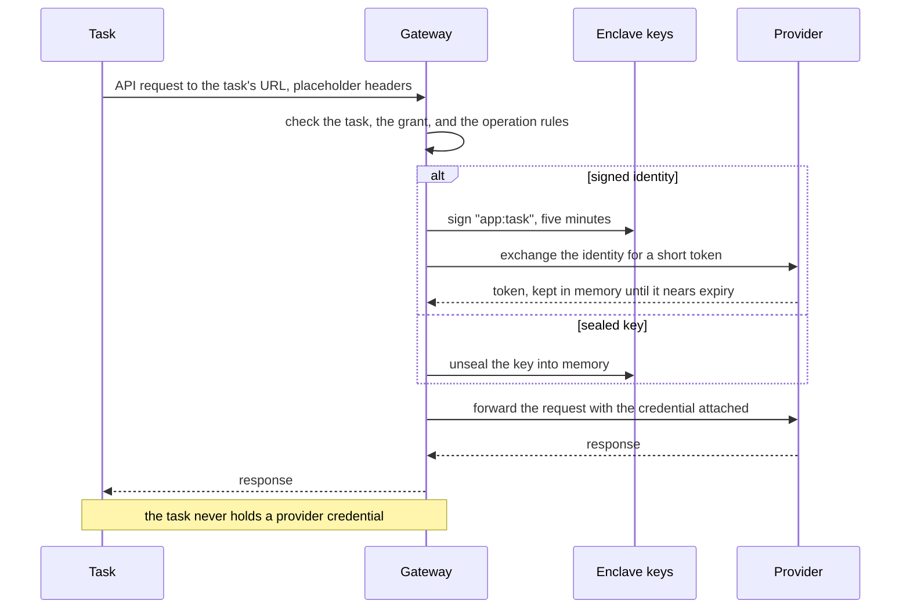

# Grants: design

Status: draft, 2026-11-11. Nothing described here has been built yet.

This document describes how grants works. The other documents cover the rest:

- [protocol.md](protocol.md) specifies the file format, the control socket,
  and the gateway's HTTP behaviour.
- [threat-model.md](threat-model.md) explains what the design protects and
  where it falls short.
- [use-cases.md](use-cases.md) works the design through three real
  applications.
- [plan.md](plan.md) says what to build first and how to tell it works.
- [checks.md](checks.md) lists the claims this design rests on, and how each
  one was checked.
- [later.md](later.md) keeps the parts of the earlier design that aren't
  planned yet.
- [prior-art.md](prior-art.md) records what other products and providers do.

## The problem

`com.kirahowe/secrets` stores an application's secrets in an age-encrypted EDN
file, one per environment, committed alongside the code. It handles config
well: secrets are data that the application loads, a committed manifest makes
every change reviewable, and no value ever passes through an environment
variable.

Its weakness is the key. A single age identity decrypts every value in a
store, and those values are long-lived. The identity is kept in the login
Keychain, in a file, or behind a password-manager command, and any process
running as the developer can read it. The `secrets` threat model acknowledges
this and puts that attacker out of scope (A6, B3).

A coding agent is code running as the developer. If an agent goes rogue, the
store is a single prize: the agent can fetch one key, read every value, and
keep using those values until someone rotates them.

Stronger encryption doesn't solve this, because the store still exists. The
fix is to leave nothing worth finding. Instead of storing a credential, grants
issues one when a task needs it, limits it to what that task does, and lets it
expire soon afterward.

## Principles

1. **Store as little as possible, and nothing valuable.** A federated grant
   stores nothing anywhere. The only secret allowed on a laptop is a key for a
   provider that offers nothing better, and that key has to be bounded: a
   test-mode key, a spend-capped key, or a read-only key. A key with none of
   those bounds needs a fingerprint every time a task that uses it starts.
2. **Issue each credential to one task.** Give it the narrowest scope that its
   provider can express, and a short lifetime.
3. **Let a task use a credential rather than hold it.** On a laptop a gateway
   attaches every credential to the request, and the task never holds one.
4. **Keep config as data.** A credential reaches the application through its
   config, the same way `#secret/req` works today. Environment variables are
   global mutable state, so don't carry secrets in them.
5. **Commit the description of access.** The description contains no values,
   so there's nothing to encrypt, and reviewing an ordinary diff is the access
   review.
6. **Run the same application code everywhere.** What differs between a
   laptop and production is who answers for a grant, and the application
   can't tell.
7. **Add as little as possible to deploy and CI.** Where a platform gives the
   workload an identity, the library uses it. Where it doesn't, the grant
   reads the platform's own secret store, and nothing else is added.
8. **Keep the concepts few.** A grant, a task, and an issuer are the whole
   model. When a problem can be solved by removing a concept or by adding a
   guard, remove the concept.
9. **Say what each check is worth.** If an attacker's position lets them skip
   a check, that check is bookkeeping, and the documents call it that.
10. **Sandbox agents by degrees.** Outside a sandbox, an agent is effectively
    the developer, and nothing on the laptop can tell the two apart. Grants
    still leaves that agent no stored secret to carry away, so trying it
    doesn't depend on a sandbox. A sandbox adds containment on top.

## Vocabulary

- **Grant**: a named description of one credential. It says which provider
  the credential is for and what it may be used for.
- **Task**: a named set of grants, such as `:dev` or `:agent`. A process runs
  as one task.
- **Provider**: the system that accepts the credential, such as Anthropic or
  Plaid.
- **Issuer**: the local daemon. It holds keys in the Secure Enclave, proves to
  providers which task is asking, and keeps the keys that a task must not
  hold.
- **Gateway**: the part of the issuer that tasks send their requests to. It
  attaches the credential and forwards the request.
- **Reference**: what `#grant` returns in place of a credential, in the
  Clojure sense of an identity whose value can change over time.
  [What a reference yields](#what-a-reference-yields) describes the value.
- **Seal**: to put a provider's key on the machine, encrypted to an enclave
  key and tied to the host it's for.
- **Slot**: one named secret that a sealed grant needs, such as `:secret`.
- **Bound**: the limit on what a sealed key can reach: `:test`, `:capped`,
  `:read-only`, or `:live` for a key with no limit.
- **Wrap**: to encrypt a piece of the application's own data with a key that
  never leaves the issuer.

## What gets committed

The repository commits a `grants.edn` file that declares every grant and
task. The file holds no values:

```clojure
;; grants.edn (committed, holds no values)
{:app "horizon"

 :grants
 {:llm/claude
  {:provider :anthropic}

  :plaid/sandbox
  {:provider :http
   :host     "sandbox.plaid.com"
   :bound    :test
   :attach   {"PLAID-CLIENT-ID" :client-id
              "PLAID-SECRET"    :secret}
   :allow    [[:post "/link/token/create"]
              [:post "/item/public_token/exchange"]
              [:post "/transactions/sync"]]}}

 :tasks
 {:dev   {:grants [:llm/claude :plaid/sandbox]}
  :agent {:grants [:llm/claude]}}

 :default-task :dev}
```

There are two kinds of grant in this file. `:llm/claude` names a provider that
accepts a signed identity, so nothing is stored for it anywhere.
`:plaid/sandbox` is for a provider that only has long-lived keys, so one key
is sealed on the machine, and the grant says where that key may go and what it
may be used for. [Where a grant's authority comes from](#where-a-grants-authority-comes-from)
covers both.

The file has no profiles or environments. A sandbox key and a production key
are two grants with two names, such as `:plaid/sandbox` and `:plaid/live`, and
each task lists the ones it may use. The application's own config decides
which grant a given environment refers to, with whatever mechanism it already
uses for that.

Asking for more access means changing this file, and that change shows up as
a diff that someone reviews.

The application's config refers to grants by name:

```clojure
;; config.edn
{:extraction {:model  "claude-sonnet-5-5"
              :client #grant :llm/claude}
 :plaid      {:client #grant :plaid/sandbox}}
```

`#secret/req` returns a string, but `#grant` returns a reference. The
application derefs it each time it builds a request. The library provides
`#grant` as a reader function for `clojure.edn` and as an Aero tag. Reading
the tag does no I/O, so loading a config never touches the issuer. The first
deref does.

### What a reference yields

For a grant to an HTTP API, the value is a map:

```clojure
@(:client (:plaid config))
;; => {:base-url "http://127.0.0.1:7465/t/gt1k3.../plaid.sandbox"
;;     :headers  {"PLAID-CLIENT-ID" "grants-placeholder"
;;                "PLAID-SECRET"    "grants-placeholder"}
;;     :host     "sandbox.plaid.com"
;;     :bound    :test}
```

The application sends its requests to `:base-url` and merges `:headers` into
each one. `:host` and `:bound` aren't secret. They let application code check
what it's talking to, such as a guard that refuses to run a sandbox-only
helper against a live grant.

The map is what lets one piece of application code run everywhere:

| Where the grant resolves          | `:base-url`              | `:headers`                           |
| --------------------------------- | ------------------------ | ------------------------------------ |
| Laptop                            | The gateway, on loopback | Placeholders                         |
| Production, federated             | The provider             | A short-lived credential             |
| Production, platform secret store | The provider             | The stored key                       |

On a laptop the headers hold placeholders, and the gateway replaces them. An
SDK that insists on an API key gets a value to pass, and the application
doesn't branch on where it's running. In production the value changes as
credentials are renewed, which is why the rule is to deref for each request
and not to keep the map.

A deref that can't produce a value throws an exception that says which grant
failed, why, and what to run to fix it.

A [wrap grant](#live-keys-and-application-data) yields a handle for `wrap`
and `unwrap`.

## Where a grant's authority comes from

**A signed identity.** The provider trusts the issuer's public key. The issuer
signs a statement that says which task is asking, and the provider exchanges
it for a credential that lasts minutes. Anthropic works this way, and nothing
is stored on any machine. OpenAI documents the same thing with more
conditions, and [checks.md](checks.md) lists what is and isn't confirmed.

**A sealed key.** The provider offers only long-lived keys. One key,
restricted as far as the provider allows, is sealed on the laptop. Only the
issuer uses it, and a task never receives it. [Sealed keys](#sealed-keys)
covers sealing, bounds, and binding.

A third source, a key minted on request by a remote service that holds the
minting root, isn't planned. [later.md](later.md) keeps that design.

Either way, the task's side looks the same. It sends a request to the gateway
with no credential, and the gateway attaches one:



## Tasks

A process becomes a task by asking the issuer. The library does this on the
first deref:

1. It finds `grants.edn` by walking up from the working directory.
2. It makes a random token, connects to the issuer's control socket, and
   sends the directory, the token, and a task name. The name comes from
   `-Dgrants.task` or the `GRANTS_TASK` variable, and otherwise the file's
   `:default-task`.
3. The issuer reads the file itself, checks that its owner has approved it,
   and replies with the task's URL at the gateway, which contains the token.

The connection stays open, and the task lasts exactly as long as it does.
When the process exits, the kernel closes the connection, the task ends, and
its URL stops working. Nothing else tracks a task's life.

`grants run <task> -- <command>` does the same on behalf of a command. It
declares the task, puts the task's URL in `GRANTS_TASK_URL` for the command,
and holds the connection until the command exits. A library that finds that
variable uses it and never opens the socket. This is also how a process
inside a sandbox gets its grants: the sandbox keeps the control socket out of
reach, and the launcher outside it holds the task.

A Clojure developer adds the dependency and jacks in from their editor as
usual. The daemon is a launchd agent with socket activation, so the first
connection starts it.

Three details follow from "a task is a held connection":

- The library keeps one connection per process, somewhere a code reload
  doesn't replace, so `(reset)` doesn't end the task.
- If the issuer restarts or is upgraded, every connection closes. Each holder
  notices, connects again, and declares the same task with the same token, so
  the task's URL doesn't change. A client that copied its base URL at startup
  keeps working, and so does a command that got its URL from the launcher.
- Any process running as the developer outside a sandbox can declare any task
  of any approved file. Task names keep honest code apart, and they keep a
  sandboxed agent to its own task, because it can't reach the socket. They
  don't stop an attacker who is already running as the developer. The threat
  model covers what that means.

## Approving the file

The issuer honours one version of an application's `grants.edn`: the one its
owner last approved. It reads the file from the directory the task named,
reduces it to a canonical form, and hashes that. Comments, whitespace, key
order, and the order of rules don't change the hash. If the hash is the
approved one, the task starts. If it isn't, the task is refused with a
message that says to run `grants approve`.

`grants approve` shows what the file would change, compared with the approved
version: grants added to or removed from each task, and any change to a host,
an attached header, an operation rule, a bound, an environment mapping, or a
list of hosts a task may reach. Approving makes this version the approved
one, and the earlier one stops being honoured. A file that goes back to an
older version asks again, like any other change.

Workspaces and branches that carry the same file never ask. A workspace whose
copy an agent edited is refused until the owner has looked. A directory that
claims an existing `:app` with a different file is shown as that, so a copied
file can't quietly take over another application's name.

What an approval is worth depends on the build
([Two builds](#two-builds)). In the unsigned build it's typed in a terminal
and recorded in a file. That holds against a sandboxed agent, which can edit
`grants.edn` but can't reach the issuer to approve its own edit. Against
unsandboxed code it's bookkeeping. In the signed build the approval happens
in the issuer's own window with a fingerprint.

## Sealed keys

### Describing an HTTP API

`:provider :http` describes any HTTP API by its host, the headers that carry
its key, and the operations a task may call:

```clojure
:llm/openrouter
{:provider :http
 :host     "openrouter.ai"
 :bound    :capped
 :attach   {"authorization" ["Bearer " :key]}
 :allow    [[:post "/api/v1/chat/completions"]
            [:get  "/api/v1/credits"]]}
```

In `:attach`, a keyword names a slot, and a vector joins strings and slots.
Every `:http` grant lists `:allow` rules, because they are the only control
over what the key is used for. The host is always reached over HTTPS on port
443, and the file has no way to say otherwise.

### Sealing

`grants seal :plaid/sandbox` says what it's about to seal for (the host, the
header, and the bound), then asks for each slot's value. The owner runs it
outside any agent session. The issuer encrypts each value to an enclave key
and stores the result. A new machine starts with none, and the owner seals
them again from the provider's dashboard.

A sealed value records what it was sealed for: the application, the grant,
the slot, the host, the header it goes in, and the bound. The gateway refuses
to use it if any of those differ from the approved file. An edit to `:host`
or `:attach` therefore can't move a key somewhere new. The owner has to seal
it again, which means getting the value from the provider's dashboard and
typing it in. `:allow` isn't part of the record, because widening what a key
may do is a change the approval covers.

A grant whose key isn't sealed yet doesn't stop its task. The task's other
grants work, and a deref of that one says what to run.

In the unsigned build the values are typed at a hidden terminal prompt. In
the signed build they're typed into the issuer's own window, because a
terminal may belong to an agent's harness.

### Bounds

A sealed key can be used by any task that lists its grant, so its worth
depends on what the key can do at the provider. Every sealed grant declares a
bound:

| `:bound`     | The key                                                     |
| ------------ | ----------------------------------------------------------- |
| `:test`      | Belongs to a sandbox or test mode, and touches no real data |
| `:capped`    | Carries a spend cap set at the provider                     |
| `:read-only` | Can read but can't change anything                          |
| `:live`      | Has none of these limits                                    |

The bound is required, so nobody seals a key without saying what limits it.
It's the owner's statement, recorded when the key is sealed, and the threat
model treats it as a statement. The first three behave the same way. A
`:live` key works differently, and
[Live keys and application data](#live-keys-and-application-data) covers it.

## The gateway

The gateway is the issuer's loopback HTTP listener. Each task gets a base URL
for each of its grants:

```
http://127.0.0.1:7465/t/<task-token>/plaid.sandbox
```

The grant `:plaid/sandbox` becomes the segment `plaid.sandbox`. The token is
in the URL because a base URL is the one setting nearly every SDK accepts,
and many accept no extra header.

For each request the gateway does the following:

- Finds the task from the token, and checks that the task lists the grant.
- Checks the method and path against the grant's `:allow` rules.
- Removes every credential header the client sent, then attaches the grant's
  own. For a federated grant it does the exchange itself and keeps the token
  in memory until it nears expiry.
- Forwards the request over TLS to the grant's host, and streams the response
  back.

An `:allow` rule is a method and a path, and `*` stands for exactly one path
segment. The gateway matches the path as the client sent it and never
normalizes it. A request whose path could be read two ways, with `..`
segments, encoded slashes, or doubled slashes, is refused. That keeps the
gateway and the provider from disagreeing about which operation was asked
for. [protocol.md](protocol.md) has the exact rules and
[vectors.md](vectors.md) the test cases.

The gateway never follows a redirect, never forwards cookies, and refuses
proxy and tunnel requests on its main port. Its own refusals carry a
`Grants-Error` header and a message that names the task and the grant, so an
application's error says what happened and a provider's errors can't be
mistaken for the gateway's. A refusal that retrying won't fix, such as a
provider that rejects the exchange because setup is wrong, is marked so that
SDKs don't retry it.

A task token is a bearer token on this machine. It works only at this gateway
and only while its task runs, so it's worthless anywhere else, but a copy in
a log file works for anything on the laptop that can reach the gateway's
port. [Agents](#agents) describes how a sandboxed session is kept from using
another task's token.

The first version has no request budgets. The limit on spending is one the
provider enforces, such as a spend limit on an Anthropic workspace.
Anthropic's documentation doesn't say that the limit covers credentials from
an exchange, and the first check in [plan.md](plan.md) finds out.
[later.md](later.md) keeps the budget design.

## The issuer

The issuer turns the laptop into an identity provider and holds the sealed
keys. It runs as a launchd agent in the user's session. launchd owns its
control socket and its loopback port, so no other process can take either
while the agent is registered. Unsandboxed code could change that
registration.

It is one binary: a Go core with no third-party modules, and a small Swift
library for the Secure Enclave. It keeps two enclave keys, one for signing
identities and one that sealed values are encrypted to. Neither can be
exported, and both are usable while the screen is locked, so a server's
scheduled work doesn't stop when the laptop locks. Their stored forms are
files in the issuer's own directory, never items in the login keychain.

### What an identity says

The issuer signs short-lived JWTs with ES256. A token carries these claims:

| Claim        | Value                                                            |
| ------------ | ---------------------------------------------------------------- |
| `iss`        | A URL that names this machine's issuer. Nothing fetches it       |
| `sub`        | `<app>:<task>`, such as `finance-aggregator:dev`                 |
| `aud`        | The provider the token is for                                    |
| `iat`, `exp` | Five minutes apart                                               |
| `jti`        | A fresh value for every token, so a provider can refuse a replay |

The header carries a `kid`, which is the thumbprint of the signing key.
A provider's rule matches on `sub`, usually by prefix. A rule for subjects
that start with `finance-aggregator:` covers that application's tasks and
nothing else on the machine, as far as honest code goes.

The `iss`, `sub`, and `kid` formats are fixed from the first version, because
every provider rule is written against them.

### Setup

Setup is where the goal of being "as easy as a `.env` file" is hardest to
meet. Each provider has to be told once to trust this machine's issuer, and
told what an application's tasks map to.

`grants init` is the one command for it. Run in a project, it does whatever
is still missing, in order, and says what each step is before it does it:

1. Installs the agent, if this machine doesn't have it.
2. Registers with each provider the file federates with.
3. Seals each key that isn't sealed.
4. Approves the file.

For Anthropic, the machine is registered once: an issuer entry that holds its
public key inline, a service account, and a workspace with a spend limit.
Every application on the machine shares those by default, and each one adds a
single rule that maps subjects starting with its name to the service account,
with the `workspace:inference` scope. An application that wants its own limit
gets its own workspace.

The issuer entry also caps how long an identity token may claim to last, at
ten minutes. Anthropic refuses a longer one, so a token signed today can't be
saved for use next week.

`grants init` runs the setup itself when Anthropic's `ant` CLI is installed
and logged in. Otherwise it prints what to enter in the Console and asks for
the ids that come back. Either way it needs an organization admin's login,
and the owner does this outside any agent session. The ids aren't secret, and
the issuer keeps them.

Two things about Anthropic's side shape the tooling:

- It refuses every failed exchange with the same message, and gives the
  reason only in the Console's history page. `grants doctor` tests each
  grant and points there when one fails.
- A public key registered inline is never refreshed. Adding a machine or
  replacing a key means an admin adding the new key by hand.

Whether setup can feel light is the main product risk.

### The commands

| Command | What it's for |
| --- | --- |
| `grants init` | Make this project work on this machine. Does whatever is missing |
| `grants approve` | Look at what a changed file would change, and approve it |
| `grants seal <grant>` | Seal one grant's key again |
| `grants doctor` | Say what works and what doesn't, with the fix for each |
| `grants log` | Show what the issuer did recently |
| `grants run <task> -- <command>` | Run a command as a task |
| `grants agent -- <harness>` | Run an agent harness in its sandbox, as a task |

On an ordinary day none of them is needed. The application declares its
default task when it first uses a grant.

### What it records

The issuer logs every task that starts or is refused, every exchange, and
every request the gateway turns away. The log is there to make the tool
debuggable. Code running as the developer can alter it, so the provider's own
record is the one to trust.

## Processes that aren't Clojure

Only a Clojure process can read `#grant`. A Node script, a Worker under
`wrangler dev`, and a shell tool all take their settings from the
environment, and they reach their grants through the launcher:

```clojure
;; grants.edn
:tasks
{:dev {:grants [:llm/claude]
       :env    {"ANTHROPIC_BASE_URL" :llm/claude}}}
```

`grants run dev -- bb dev` starts the command with each variable in `:env`
set to the gateway's base URL for the named grant. The variable holds a
loopback URL and a task token. Neither is a credential anywhere else, and no
key passes through the environment.

Two details come from how SDKs behave:

- Some SDKs expect a path in their base URL. A vector adds one:
  `{"OPENAI_BASE_URL" [:llm/openai "/v1"]}`.
- An SDK that is given a base URL and no key may go looking for a real
  credential on disk. For providers it knows, the launcher also sets the
  SDK's key variable to a placeholder, which wins over every other source.

A tool that needs a real credential in a variable or a file is a case the
first version doesn't cover. [later.md](later.md) keeps the notes on
credential helpers.

## Tests and machines with no issuer

A test run, a CI job, and a contributor's machine with no issuer all have to
load a config that contains `#grant`. Loading is never the problem, because
reading the tag does nothing. A test that derefs needs a value, and the test
config supplies one in place of the grant:

```clojure
;; test config
{:extraction {:client #grant/fake {:base-url "http://localhost:9999"
                                   :headers  {}}}}
```

`#grant/fake` returns a reference with a fixed value and never opens a socket
or a network connection.

With no fake, the library looks for a task URL from the launcher, then for
the local issuer. If it finds neither, the deref fails with an error that
names the grant. It never falls back to a fake, because a test that silently
ran against nothing would pass for the wrong reason. A test that needs the
real thing, such as one that calls a provider's sandbox, can ask the library
whether an issuer is there and skip when it isn't.

## Agents

An agent task doesn't need a sandbox. Each level closes more of the routes
around its grants:

| Level                 | What it encloses                                        | What it adds                                                                                                            |
| --------------------- | ------------------------------------------------------- | ----------------------------------------------------------------------------------------------------------------------- |
| No sandbox            | Nothing                                                 | Nothing. The agent is effectively the developer                                                                         |
| Command sandbox       | The agent's shell commands and the processes they start | Those commands can't read the listed files, reach the control socket or another task's ports, or reach a host the task doesn't list |
| Whole-harness sandbox | Everything the harness runs                             | The same limits on the harness's own tools, MCP servers, and hooks                                                      |

`grants agent -- claude` starts the harness as the `:agent` task with its
command sandbox turned on, using settings it generates:

- The issuer opens a loopback port for this session alone, and the settings
  make that port the sandbox's proxy. Sandboxed commands can connect to it
  and to nothing else on the machine or the network. The port serves only
  this session's task, so a token that another task left in a log file is
  useless inside the sandbox.
- Reads are denied for a list of credential files and for the issuer's own
  directory.
- The control socket and every other Unix socket stay closed.
- The harness's option to run a command outside the sandbox is turned off,
  and settings from the repository are not loaded.

Because the session's port is the sandbox's proxy, every other outbound
request arrives there too, and the gateway refuses it. A task can list hosts
it needs, such as a package registry, and the gateway then tunnels to those
hosts only:

```clojure
:agent {:grants [:llm/claude]
        :egress ["repo.clojars.org" "repo1.maven.org"]}
```

The list is part of the committed file, so widening it is reviewed and
approved like any other access. The default is no hosts. A listed host is a
way out for any data the session can read, and on a shared host it's a way
out to anyone's account there.

This was tested with Claude Code, and [checks.md](checks.md) has the results.
Codex's sandbox works differently and hasn't been taken this far, so the
first version supports Claude Code only. The tests also showed what a command
sandbox leaves open, and the threat model lists it. The two that matter most:

- The login Keychain is reachable from inside the sandbox. No setting closes
  it, so a login that a tool keeps there is exposed to a sandboxed command.
- The repository's own hooks and MCP servers run outside the sandbox unless
  the harness is told not to load the repository's settings.

Anything the owner lets a session run outside its sandbox is a hole as big as
whatever the agent can steer. A command that pushes to a remote obeys the
repository's config, which the agent can write.

The agent's own model calls stay on the harness's own login. A grant in the
`:agent` task covers the code the agent runs, such as an application's tests,
and nothing changes about how the harness is billed.

The sandbox is someone else's software, and turning it on changes how an
agent session works. [use-cases.md](use-cases.md) lists what that means on
the owner's machine, and one part of it is still an open question below.

## Live keys and application data

Some applications have no production other than the laptop. A personal
finance application that runs at home needs the live key for its bank data on
the same machine where its developer writes code. Refusing that key wouldn't
remove it from the laptop. It would stay where it is now, in an encrypted
store whose key any process can read.

This section describes what the signed build adds. In the unsigned build a
task that lists a grant with `:bound :live` can't start.

### One rule

A grant with `:bound :live` is sealed to a third enclave key, one that needs
a fingerprint for every use. **A task that lists a live grant takes one
fingerprint to start.** The issuer asks in its own window, which names the
application, the task, the directory, and the program that asked. The live
values are unsealed for that one run of the task, held in the issuer's
memory, and wiped when the task ends.

A long-running server asks once when it starts, and its scheduled work runs
unattended after that. Restarting it asks again. An application has at most
one live task at a time, so a second attempt to start one is refused and
never raises a prompt.

Sealing a live key is itself done in the issuer's window with a fingerprint.
That act is what puts a live key on a machine, and nothing in the repository
can do it.

### Where live runs

A fingerprint at the start says nothing about code that changes afterwards. A
sandboxed agent edits code in the project, and if the owner's live task runs
from that same working copy, it runs what the agent wrote. No sandbox can
close that, because writing code is the agent's job.

So a live key is sealed for one directory, and the issuer starts a live task
only from there. That does two things. It keeps the owner from starting live
out of an agent's workspace by mistake. And it tells `grants agent` which
directory to protect: a session is never given write access to it, or to a
version-control store inside it.

This is not a boundary against unsandboxed code, which can name any directory
it likes. And against a sandboxed agent it holds only as far as the agent
can't change what that directory holds or loads: its files, its
version-control store, and the dependency caches its JVM reads. A separate
clone, with its own store and caches, is the arrangement that satisfies all
three. [use-cases.md](use-cases.md) works through the choice for
finance-aggregator.

### Application data

Some secrets don't come from a provider's dashboard. An application that
links a bank account receives an access token for that account, and it has to
keep the token for years. Applications usually encrypt such tokens with a key
from their secret store, which puts the key back on disk beside the data.

A wrap grant gives the application encryption without the key:

```clojure
;; grants.edn
:connections/live {:provider :wrap :bound :live}
```

```clojure
(grants/wrap   tokens "access-prod-1234")  ;; => "gw1:k7:..."
(grants/unwrap tokens blob)                ;; => "access-prod-1234"
```

The issuer creates a wrapping key the first time the grant is used, and seals
it the way it seals any other value. `wrap` and `unwrap` run inside the
issuer, and the key never reaches the task. A wrap grant with `:bound :live`
follows the one rule above: its key opens with the fingerprint that starts
the task. Wrap grants arrive with the signed build.

Wrapping protects the stored copies: the database file, its backups, and
anything that syncs them. It doesn't protect against the running task, which
can unwrap whatever it's allowed to. A task that doesn't list the grant can't
open a copy of the database, which is what an honest task for exercising the
application against copied data relies on.

An enclave key can't be exported, so wrapped data doesn't survive the loss of
the machine. The default answer is to acquire the data again, since a bank
can be linked again. [later.md](later.md) keeps the design for a recovery
key.

## Two builds

The Secure Enclave ties a key to the device and not to the program that made
it. Any process that can read a key's stored form can use the key. This was
tested, and it changes what the issuer can promise.

What ties a key to one program on macOS is the keychain's access group, and
that takes a bundle signed with an Apple Developer ID, a provisioning
profile, and notarization. So there are two builds:

| Protection                                               | Unsigned build | Signed build |
| -------------------------------------------------------- | -------------- | ------------ |
| Keys can't leave the machine                             | Yes            | Yes          |
| A copy of the disk holds nothing usable elsewhere        | Yes            | Yes          |
| A command in Claude Code's sandbox can't use the issuer's keys or records | Yes, because the generated settings deny the issuer's directory | Yes, and the OS enforces it without the sandbox |
| Unsandboxed code can't use the issuer's keys directly    | No             | Yes          |
| Approvals and other records can't be forged              | No, they're files | Yes, they're keychain items only the issuer can write |
| A fingerprint is needed for a live key                   | Not offered    | Yes          |
| Other processes can't read the issuer's memory           | Injection is blocked. Replacing the binary isn't | Yes |

The unsigned build is where the project starts. It removes long-lived keys
for every provider that federates, keeps sealed keys useless off the machine,
and contains a sandboxed agent. Against unsandboxed code running as the
developer it promises less. Such code can use the keys while it runs, but it
can't take one off the machine, a federated credential dies in minutes, and a
signed identity is only good for the few minutes the provider's own rule
allows.

The signed build is what makes a fingerprint mean something against that same
code, and it's what live keys wait for. It costs an Apple Developer Program
membership. Someone who builds the signed bundle from source with their own
membership gets the same protections for their own keys.

## Production

The same `grants.edn` describes production. What changes is who answers for a
grant, and the application chooses that explicitly when it reads its config,
never by detection:

- Where the platform gives a workload an identity, the library exchanges it
  for a credential and renews it. Fly.io does this, and its identity is in a
  form Anthropic accepts.
- Where it doesn't, or the provider has only keys, the grant reads the
  platform's own secret store.

No application is deployed with grants yet, so this part is designed only as
far as [later.md](later.md) records. The reference's map is the contract that
keeps it open: production code that returns a different `:base-url` and real
`:headers` fits it unchanged. Production is also where a second reader of
`grants.edn` first appears, since there is no daemon there to read it.

## Decisions

All of these were made on 2026-11-11. Most came out of a review that tested
the design's claims on the owner's machine, read it against the real
applications, and then had the result read again by fresh reviewers.
[checks.md](checks.md) has the evidence.

**Language and shape.** `grants` is a Clojure library backed by a native
daemon. The daemon is a Go binary with no third-party modules, plus a small
Swift library, linked into the same binary, for everything Apple-specific. Go
is chosen for its standard library: it covers the gateway, JWT signing, and
strict JSON, so the security-critical code has no dependencies to audit. The
enclave code goes through CryptoKit in Swift because CryptoKit's stored key
format is documented. Reaching the enclave from Go through Objective-C works,
but restoring a key that way depends on an undocumented attribute. A Swift
application as the whole daemon was turned down because Swift has no HTTP
server in its standard library. A separate helper process for the enclave was
turned down because the link between the two would become a boundary of its
own.

**No profiles.** A sandbox key and a live key are two named grants. The
earlier design had a `#profile` tag in the file and a profile on each task.
The first real application showed two profile systems that had to agree, the
application's and the file's, with nothing checking that they did. The
application's config already chooses per environment, so the file doesn't
need to.

**Every grant on a laptop goes through the gateway.** The earlier design let
an application task hold a short-lived credential and renew it. Sending
everything through the gateway means the task holds nothing, the library has
no renewal logic, a sandboxed process uses the same path as any other, and
operation rules apply to every grant. The cost is a proxy in the request path
of every call. Holding a credential comes back if a protocol other than HTTP
needs it.

**A task is a held connection, and the client makes its token.** A process
declares its task on the control socket and the task ends when the connection
closes. This replaces matching a peer process to a launch, and it's the same
for a command the launcher started and a process that declares itself.
Because the client chose the token, it can declare the same task again after
the issuer restarts, and nothing that holds the task's URL has to change.

**One approved version of the file.** Approving by directory or by file bytes
would ask again for every workspace and every comment edit. Keeping every
version ever approved would let an old, wider file come back unasked. One
approved hash of the canonical form asks exactly when access changes.

**A grant that isn't ready doesn't stop its task.** A missing key on a new
machine used to fail the whole task, which took away grants that had nothing
to do with it. Each grant reports its own state, with the command that fixes
it.

**A sealed key is bound to its host and header.** The approval prompt was the
only check on a change to `:host`, and people approve prompts they expect.
Recording the destination when the key is sealed takes that decision away
from the prompt.

**Live is a bound, and it means a fingerprint at task start.** The earlier
design asked for the fingerprint when a live key was first used, and left
wrapped live data open with no fingerprint at all. One prompt at the start
covers everything live that the task lists, and it comes at a moment the
owner chose. A separate opt-in command was dropped, because sealing a live
key in the issuer's window already is one.

**The bound stays required.** A flag that marks only live keys would be one
key fewer to write, but forgetting it would be the unsafe direction.

**A fingerprint isn't a claim in the token.** A provider rule can't see which
key signed a token, so a claim is only as strong as the ordinary signing key.
If a provider ever needs to require a fingerprint, the fingerprint key is
registered as a separate issuer.

**Two builds.** The first version is unsigned and says plainly what that
means. Signing comes with live keys.

**One command for setup, and shared provider setup by default.** Setup is the
main product risk, so `grants init` does every missing step, and a new
application adds one rule at Anthropic and nothing more.

**Launching stays out of the file.** A task lists access. The command to run
is given to `grants run`, where commands already live, and the agent launcher
is its own command and not a task name with a special meaning.

**The agent's own model calls stay on its own login.** Moving the harness to
a federated grant works mechanically, but it changes billing and turns off
features tied to the harness's login.

**The gateway is the sandbox's proxy.** The sandbox blocks direct connections
to loopback and lets JVM clients through only with a setting that opens every
local port. It has to let commands reach its proxy, though, and a session
port that is the proxy needs nothing else opened.

**One reader of the file.** On a laptop only the daemon reads `grants.edn`,
so only the daemon needs the strict reader. A second one waits for
production.

**A reference yields a map.** For an HTTP API the value is a base URL and a
map of headers. A string stops being enough when a provider needs two
headers.

**`#grant` does nothing when read.** Applications load config in tests, in
reloads, and in tools that must not touch the issuer.

**No remote minter, browser callers, or cloud agents for now.** One use case
wanted them, and it can keep its personal access token.
[later.md](later.md) keeps the designs.

## Open questions

1. **The name.** `grants` is a working title. Check that it's free on Clojars
   and as a Go module path.
2. **How a sandboxed agent runs a server.** An agent that starts a dev server
   or an end-to-end test has to listen on a local port, and the one sandbox
   setting that allows it lets its commands connect to every local port,
   including another task's REPL. Running the server outside the sandbox
   isn't an answer, because the server is code the agent wrote. This has to
   be settled before agent sessions are built.
3. **A live task that restarts unattended.** A server that comes back after a
   reboot or a crash waits for a fingerprint, and its scheduled work doesn't
   run until someone gives one. Is that the right default for a server at
   home?
4. **Which operations Anthropic's inference scope covers.** The scope's
   documentation lists Messages, token counting, and Models, and doesn't
   mention Message Batches. finance-aggregator's evaluations use batches. If
   the scope excludes them, those runs need a rule with a wider scope or a
   capped key behind the gateway.
5. **Opening wrapped values at the gateway.** A task that unwraps a bank
   token holds it for as long as a request takes. For a credential that
   travels in a header, the gateway could unwrap it on the way out and the
   task would never hold it. SimpleFIN's access URLs are the case that would
   gain most. Is that worth building?
6. **How approval reaches the owner in the signed build.** A window opened by
   a background agent isn't guaranteed to come to the front. A menu-bar item
   or a notification that the owner clicks is the likely answer.
7. **More than one machine.** Each laptop registers its own key with every
   provider. Is there a lighter way to add a machine than repeating setup?
