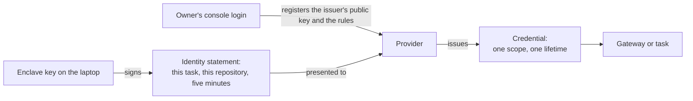
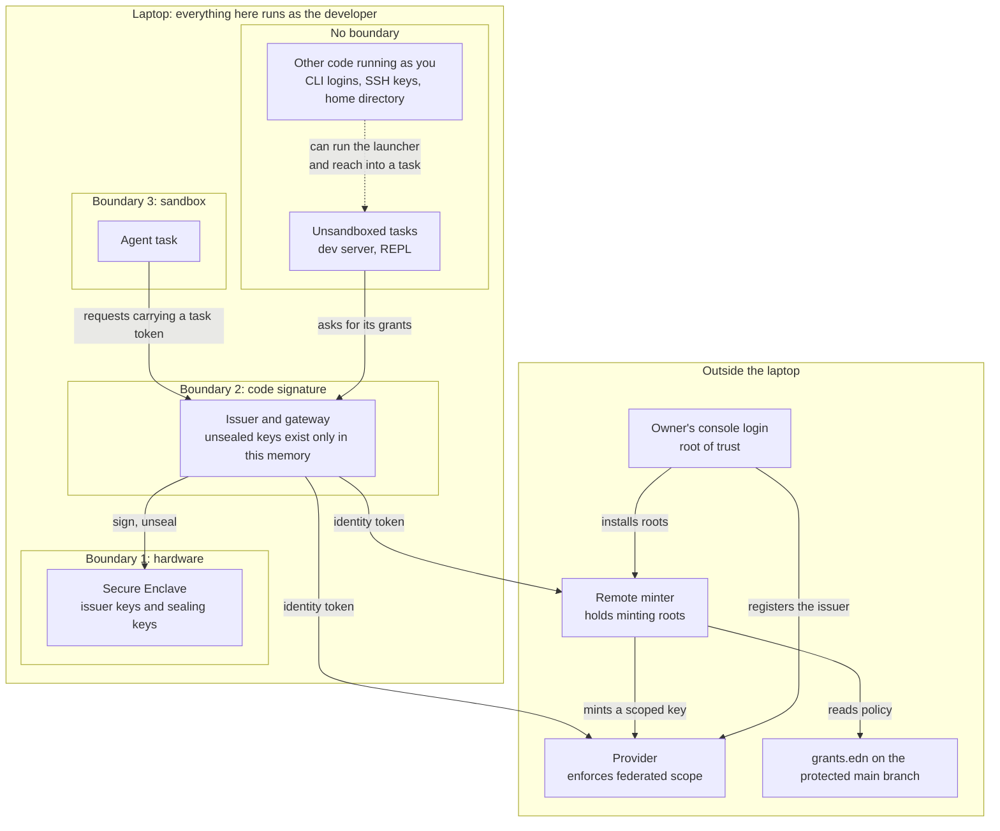
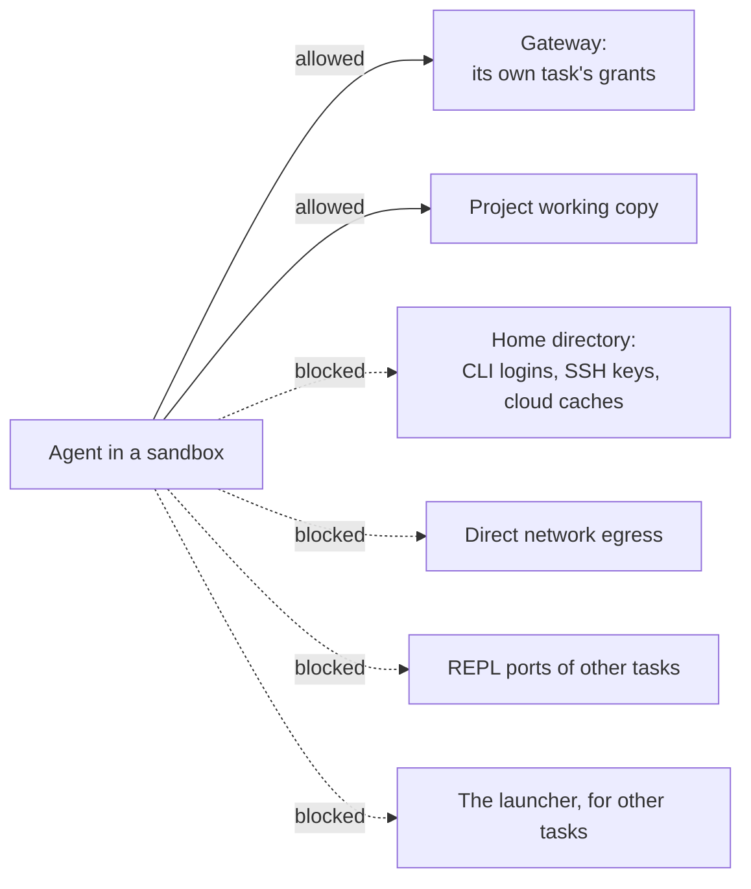
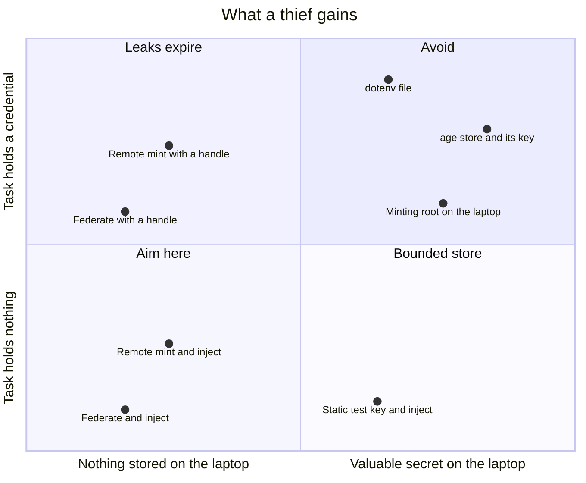
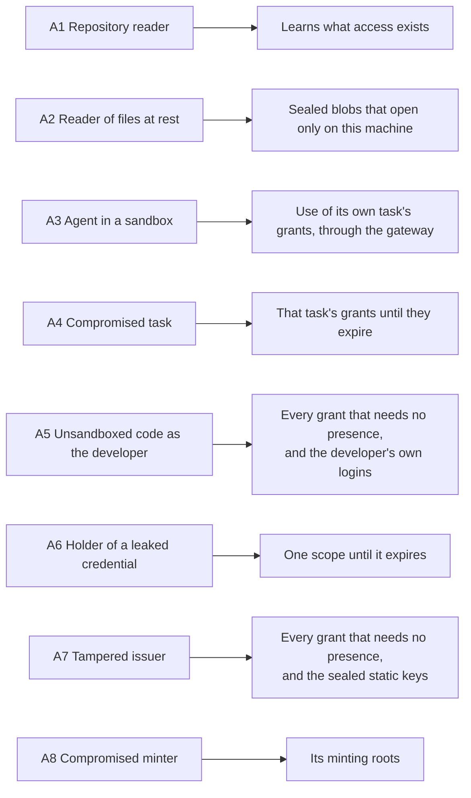

# Threat model

Status: draft, 2026-11-10. Nothing is built, so every protection here is a
design intention. [Design](design.md) describes the mechanism. This document
says what the design protects, where its boundaries are, and what it leaves
exposed.

## What is worth stealing

| Asset | Where it lives | What protects it |
| --- | --- | --- |
| The owner's console login at each provider | With the owner: a passkey or hardware key | Nothing in this tool. It is the root of trust |
| Minting roots, such as a GitHub App key or an admin API key | The remote minter | They never reach a laptop |
| Issuer signing keys | The Secure Enclave | Hardware. They cannot be exported |
| Sealed static keys | The laptop's disk, encrypted to an enclave key | Only the signed issuer can have the enclave open them. They are test-mode keys by default |
| Issued credentials | The memory of the gateway or of the task | Narrow scope and a short life |
| Identity tokens | In flight between the issuer and a provider | Minutes long, bound to one audience, and single use where the provider checks |
| Policy: `grants.edn` and each provider's trust rules | The repository and the provider | Review on a protected branch, and the owner's login |
| The developer's own logins: CLI tokens, SSH keys, browser sessions | The home directory and the keychain | Nothing in this tool. The sandbox keeps agents away from them |

## The root of trust

Every chain of authority ends at a person logging in to a provider's console.
That login registers the issuer's public key, creates the rules that say what
each task may have, and installs any minting root. The design's job is to make
sure nothing on the laptop can act as that login.

Three things follow.

- The owner runs setup, outside any agent session. `grants init` generates the
  provider-side configuration, and applying it takes the owner's login.
- A lost laptop loses no secret. The owner removes its issuer at each provider
  and registers the new one.
- A stolen console login is out of scope. Protect it with a passkey or a
  hardware key, and keep its session out of reach of agents.

## Trust boundaries

The laptop has three boundaries and one zone with none.

Hardware. Enclave keys can be used and never read. Code that takes over the
developer's account can ask for a signature. It cannot copy the key to another
machine.

Code signature. The enclave lets only the binary that created a key use it,
and the issuer and gateway run as one signed binary that other processes of
the same user cannot attach to. Both statements are on the list of claims to
check. Unsealed static keys and injected credentials exist only in that
binary's memory.

Sandbox. An agent in a sandbox reaches the gateway and its own working copy.
The sandbox is someone else's software, and this design depends on it.

No boundary. Everything else that runs as the developer shares one zone: dev
servers, REPLs, editors, unsandboxed agents, and command-line tools with their
stored logins. Code in this zone can start a task through the launcher and can
reach into a running one. The issuer records which task asked for a grant, and
in this zone that record is bookkeeping. It does not keep tasks apart.

## What the sandbox has to close

Each blocked route is a way around the grants:

- The home directory holds the developer's own logins. `gh`, `~/.aws`,
  `wrangler`, and SSH keys are a larger prize than the application's
  credentials, and an agent that can read them has no need to ask for a grant.
- Direct egress lets a credential or data leave without passing the gateway.
- A REPL port is code execution inside another task. Whoever can evaluate code
  in a process has that task's grants.
- The launcher starts tasks. An agent that can run it has every grant that
  needs no presence.

The claims this document makes about agents hold only inside such a sandbox.

## What a thief gains

Two choices decide it. The source of a grant decides what is stored and where.
The delivery decides whether the task ever holds a credential.

| Source | Delivered as a handle | Delivered by injection |
| --- | --- | --- |
| Federate | Nothing is stored. The task's token can leak until it expires | Nothing is stored and the task has nothing to leak |
| Mint, root in the remote minter | Nothing is on the laptop. The key can leak until it is revoked | Nothing is on the laptop and the task has nothing to leak |
| Mint, root on the laptop | Not allowed | Not allowed |
| Static key | Not allowed. This is a `.env` file | One bounded key on the laptop, and the task has nothing to leak |

A minting root can create other credentials, so it is worth more than any key
it replaces. Compared with a minting root on the laptop, an injected static
test key stores something less valuable and gives a compromised task nothing
to carry away. So a minting root never lives on a laptop.

## Who enforces scope

The enforcer differs by source, and so does what it takes to widen a grant.

| Source | Who enforces the scope | What widening takes |
| --- | --- | --- |
| Federate | The provider, with rules created at setup | The owner's console login |
| Mint | The remote minter, reading `grants.edn` from the protected main branch | A merged pull request |
| Static | The local gateway, reading the pinned `grants.edn` | The developer's approval in the issuer's own window, with Touch ID |

The third row is the weakest, which is one more reason static keys are
test-mode keys by default.

## Threats in scope

### A1. A reader of the repository

They see `grants.edn` and learn what access exists. They gain none of it. The
file's contents are public metadata, as the manifest's key paths are in
`secrets`.

### A2. A reader of the developer's files at rest

Backups, synced dotfiles, and disk images copy files without anyone deciding
to share them. The copies contain no credential and no exportable key. A
sealed static key opens only inside the enclave of the machine that sealed it.

### A3. An agent in a sandbox

The agent may be misbehaving or steered by injected instructions. It can use
its own task's grants through the gateway while the task lives. Under
injection it holds no provider credential, so it has nothing to carry out.

It can still misuse its grants inside their scope. Operation rules and budgets
at the gateway narrow that, and they are the only control this design has over
what a grant is used for.

### A4. A compromised task

The attacker is a malicious dependency in the application, or anyone who can
evaluate code in its process. A Clojure dev server with an nREPL port on
localhost is open to every local process, so "the task" includes whoever can
reach that port.

The attacker has the task's grants. Under handle delivery they also hold
credentials that work from anywhere until they expire. This is the designed
blast radius, and it replaces "the whole store, until somebody rotates."

### A5. Unsandboxed code running as the developer

It cannot export an issuer key, open a sealed static key, pass a presence
check, or widen the pinned policy. It can run the launcher, so it can use
every grant that needs no presence. It can also read the developer's own
logins. This position is the reason agents belong in a sandbox.

### A6. The holder of a leaked credential

They have one scope until it expires. A minted key can be revoked sooner.
Some providers can bind a credential to a source address, and AWS is one.

### A7. A tampered issuer

A malicious update or a compromised dependency of the issuer can sign an
identity for any task and open the sealed static keys. It cannot use the
presence key without a fingerprint, and it holds no minting root. The defence
is ordinary: a small codebase with few dependencies, signed releases, and
updates the developer chooses to install.

### A8. A compromised minter

The minter holds minting roots, so its attacker can mint whatever those roots
allow. It is the most valuable target in the design. It sits off the laptop,
where no agent runs, and a dev-only provider account should bound each root.

## Out of scope

### B1. Root on the laptop, or a compromised kernel

The code-signature and sandbox boundaries do not survive it. The enclave keys
still cannot be exported.

### B2. A stolen console login

Whoever holds it can register their own issuer and rules. It is the root of
trust.

### B3. A provider that issues more than the grant describes

The provider enforces federated scope. This design cannot check that it does.

### B4. A sandbox that leaks

The sandbox is a dependency. Its escapes are its maintainers' to fix.

## Known gaps

1. Misuse inside scope. Short lives and narrow scopes limit what a task can
   touch and for how long. They say nothing about intent. An agent with
   legitimate write access to a repository can push bad code.
2. No wall between unsandboxed tasks. On a bare laptop the task name on a
   request is bookkeeping (A5).
3. Portable credentials under handle delivery. A leaked token works from
   anywhere until it expires (A6). Injection avoids this and costs a proxy in
   the request path.
4. Coarse provider scopes. Anthropic's narrowest scope is all inference in a
   workspace. Anything finer has to come from the gateway.
5. Presence wears out. People approve prompts they expect to see. Presence
   should stay rare, and the issuer has to show what is being approved in its
   own window, because the system prompt cannot show a diff and an agent may
   control the terminal.
6. The developer's own logins are unmanaged. The sandbox keeps agents away
   from them and the tool does nothing else about them. Bringing those tools
   under the issuer, through credential helpers and SSH certificates, is
   future work.
7. The local log can be altered by code running as the developer. The
   provider's own record of each exchange is the one to trust.
8. Recovery and scale. A new laptop means registering a new issuer with every
   provider. A team with many laptops registers many issuers. A shared team
   issuer would fix that and is not designed.
9. Production static keys have no place on a laptop in this design. An
   application whose production still depends on one keeps it in the
   production platform's own store.

## How to decide what to change

1. Name the attacker's position and the asset.
2. Find the boundary between them: hardware, code signature, sandbox, or a
   system off the laptop.
3. If no boundary stands there, write the gap down. A check that the
   attacker's position lets them skip is bookkeeping, and this document should
   call it that.
