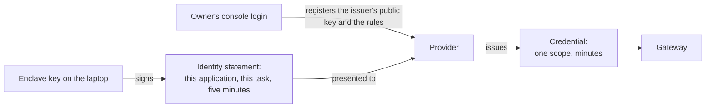
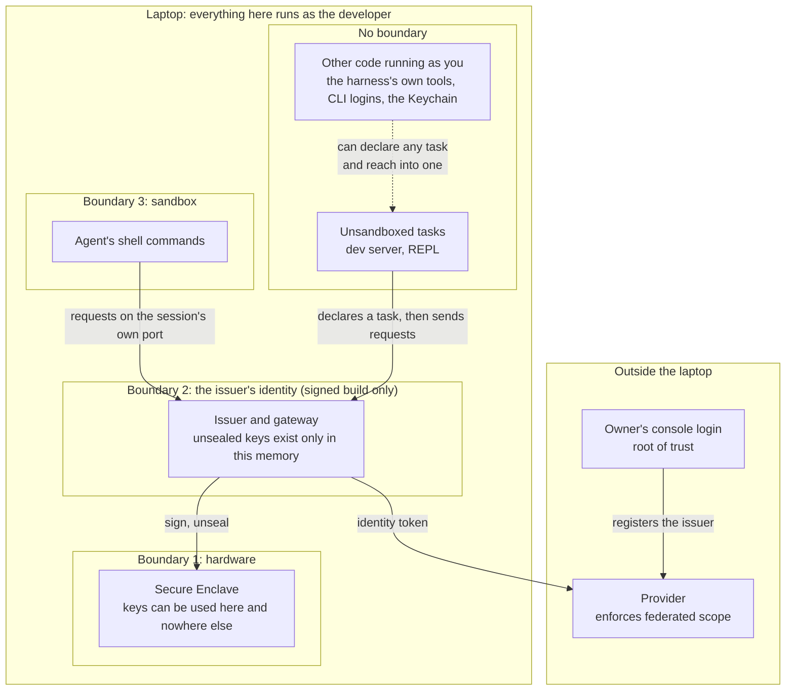
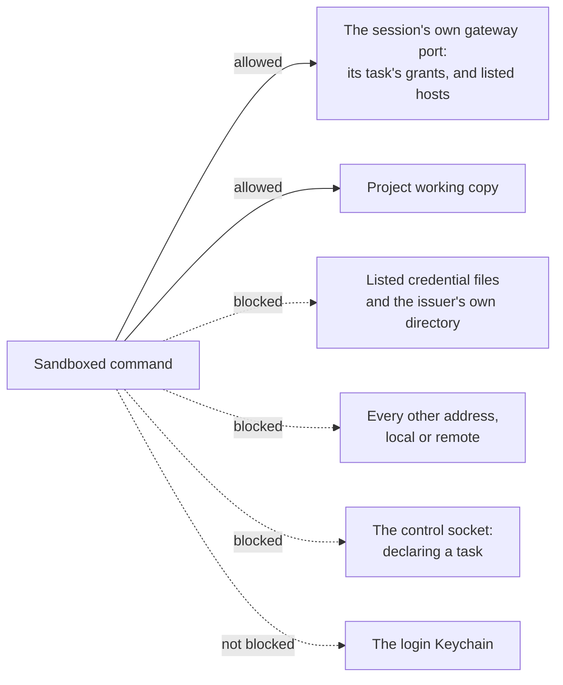
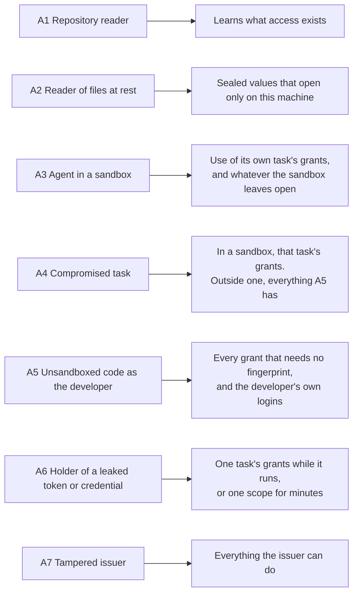

# Threat model

Status: draft, 2026-11-11. Nothing has been built yet, so every protection
described here is a design intention. The [design](design.md) describes the
mechanism. This document covers what the design protects, where its
boundaries are, and what it leaves exposed.

Several statements here were tested on the owner's machine on 2026-11-11, and
several earlier ones turned out to be wrong. [checks.md](checks.md) has the
evidence.

## What is worth stealing

| Asset | Where it lives | What protects it |
| --- | --- | --- |
| The owner's console login at each provider | With the owner: a passkey or hardware key | Nothing in this tool. It's the root of trust |
| Issuer signing key | The Secure Enclave | Hardware. It can't be exported. Who may use it depends on the build |
| Sealed keys with a bound | The laptop's disk, encrypted to an enclave key | They open only on this machine. In the signed build, only the issuer can open them. Each carries a bound at its provider: test mode, a spend cap, or read-only |
| Sealed live keys (signed build only) | The laptop's disk, encrypted to an enclave key that needs a fingerprint | The same, plus a fingerprint each time a task that uses one starts |
| Wrapping keys for application data (signed build only) | The laptop's disk, sealed like any other value | The same as a sealed key with the same bound. A task gets `wrap` and `unwrap`, never the key |
| Wrapped application data, such as bank tokens | The application's database and its backups | Copies open only through the issuer on the machine that wrapped them. On that machine, any task that lists the grant opens all of it |
| Credentials from an exchange | The issuer's memory | They last minutes and have one scope. No task holds one |
| Identity tokens | In flight between the issuer and a provider | They last five minutes, are bound to one audience, and can be exchanged once |
| A task's token | The task's memory and environment, and wherever its URL gets logged | It works only at this machine's gateway, only while the task runs |
| Policy | `grants.edn`, and each provider's rules | On a laptop, the issuer's record of the approved file. At a provider, the owner's console login |
| The developer's own logins: CLI tokens, SSH keys, browser sessions, the harness's login | The home directory and the login Keychain | Nothing in this tool. A sandbox keeps agents away from the files it denies, and it doesn't close the Keychain |

## The root of trust

Every chain of authority ends with a person logging in to a provider's
console. That login registers the issuer's public key and creates the rules
that say what each application's tasks may have. The design's job is to make
sure that nothing on the laptop can act as that login.

This has three consequences:

- The owner runs setup outside any agent session. `grants init` says what to
  configure, and applying it requires the owner's login.
- Losing a laptop exposes no secret. The owner removes the old laptop's key
  at each provider and registers the new one. A key registered inline is
  never refreshed, so both steps are done by hand with that same login.
- A stolen console login is out of scope. Protect the login with a passkey
  or a hardware key, and keep its session out of reach of agents.

## Trust boundaries

**Hardware.** An enclave key can be used but never read. Code that takes over
the developer's account can't copy a key to another machine, and a copy of
the disk holds nothing that works elsewhere. This holds in both builds.

The enclave ties a key to the device and not to a program. Any process that
can read a key's stored form can ask the enclave to use it. This was tested:
a second, differently signed program signed and unsealed with a key the first
had made.

**The issuer's identity.** In the signed build, the issuer's keys and records
are keychain items in an access group that only a bundle signed by the same
developer can claim, and the hardened runtime keeps other processes out of
its memory. Other code running as the developer then has to go through the
issuer and can't go around it.

The unsigned build has no such boundary. There, code in the no-boundary zone
can use the signing key and the sealed keys directly, rewrite the issuer's
records, and replace the issuer itself. In that build this boundary doesn't
exist, and the document says so wherever it matters.

**Sandbox.** A sandbox is someone else's software, and how much of an agent
it encloses depends on its level. The command sandbox that Claude Code and
Codex each ship encloses the agent's shell commands. The harness itself
stays in the zone with no boundary, along with its file tools, web fetches,
MCP servers, and hooks.

**No boundary.** Everything else that runs as the developer shares one zone:
dev servers, REPLs, editors, unsandboxed agents, and command-line tools with
their stored logins. Code in this zone can declare any task of any approved
file, and it can reach into a running task. The issuer records which task
asked for what, but in this zone that record is only bookkeeping. It doesn't
keep tasks apart.

## What the sandbox has to close

Each blocked route is a way around the grants:

- The home directory holds the developer's own logins, which are a bigger
  prize than the application's credentials.
- Any other network address lets data leave without going through the
  gateway, and any other local port may be a REPL, which gives code
  execution inside another task.
- The control socket is how a process becomes a task. A command that could
  reach it would have every grant that needs no fingerprint.

### Sandbox levels

A sandbox is optional. How many of the routes are closed, and for how much of
the agent, depends on its level.

| Level | What it encloses | What stays open |
| --- | --- | --- |
| No sandbox | Nothing | Every route. The agent is in position A5 |
| Command sandbox, where `grants agent` starts | The agent's shell commands and the processes they start | The Keychain. Credential files missing from the deny list. Hosts the task lists under `:egress`. Everything the harness does outside a shell command |
| Command sandbox with the home directory denied | The same | The Keychain. Everything the harness does outside a shell command, and the paths re-allowed for the toolchain |
| Whole-harness sandbox | Everything the harness runs | Only what its settings allow |

The first version supports Claude Code's sandbox only. Codex's proxy can't
open one local port without the others, so it needs a different arrangement
that hasn't been tested end to end.

What was tested with Claude Code's command sandbox:

- A denied path can't be read by a sandboxed command or by a program it
  starts. A read rule for the harness's file tool also becomes an
  operating-system denial for shell commands, so one list covers both.
- Settings from the repository can't loosen the sandbox once the launcher
  passes the setting that forbids unsandboxed commands.
- The repository can still run code outside the sandbox. Its session-start
  and tool hooks ran unsandboxed under those same settings, and it could
  allow its own MCP server. Telling the harness not to load the repository's
  settings stopped both.
- With a port set as the sandbox's proxy, a sandboxed command could connect
  to that port and to no other local port. This held for `curl`, `nc`, and a
  JVM.
- A sandboxed `security` command read an item from the login Keychain. No
  setting denies it.

That last result matters most. A tool that keeps its login in the Keychain
exposes it to a sandboxed command, and a deny list of files can't name it.
`gh` keeps its token there on this machine. Claude Code reads its own login
from there with the same command a sandboxed process could run, which
suggests the harness's own login is reachable from inside its own sandbox.
That last step wasn't tested.

Denying the whole home directory is an optional tightening. It breaks
ordinary tooling until each toolchain's config files and caches are
re-allowed, and each re-allowed cache that the agent can write is a route
into whatever task loads from it next. The design's answer is to give an
agent its own copy of each cache and never write access to the shared one.

The claims this document makes about agents hold only for the part of an
agent that its sandbox encloses, and only for the routes that the sandbox's
level closes.

## What a thief gains

On a laptop no task holds a provider credential, so what a thief gains
depends on which kind of grant it is and where the thief is standing.

| Grant | Takes a copy of the disk | Runs inside a sandbox | Runs as the developer, unsigned build | Runs as the developer, signed build |
| --- | --- | --- | --- | --- |
| Federated | Nothing | Use of its own task's grant, while the task runs | Use of any task's grant. Credentials that die in minutes, and identity tokens it can sign for itself, each good for the few minutes the provider's rule allows | Use of any task's grant, through the issuer. Credentials that die in minutes |
| Sealed, with a bound | Nothing that opens elsewhere | Use of its own task's grant, within `:allow` | The key itself, to keep | Use of any task's grant, within `:allow`. Never the key |
| Sealed, live | Nothing that opens elsewhere | Nothing, unless its task lists it | Not offered | Nothing without the owner's fingerprint. It can reach into a task the owner started |
| Wrapped data | Blobs that don't open | Nothing, unless its task lists the grant | Not offered | Everything the grants it can declare protect. Live data needs a fingerprint |

The column for the unsigned build is the reason sealed keys have to be
bounded. A test key, a spend-capped key, or a read-only key that leaks is a
limited loss. A live key isn't, so the unsigned build won't serve one.

## Who enforces scope

| Grant | Who enforces the scope | What widening takes |
| --- | --- | --- |
| Federated | The provider, with rules created at setup | The owner's console login |
| Sealed | The gateway, reading the approved `grants.edn` | An approval. Sending the key to a different host or header takes sealing it again |
| Sealed, live | The same, in the signed build | The same approval, in the issuer's window with a fingerprint |
| Wrap | The issuer, which serves any task that lists the grant | An approval |

An approval is worth what the build makes it worth. In the unsigned build it
stops a sandboxed agent, which can edit the file and can't approve the edit.
In the signed build it also stops unsandboxed code.

## Threats in scope

### A1. A reader of the repository

Someone who can read the repository sees `grants.edn` and learns what access
exists, but gains none of it.

### A2. A reader of the developer's files at rest

Backups, synced dotfiles, and disk images copy files without anyone deciding
to share them. The copies contain no credential and no exportable key. A
sealed value opens only inside the enclave of the machine that sealed it,
and the same holds for wrapped application data.

### A3. An agent in a sandbox

The agent might be misbehaving, or it might be steered by prompt injection.
Its sandboxed commands can use its own task's grants through its session's
port while the task is running. They hold no provider credential, so they
have nothing to carry out, and a token for another task has nowhere to be
used.

This describes the part of the agent that the sandbox encloses. What the
harness does through its own tools, MCP servers, and hooks is outside. The
Keychain is reachable from inside. And the agent writes code in the project
that other tasks run later, which known gap 13 covers.

The agent can still misuse its grants within their scope. Operation rules at
the gateway narrow that, and they're the only control this design has over
what a grant is used for.

Each host its task lists under `:egress` is a way out for anything the
session can read. On a shared host, such as a package registry, it's a way
out to anyone's account there.

### A4. A compromised task

The attacker is a malicious dependency in the application, or anyone who can
evaluate code in its process. A Clojure dev server with an nREPL port on
localhost is open to every local process, so "the task" includes whoever can
reach that port.

If the task runs in a sandbox, the attacker gets that task's grants. If it
doesn't, and no application task in the three use cases does, the attacker is
unsandboxed code running as the developer: position A5. It can declare any
other task and read the developer's logins. The task it started in is only
where it began.

### A5. Unsandboxed code running as the developer

This attacker can declare any task of any approved file, so it can use every
grant that needs no fingerprint, and it can read the developer's own logins.
In both builds it can't take a key off the machine.

In the unsigned build it can also go around the issuer. It can use the
signing key to make an identity for any application and task, open every
sealed key, approve a file by editing the issuer's records, and put its own
program in the issuer's place, since the agent's registration with launchd
is a file it can rewrite. What limits the damage there is what the keys can
do. A federated credential dies in minutes. An identity token it signs for
itself is refused by the provider once it claims more than the few minutes
the issuer's registration allows, which is why setup sets that limit low.
And sealed keys are bounded.

In the signed build it has to go through the issuer. It can't open a sealed
key or forge an approval, and a live grant stays closed until the owner gives
a fingerprint. It can still make a prompt appear, and it can still reach into
a live task that the owner has started.

An agent with no sandbox is in this position. That's still better than an
agent beside a stored key: it finds no long-lived secret for a federated
provider, and what it takes stops working. The developer's own logins are as
exposed as they were before grants, and that's the reason to give an agent a
sandbox.

### A6. The holder of a leaked token or credential

A task's token, copied from a log or an environment, works at this machine's
gateway until the task ends. It's useful to code on this machine that can
reach the port the task uses. A sandboxed command can't, because it can only
reach its own session's port. Another user account on the machine could, if
it could read the file the token is in.

A provider credential lives only in the issuer's memory on a laptop. In
production the application holds one, and a leaked one works from anywhere
until it expires.

### A7. A tampered issuer

A malicious update or a compromised dependency of the issuer can sign an
identity for any task, open the sealed keys, and use every wrapping key. It
can't use a live key without a fingerprint, so a live key stays closed until
its owner next starts a task that uses it. From then on the tampered issuer
has it. The defence is the ordinary one: a small codebase with no third-party
modules, signed releases, and updates that the developer chooses to install.

## Out of scope

### B1. Root on the laptop, or a compromised kernel

No boundary on the laptop survives this attacker, though the enclave keys
still can't be exported.

### B2. A stolen console login

Whoever holds the console login can register their own issuer and rules. The
login is the root of trust.

### B3. A provider that issues more than the grant describes

The provider enforces federated scope, and this design has no way to check
that it does.

### B4. A sandbox that leaks

The sandbox is a dependency, and fixing its escapes is up to its maintainers.
This covers escapes from what a sandbox says it encloses. What a sandbox
level leaves outside is in scope, and [Sandbox levels](#sandbox-levels)
lists it.

## Known gaps

1. **Misuse within scope.** Short lifetimes and narrow scopes limit what a
   task can touch and for how long, but they say nothing about intent.
2. **No wall between unsandboxed tasks.** On a bare laptop, the task name on
   a request is only bookkeeping, and an unsandboxed process can declare any
   task (see A4 and A5).
3. **A task token is a bearer token on this machine.** HTTP clients log URLs,
   and the gateway's URL contains the token. A logged copy works until the
   task ends, for anything that can reach that task's port.
4. **Coarse provider scopes.** Anthropic's narrowest scope is all inference
   in a workspace. Path rules at the gateway can't narrow it further, because
   the model's name is in the request body.
5. **Prompts wear out, and a prompt can be imitated.** People approve
   prompts they expect to see, so a fingerprint should be asked for rarely. The text of a
   Touch ID prompt is supplied by whoever asks, so it authenticates nothing.
   What a fingerprint is worth comes from the key it unlocks and, in the
   signed build, from only the issuer being able to ask for that key.
6. **Unmanaged developer logins.** The tool does nothing about the
   developer's own logins, and a command sandbox doesn't close the Keychain,
   where several of them live.
7. **An alterable local log.** Code running as the developer can alter the
   local log, so the provider's own record of each exchange is the one to
   trust.
8. **Recovery and scale.** A new laptop means registering a new key with
   every provider by hand.
9. **Live keys on a laptop.** An application whose only production is the
   laptop can keep a live key there in the signed build, sealed and behind a
   fingerprint. The key is then one tampered issuer or one compromised live
   task away from use, which a test key never is.
10. **A partial sandbox.** At the level where `grants agent` starts, the
    harness's own tools run outside the sandbox, and so do a repository's
    hooks and MCP servers unless the harness is told not to load them.
11. **A bound is only a statement.** The gateway can't check a spend cap or a
    read-only restriction, so a bound is as true as what the owner said when
    sealing. It's recorded then, so a later edit to the file can't change it.
12. **Wrapped data and a lost machine.** Wrapped data is gone when the
    machine is.
13. **The working copy leads into other tasks.** A sandboxed agent writes
    code in the project, and the owner's tasks run that code. The route also
    runs through files that the shell, the editor, and the build tools load
    from the project, such as `.envrc`, `deps.edn` aliases, `bb.edn`, and
    package scripts, and through any dependency cache the agent can write.
    A sandbox can't close this, because writing code is the agent's job. The
    design's answer for a live task is to run it from a directory that agents
    can't change. That holds only as far as an agent can't write the
    directory's files, its version-control store, or the caches its process
    loads, and it does nothing against unsandboxed code. Anything short of a
    live task runs whatever the working copy holds.
14. **The unsigned build's records are files.** Approved hashes, provider
    ids, and sealed values are files that code running as the developer can
    edit. In that build an approval stops a sandboxed agent and nothing else.
15. **Unwrapped values that are credentials.** A SimpleFIN access URL is a
    complete credential that never expires. Unwrapping one hands the task a
    live credential to hold, which no other part of the design does.
16. **An approval covers more than grants.** A task's `:env` and `:egress`
    decide which variables a command receives and where data may go. They're
    shown with every other change, but they don't read as access, and a
    hurried owner may not see them that way.
17. **One application can claim another's name.** Any unsandboxed process can
    declare a task in any project, so a provider's rule for one application's
    prefix separates applications only as far as honest code goes.
18. **The spending limit is the provider's.** The first version has no
    budgets of its own and relies on a workspace's spend limit. Anthropic's
    documentation doesn't say that the limit counts credentials from an
    exchange. Until that's checked, nothing is known to cap what a task can
    spend.
19. **An exclusion is a hole.** Whatever the owner lets a sandboxed session
    run outside its sandbox, such as a push or a nested review, runs with
    the developer's access and with arguments and repository config that the
    agent chose.
20. **The launcher reaches some sessions.** A session the owner starts
    through `grants agent` is sandboxed. One that a session manager resumes
    by itself, or that the harness's own daemon starts, isn't, unless those
    are routed through the launcher too.
21. **A task that lacks a grant is only as good as its code.** A task for
    exercising the application against copied data can't unwrap the bank
    credentials in the copy, because it doesn't list the wrap grant. Code
    that runs unsandboxed could declare the live task instead. One live task
    at a time, and a fingerprint, are what stand in the way.

## How to decide what to change

To evaluate a change to the design:

1. Name the attacker's position and the asset at stake.
2. Find the boundary between them: hardware, the issuer's identity, a
   sandbox, or a system off the laptop. Check that the boundary exists in
   the build you mean.
3. If no boundary stands between them, write the gap down. If the attacker's
   position lets them skip a check, that check is only bookkeeping, and this
   document should call it that.
4. Before adding a mechanism, look for a concept to remove.
