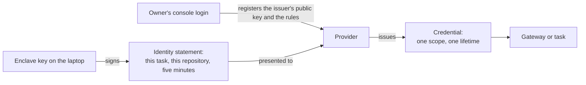
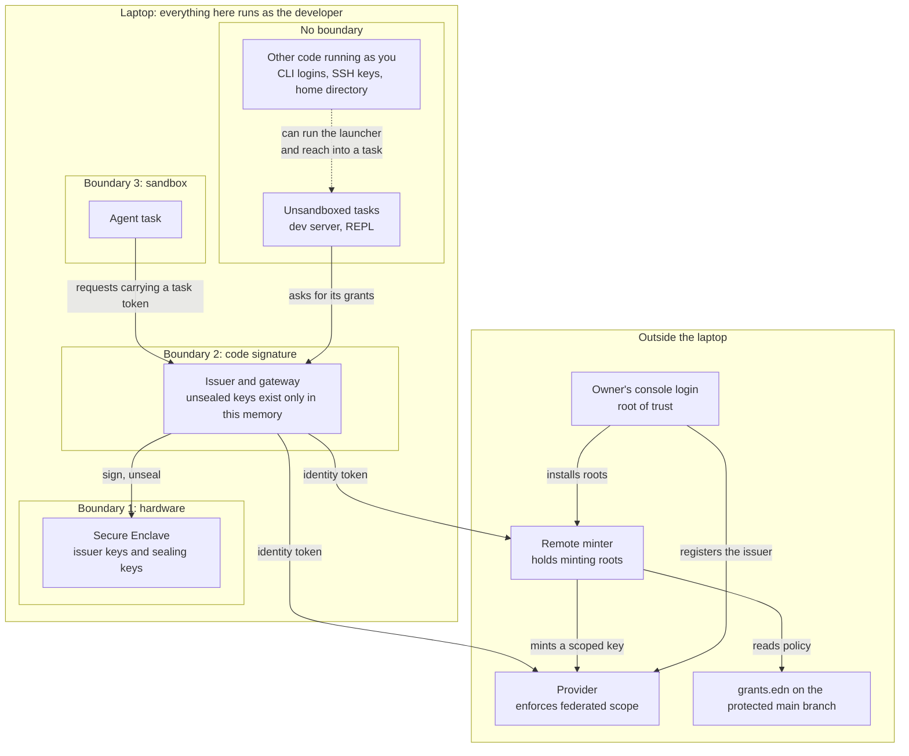
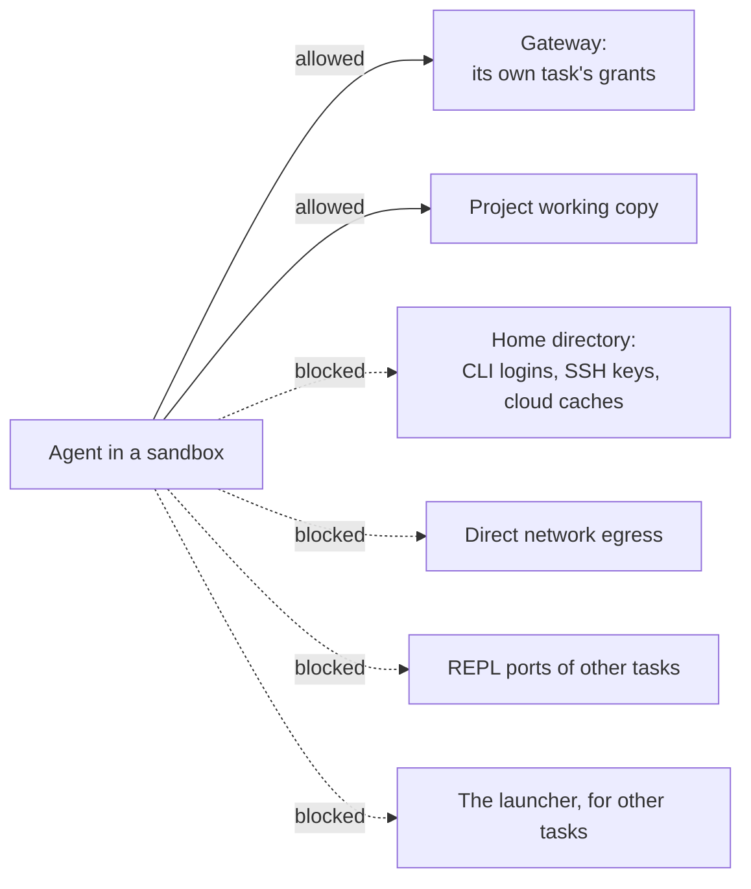
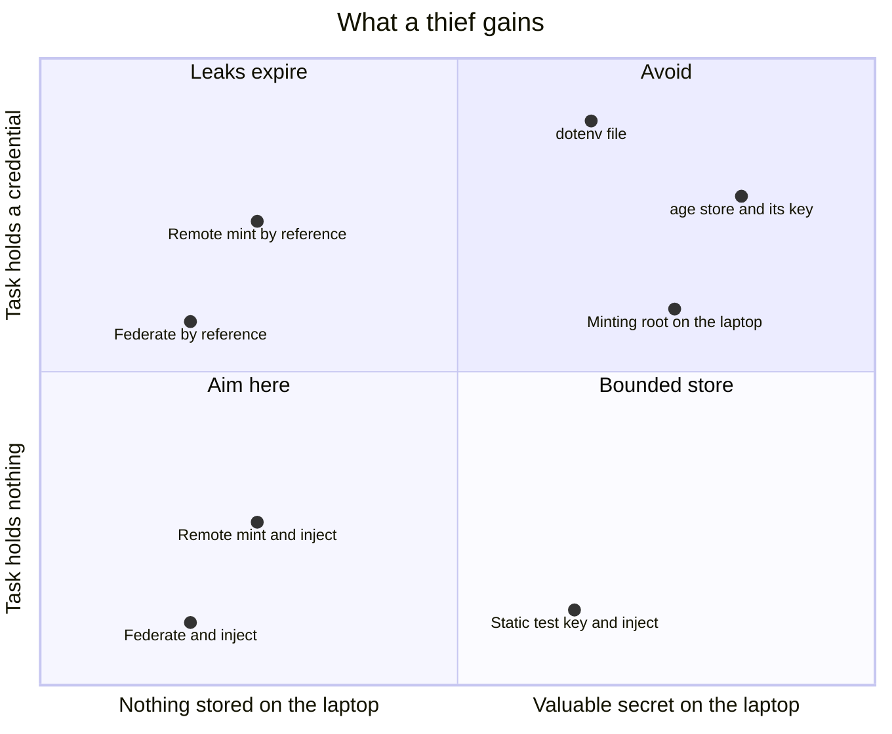
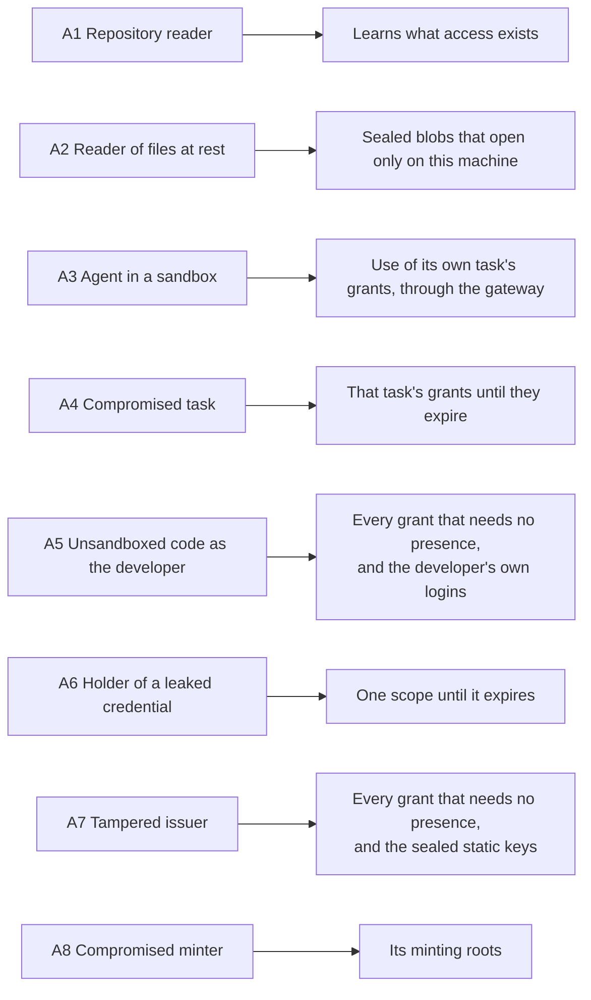

# Threat model

Status: draft, 2026-11-10. Nothing has been built yet, so every protection
described here is a design intention. The [design](design.md) describes the
mechanism. This document covers what the design protects, where its
boundaries are, and what it leaves exposed.

## What is worth stealing

The following table lists each asset, where it lives, and what protects it.

| Asset | Where it lives | What protects it |
| --- | --- | --- |
| The owner's console login at each provider | With the owner: a passkey or hardware key | Nothing in this tool. It's the root of trust |
| Minting roots, such as a GitHub App key or an admin API key | The remote minter | They never reach a laptop |
| Issuer signing keys | The Secure Enclave | Hardware. They can't be exported |
| Sealed static keys | The laptop's disk, encrypted to an enclave key | Only the signed issuer can get the enclave to open them. They're test-mode keys by default |
| Issued credentials | The memory of the gateway or of the task | Narrow scope and a short life |
| Identity tokens | In flight between the issuer and a provider | They last minutes, are bound to one audience, and are single use where the provider checks |
| Policy: `grants.edn` and each provider's trust rules | The repository and the provider | Review on a protected branch, and the owner's login |
| The developer's own logins: CLI tokens, SSH keys, browser sessions | The home directory and the keychain | Nothing in this tool. The sandbox keeps agents away from them |

## The root of trust

Every chain of authority ends with a person logging in to a provider's
console. That login registers the issuer's public key, creates the rules that
say what each task may have, and installs any minting root. The design's job
is to make sure that nothing on the laptop can act as that login.

This has three consequences:

- The owner runs setup outside any agent session. `grants init` generates the
  provider-side configuration, and applying it requires the owner's login.
- Losing a laptop exposes no secret. The owner removes the old laptop's issuer
  at each provider and registers the new one.
- A stolen console login is out of scope. Protect the login with a passkey or
  a hardware key, and keep its session out of reach of agents.

## Trust boundaries

The laptop has three boundaries, plus one zone with no boundary at all.

**Hardware.** Enclave keys can be used but never read. Code that takes over
the developer's account can ask for a signature, but it can't copy the key to
another machine.

**Code signature.** The enclave lets only the binary that created a key use
it. The issuer and gateway run as one signed binary, and other processes of
the same user can't attach to it. Both of these statements are on the list of
claims to check. Unsealed static keys and injected credentials exist only in
that binary's memory.

**Sandbox.** An agent in a sandbox can reach the gateway and its own working
copy. The sandbox is someone else's software, and this design depends on it.

**No boundary.** Everything else that runs as the developer shares one zone:
dev servers, REPLs, editors, unsandboxed agents, and command-line tools with
their stored logins. Code in this zone can start a task through the launcher,
and can reach into a running one. The issuer records which task asked for a
grant, but in this zone that record is only bookkeeping. It doesn't keep tasks
apart.

## What the sandbox has to close

Each blocked route in the diagram is a way to get around the grants:

- The home directory holds the developer's own logins. `gh`, `~/.aws`,
  `wrangler`, and SSH keys are a bigger prize than the application's
  credentials, and an agent that can read them has no need to ask for a grant.
- Direct egress lets a credential or data leave without going through the
  gateway.
- A REPL port gives code execution inside another task, and whoever can
  evaluate code in a process has that task's grants.
- The launcher starts tasks, so an agent that can run it has every grant that
  doesn't need presence.

The claims this document makes about agents hold only inside a sandbox that
closes all of these routes.

## What a thief gains

Two choices decide what a thief gains. A grant's source decides what is
stored and where, and its delivery decides whether the task ever holds a
credential.

| Source | Delivered by reference | Delivered by injection |
| --- | --- | --- |
| Federate | Nothing is stored. The task's token can leak, and works until it expires | Nothing is stored, and the task has nothing to leak |
| Mint, root in the remote minter | Nothing is on the laptop. The key can leak, and works until it's revoked | Nothing is on the laptop, and the task has nothing to leak |
| Mint, root on the laptop | Not allowed | Not allowed |
| Static key | Not allowed, because this is just a `.env` file | One bounded key on the laptop, and the task has nothing to leak |

A minting root can create other credentials, so it's worth more than any key
it replaces. An injected static test key compares well against a minting root
on the laptop: what it stores is less valuable, and a compromised task gets
nothing to carry away. That's why a minting root never lives on a laptop.

## Who enforces scope

Who enforces a grant's scope depends on the grant's source, and so does what
it takes to widen the grant.

| Source | Who enforces the scope | What widening takes |
| --- | --- | --- |
| Federate | The provider, with rules created at setup | The owner's console login |
| Mint | The remote minter, reading `grants.edn` from the protected main branch | A merged pull request |
| Static | The local gateway, reading the pinned `grants.edn` | The developer's approval in the issuer's own window, with Touch ID |

The third row is the weakest, which is one more reason that static keys are
test-mode keys by default.

## Threats in scope

The diagram summarizes what each attacker gains. The sections after it cover
each attacker in turn.

### A1. A reader of the repository

Someone who can read the repository sees `grants.edn` and learns what access
exists, but gains none of it. The file's contents are public metadata, just as
the manifest's key paths are in `secrets`.

### A2. A reader of the developer's files at rest

Backups, synced dotfiles, and disk images copy files without anyone deciding
to share them. The copies contain no credential and no exportable key. A
sealed static key opens only inside the enclave of the machine that sealed it.

### A3. An agent in a sandbox

The agent might be misbehaving, or it might be steered by prompt injection. It
can use its own task's grants through the gateway while the task is running.
When its grants are delivered by injection, it holds no provider credential,
so it has nothing to carry out.

The agent can still misuse its grants within their scope. Operation rules and
budgets at the gateway narrow that, and they're the only control this design
has over what a grant is used for.

### A4. A compromised task

The attacker is a malicious dependency in the application, or anyone who can
evaluate code in its process. A Clojure dev server with an nREPL port on
localhost is open to every local process, so "the task" includes whoever can
reach that port.

The attacker gets the task's grants. With delivery by reference, they also hold
credentials that work from anywhere until they expire. That's the blast
radius the design accepts, and it replaces "the whole store, until somebody
rotates."

### A5. Unsandboxed code running as the developer

Unsandboxed code can't export an issuer key, open a sealed static key, pass a
presence check, or widen the pinned policy. But it can run the launcher, so it
can use every grant that doesn't need presence, and it can read the
developer's own logins. This position is the reason agents belong in a
sandbox.

### A6. The holder of a leaked credential

The holder gets one scope until the credential expires. A minted key can be
revoked sooner. Some providers, including AWS, can bind a credential to a
source address.

### A7. A tampered issuer

A malicious update or a compromised dependency of the issuer can sign an
identity for any task and open the sealed static keys. It can't use the
presence key without a fingerprint, and it holds no minting root. The defence
is the ordinary one: a small codebase with few dependencies, signed releases,
and updates that the developer chooses to install.

### A8. A compromised minter

The minter holds minting roots, so an attacker who compromises it can mint
whatever those roots allow. That makes the minter the most valuable target in
the design. It sits off the laptop, where no agent runs, and each root should
belong to a dev-only provider account so that its reach is bounded.

## Out of scope

### B1. Root on the laptop, or a compromised kernel

The code-signature and sandbox boundaries don't survive this attacker, though
the enclave keys still can't be exported.

### B2. A stolen console login

Whoever holds the console login can register their own issuer and rules. The
login is the root of trust.

### B3. A provider that issues more than the grant describes

The provider enforces federated scope, and this design has no way to check
that it does.

### B4. A sandbox that leaks

The sandbox is a dependency, and fixing its escapes is up to its maintainers.

## Known gaps

1. **Misuse within scope.** Short lifetimes and narrow scopes limit what a
   task can touch and for how long, but they say nothing about intent. An
   agent with legitimate write access to a repository can push bad code.
2. **No wall between unsandboxed tasks.** On a bare laptop, the task name on a
   request is only bookkeeping (see A5).
3. **Portable credentials under delivery by reference.** A leaked token works from
   anywhere until it expires (see A6). Injection avoids this, at the cost of a
   proxy in the request path.
4. **Coarse provider scopes.** Anthropic's narrowest scope is all inference in
   a workspace, so anything finer has to come from the gateway.
5. **Presence wears out.** People approve prompts they expect to see, so
   presence should stay rare. The issuer also has to show what's being
   approved in its own window, because the operating system's Touch ID prompt
   can't show a diff, and an agent might control the terminal.
6. **Unmanaged developer logins.** The sandbox keeps agents away from the
   developer's own logins, but the tool does nothing else about them. Bringing
   those tools under the issuer, through credential helpers and SSH
   certificates, is future work.
7. **An alterable local log.** Code running as the developer can alter the
   local log, so the provider's own record of each exchange is the one to
   trust.
8. **Recovery and scale.** A new laptop means registering a new issuer with
   every provider, and a team with many laptops has to register many issuers.
   A shared team issuer would fix that, but it hasn't been designed.
9. **Production static keys.** This design has no place for them on a laptop.
   If an application still depends on one in production, the key stays in the
   production platform's own store.

## How to decide what to change

To evaluate a change to the design:

1. Name the attacker's position and the asset at stake.
2. Find the boundary between them: hardware, code signature, sandbox, or a
   system off the laptop.
3. If no boundary stands between them, write the gap down. If the attacker's
   position lets them skip a check, that check is only bookkeeping, and this
   document should call it that.
