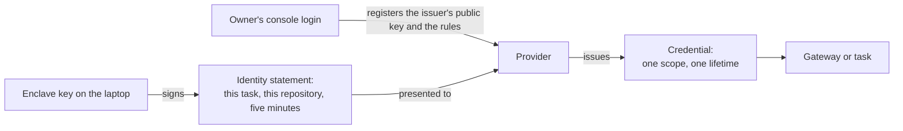
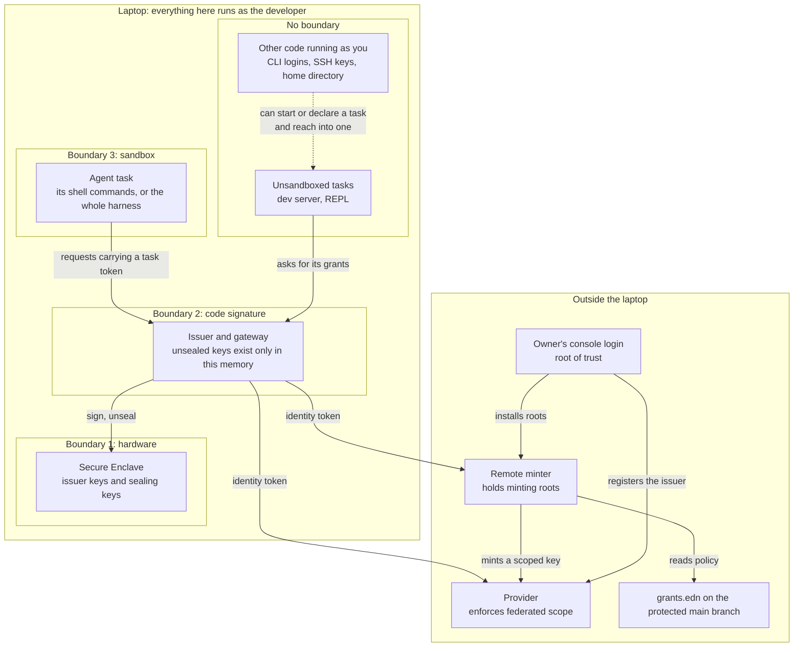
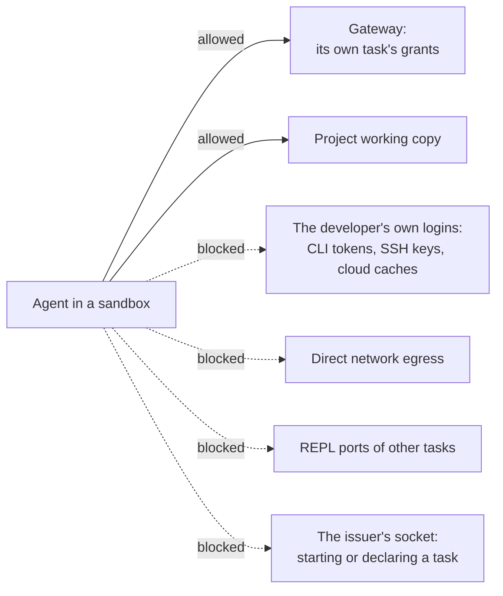
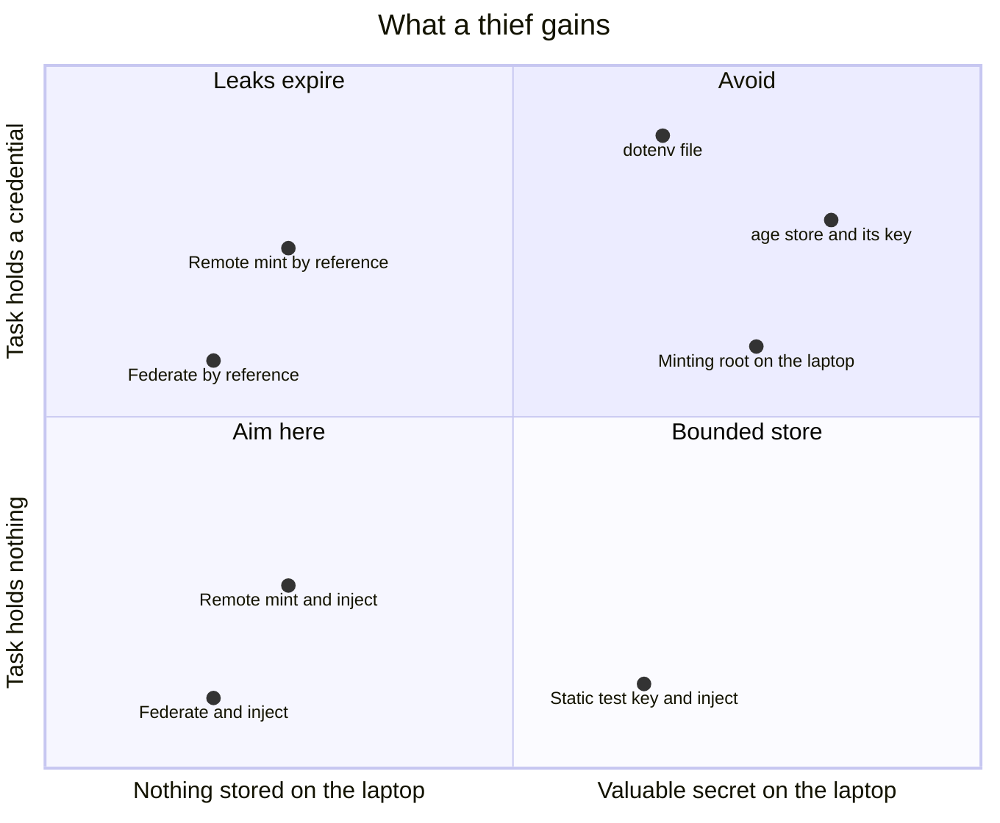
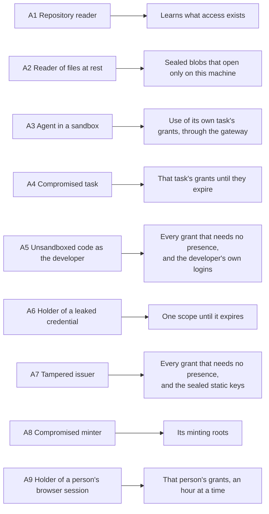

# Threat model

Status: draft, 2026-11-10. Nothing has been built yet, so every protection
described here is a design intention. The [design](design.md) describes the
mechanism. This document covers what the design protects, where its
boundaries are, and what it leaves exposed.

## What is worth stealing

The following table lists each asset, where it lives, and what protects it.

| Asset | Where it lives | What protects it |
| --- | --- | --- |
| The owner's console login at each provider | With the owner: a passkey or hardware key | Nothing in this tool. It's the root of trust |
| Minting roots, such as a GitHub App key or an admin API key | The remote minter | They never reach a laptop |
| Issuer signing keys | The Secure Enclave | Hardware. They can't be exported |
| Sealed static keys | The laptop's disk, encrypted to an enclave key | Only the signed issuer can get the enclave to open them. Each carries a bound at its provider: test mode, a spend cap, or read-only |
| Sealed live keys | The laptop's disk, encrypted to the presence key | The same, plus a fingerprint each time a task that uses one starts, and an opt-in on that machine |
| Wrapping keys for application data | The laptop's disk, encrypted to an enclave key | Only the signed issuer can use them. A task gets `wrap` and `unwrap`, never the key |
| Wrapped application data, such as bank tokens | The application's database and its backups | It opens only through the issuer on the machine that wrapped it, or with the recovery key |
| A person's login session at the access proxy | The browser | Nothing in this tool. The proxy's policy and session length |
| Issued credentials | The memory of the gateway or of the task | Narrow scope and a short life |
| Identity tokens | In flight between the issuer and a provider | They last minutes, are bound to one audience, and are single use where the provider checks |
| Policy: `grants.edn` and each provider's trust rules | The repository and the provider | Review on a protected branch, and the owner's login |
| The developer's own logins: CLI tokens, SSH keys, browser sessions | The home directory and the keychain | Nothing in this tool. A sandbox keeps agents away from the files it denies |

## The root of trust

Every chain of authority ends with a person logging in to a provider's
console. That login registers the issuer's public key, creates the rules that
say what each task may have, and installs any minting root. The design's job
is to make sure that nothing on the laptop can act as that login.

This has three consequences:

- The owner runs setup outside any agent session. `grants init` generates the
  provider-side configuration, and applying it requires the owner's login.
- Losing a laptop exposes no secret. The owner removes the old laptop's issuer
  at each provider and registers the new one.
- A stolen console login is out of scope. Protect the login with a passkey or
  a hardware key, and keep its session out of reach of agents.

The minter adds one more login to this list. It runs as a Cloudflare Worker,
and whoever controls that Cloudflare account can deploy code that uses the
minter's roots. That login needs the same protection as a provider's.

## Trust boundaries

The laptop has three boundaries, plus one zone with no boundary at all.

**Hardware.** Enclave keys can be used but never read. Code that takes over
the developer's account can ask for a signature, but it can't copy the key to
another machine.

**Code signature.** The enclave lets only the binary that created a key use
it. The issuer and gateway run as one signed binary, and other processes of
the same user can't attach to it. Both of these statements are on the list of
claims to check. Unsealed static keys and injected credentials exist only in
that binary's memory.

**Sandbox.** An agent in a sandbox can reach the gateway and its own working
copy. The sandbox is someone else's software, and how much of the agent it
encloses depends on its level. The command sandbox that Claude Code and Codex
each ship encloses the agent's shell commands. The harness stays in the zone
with no boundary, along with its file tools, web fetches, MCP servers, and
hooks. A sandbox around the whole harness encloses all of them.
[Sandbox levels](#sandbox-levels) lists what each level leaves open.

**No boundary.** Everything else that runs as the developer shares one zone:
dev servers, REPLs, editors, unsandboxed agents, and command-line tools with
their stored logins. Code in this zone can start a task through the launcher
or declare one over the issuer's socket, and it can reach into a running
task. The issuer records which task asked for a
grant, but in this zone that record is only bookkeeping. It doesn't keep tasks
apart.

These boundaries describe macOS. Windows and Linux have a hardware boundary
through a TPM 2.0 or a security key, but as far as the design knows they have
no code-signature boundary. Code in the no-boundary zone can then use the
issuer's keys directly, and so has what a tampered issuer has (A7). The
design's [Platforms](design.md#platforms) section lists what each platform
provides and what each fallback costs.

## What the sandbox has to close

Each blocked route in the diagram is a way to get around the grants:

- The home directory holds the developer's own logins. `gh`, `~/.aws`,
  `wrangler`, and SSH keys are a bigger prize than the application's
  credentials, and an agent that can read them has no need to ask for a grant.
- Direct egress lets a credential or data leave without going through the
  gateway.
- A REPL port gives code execution inside another task, and whoever can
  evaluate code in a process has that task's grants.
- The issuer's socket is how a process starts a task through the launcher or
  declares one itself. An agent that can reach it has every grant that
  doesn't need presence, so a sandbox closes this route by keeping that
  socket out of reach.

### Sandbox levels

A sandbox is optional. How many of the routes are closed, and for how much of
the agent, depends on the sandbox's level.

| Level | What it encloses | What stays open |
| --- | --- | --- |
| No sandbox | Nothing | Every route. The agent is in position A5 |
| Command sandbox, where `grants run agent` starts | The agent's shell commands and the processes they start | Credential files missing from the deny list, and everything the harness does outside a shell command |
| Command sandbox with the home directory denied | The same | Everything the harness does outside a shell command, and the paths re-allowed for the toolchain |
| Whole-harness sandbox | Everything the harness runs | Only what its settings allow |

`grants run agent` starts the harness with its command sandbox turned on, and
with settings that close the four routes for shell commands. Reads of a list
of known credential files are denied, egress goes only to the gateway, and
other localhost ports and Unix sockets stay closed. Claude Code and Codex
document settings for each of these, but none has been tested here.

Denying the whole home directory is an optional tightening. It isn't where an
agent starts, because it breaks ordinary tooling: with the home directory
unreadable, `git` fails on `~/.gitconfig` and `clojure` won't start. Each
toolchain needs its config files and dependency caches re-allowed.

A command sandbox doesn't enclose the harness. In Claude Code, the file tools,
web fetches, MCP servers, and hooks all run outside it, and the Codex
documentation describes its sandbox in terms of the commands it spawns. An
agent steered by prompt injection can use those tools as well as the shell.
The generated settings also give the harness permission rules that deny its
file tools the same credential files. The harness enforces those rules itself,
with no operating-system boundary behind them, and they don't reach an MCP
server.

Both kinds of list have a weakness. A deny list closes only the files that
someone thought to put on it. A re-allow list can open a route into other
tasks: if the agent can write to a dependency cache, whatever task loads code
from that cache next runs what the agent left there.

The claims this document makes about agents hold only for the part of an agent
that its sandbox encloses, and only for the routes that the sandbox's level
closes.

## What a thief gains

Two choices decide what a thief gains. A grant's source decides what is
stored and where, and its delivery decides whether the task ever holds a
credential.

| Source | Delivered by reference | Delivered by injection |
| --- | --- | --- |
| Federate | Nothing is stored. The task's token can leak, and works until it expires | Nothing is stored, and the task has nothing to leak |
| Mint, root in the remote minter | Nothing is on the laptop. The key can leak, and works until it's revoked | Nothing is on the laptop, and the task has nothing to leak |
| Mint, root on the laptop | Not allowed | Not allowed |
| Static key, bounded | Not allowed, because this is just a `.env` file | One bounded key on the laptop, and the task has nothing to leak |
| Static key, live | Not allowed | One live key on the laptop, unsealed only while its task runs, and the task has nothing to leak |

Wrapped application data is a third case. The stored copies are worth
nothing without the issuer, and the running task can unwrap all of them. A
thief who takes the database file gains nothing, and one who takes over the
task gains every token in it.

A minting root can create other credentials, so it's worth more than any key
it replaces. An injected static test key compares well against a minting root
on the laptop: what it stores is less valuable, and a compromised task gets
nothing to carry away. That's why a minting root never lives on a laptop.

## Who enforces scope

Who enforces a grant's scope depends on the grant's source, and so does what
it takes to widen the grant.

| Source | Who enforces the scope | What widening takes |
| --- | --- | --- |
| Federate | The provider, with rules created at setup | The owner's console login |
| Mint | The remote minter, reading `grants.edn` from the protected main branch | A merged pull request |
| Mint, for a person in a browser | The minter, for what a login gets. The access proxy, for who can log in | A merged pull request, or a change to the proxy's policy |
| Static | The local gateway, reading the pinned `grants.edn` | The developer's approval in the issuer's own window, with Touch ID |
| Static, live | The same, and only on a machine that opted in | The same approval. Opting in a new machine takes its owner's fingerprint there |
| Wrap | The issuer, which serves any task that lists the grant | The developer's approval in the issuer's own window |

The static rows are the weakest, which is why a static key has to be
bounded, and why a live one needs an opt-in that the repository can't give.

## Threats in scope

The diagram summarizes what each attacker gains. The sections after it cover
each attacker in turn.

### A1. A reader of the repository

Someone who can read the repository sees `grants.edn` and learns what access
exists, but gains none of it. The file's contents are public metadata, just as
the manifest's key paths are in `secrets`.

### A2. A reader of the developer's files at rest

Backups, synced dotfiles, and disk images copy files without anyone deciding
to share them. The copies contain no credential and no exportable key. A
sealed static key opens only inside the enclave of the machine that sealed it.

The same holds for wrapped application data. A copy of the database carries
bank tokens that only the issuer on the original machine can open. A grant
that names a recovery recipient adds one more way in, which is the private
half of that key, kept offline.

### A3. An agent in a sandbox

The agent might be misbehaving, or it might be steered by prompt injection. It
can use its own task's grants through the gateway while the task is running.
When its grants are delivered by injection, it holds no provider credential,
so it has nothing to carry out.

This describes the part of the agent that the sandbox encloses. Under a
command sandbox, that's its shell commands. What the harness does through its
own tools, MCP servers, and hooks is outside, and
[Sandbox levels](#sandbox-levels) lists what that leaves open.

The agent can still misuse its grants within their scope. Operation rules and
budgets at the gateway narrow that, and they're the only control this design
has over what a grant is used for.

### A4. A compromised task

The attacker is a malicious dependency in the application, or anyone who can
evaluate code in its process. A Clojure dev server with an nREPL port on
localhost is open to every local process, so "the task" includes whoever can
reach that port.

The attacker gets the task's grants. With delivery by reference, they also hold
credentials that work from anywhere until they expire. That's the blast
radius the design accepts, and it replaces "the whole store, until somebody
rotates."

Two kinds of grant give this attacker more than a short-lived credential. A
task with a wrap grant can unwrap every stored token while it runs, and a
token for a bank link doesn't expire. A task with a live static key can make
every call its `:allow` rules permit against real data, though it never
holds the key. For an application that syncs bank accounts, those two
together are read access to the accounts for as long as the task is
compromised.

### A5. Unsandboxed code running as the developer

Unsandboxed code can't export an issuer key, open a sealed static key, pass a
presence check, or widen the pinned policy. But it can run the launcher or
declare a task over the issuer's socket, so it can use every grant that
doesn't need presence, and it can read the developer's own logins.

A live key changes this in one way. Starting a task that uses one takes a
fingerprint, so unsandboxed code can't start it. It can still reach into
such a task once the owner has started it, as A4 describes.

An agent with no sandbox is in this position. That's still better than an
agent beside a stored key: it finds no stored secret that it can read, and a
credential it takes from a running task stops working when it expires or is
revoked. The developer's own logins are as exposed as they were before grants,
and that's the reason to give an agent a sandbox.

### A6. The holder of a leaked credential

The holder gets one scope until the credential expires. A minted key can be
revoked sooner. Some providers, including AWS, can bind a credential to a
source address.

### A7. A tampered issuer

A malicious update or a compromised dependency of the issuer can sign an
identity for any task, open the sealed static keys, and use every wrapping
key. It can't use the presence key without a fingerprint, so a sealed live
key stays closed until its owner next starts a task that uses it. From then
on the tampered issuer has that key too. It holds no minting root. The defence
is the ordinary one: a small codebase with few dependencies, signed releases,
and updates that the developer chooses to install.

### A8. A compromised minter

The minter holds minting roots, so an attacker who compromises it can mint
whatever those roots allow. That makes the minter the most valuable target in
the design. It sits off the laptop, where no agent runs, and each root should
belong to a dev-only provider account so that its reach is bounded.

A root that serves a person can't be dev-only. A GitHub App that publishes a
website has write access to the real repositories. What bounds it is the
App's installation, which names the repositories it can touch at all.

### A9. The holder of a person's browser session

Someone with a person's unlocked device, or a copy of their session at the
access proxy, can ask the minter for that person's grants. Each token lasts
an hour, and the attacker can keep asking until the session ends or is
revoked.

That is less than the same device gives up today. A personal access token
in the browser's storage works from anywhere until it expires, and revoking
it means finding it at the provider. A session is revoked at the proxy.

## Out of scope

### B1. Root on the laptop, or a compromised kernel

The code-signature and sandbox boundaries don't survive this attacker, though
the enclave keys still can't be exported.

### B2. A stolen console login

Whoever holds the console login can register their own issuer and rules. The
login is the root of trust.

### B3. A provider that issues more than the grant describes

The provider enforces federated scope, and this design has no way to check
that it does.

### B4. A sandbox that leaks

The sandbox is a dependency, and fixing its escapes is up to its maintainers.
This covers escapes from what a sandbox says it encloses. What a sandbox level
leaves outside is in scope, and [Sandbox levels](#sandbox-levels) lists it.

## Known gaps

1. **Misuse within scope.** Short lifetimes and narrow scopes limit what a
   task can touch and for how long, but they say nothing about intent. An
   agent with legitimate write access to a repository can push bad code.
2. **No wall between unsandboxed tasks.** On a bare laptop, the task name on a
   request is only bookkeeping, and an unsandboxed process can declare its own
   (see A5).
3. **Portable credentials under delivery by reference.** A leaked token works from
   anywhere until it expires (see A6). Injection avoids this, at the cost of a
   proxy in the request path.
4. **Coarse provider scopes.** Anthropic's narrowest scope is all inference in
   a workspace, so anything finer has to come from the gateway.
5. **Presence wears out.** People approve prompts they expect to see, so
   presence should stay rare. The issuer also has to show what's being
   approved in its own window, because the operating system's Touch ID prompt
   can't show a diff, and an agent might control the terminal.
6. **Unmanaged developer logins.** A sandbox keeps agents away from the
   developer's own logins as far as its level goes, and the tool does nothing
   else about them. Bringing
   those tools under the issuer, through credential helpers and SSH
   certificates, is future work.
7. **An alterable local log.** Code running as the developer can alter the
   local log, so the provider's own record of each exchange is the one to
   trust.
8. **Recovery and scale.** A new laptop means registering a new issuer with
   every provider, and a team with many laptops has to register many issuers.
   A shared team issuer would fix that, but it hasn't been designed.
9. **Live keys on a laptop.** An application whose only production is the
   laptop can keep a live static key there, sealed and behind a fingerprint.
   The key is then one tampered issuer or one compromised task away from
   use, which a test key never is. Elsewhere a production static key stays
   in the production platform's own store, and this design does nothing to
   protect that store.
10. **A partial sandbox.** At the level where `grants run agent` starts, the
    harness's own tools run outside the sandbox, and a credential file that's
    missing from the deny list stays readable (see
    [Sandbox levels](#sandbox-levels)).
11. **A bound is often only a statement.** The gateway can check that a key
    is a test key when the provider gives test keys their own host or
    prefix. It can't check a spend cap or a read-only restriction, so those
    bounds are as true as what the owner typed.
12. **Wrapped data and a lost machine.** Without a recovery recipient,
    wrapped data is gone when the machine is. With one, the recovery key is
    a long-lived secret again, and the design only asks that it stay
    offline.
13. **A task token in a URL.** The gateway's base URL contains the task
    token, and HTTP clients log URLs. The token works only on this machine
    and only while the task runs, so a logged copy is useful to code that's
    already in position A5 and to nothing else.

## How to decide what to change

To evaluate a change to the design:

1. Name the attacker's position and the asset at stake.
2. Find the boundary between them: hardware, code signature, sandbox, or a
   system off the laptop.
3. If no boundary stands between them, write the gap down. If the attacker's
   position lets them skip a check, that check is only bookkeeping, and this
   document should call it that.
